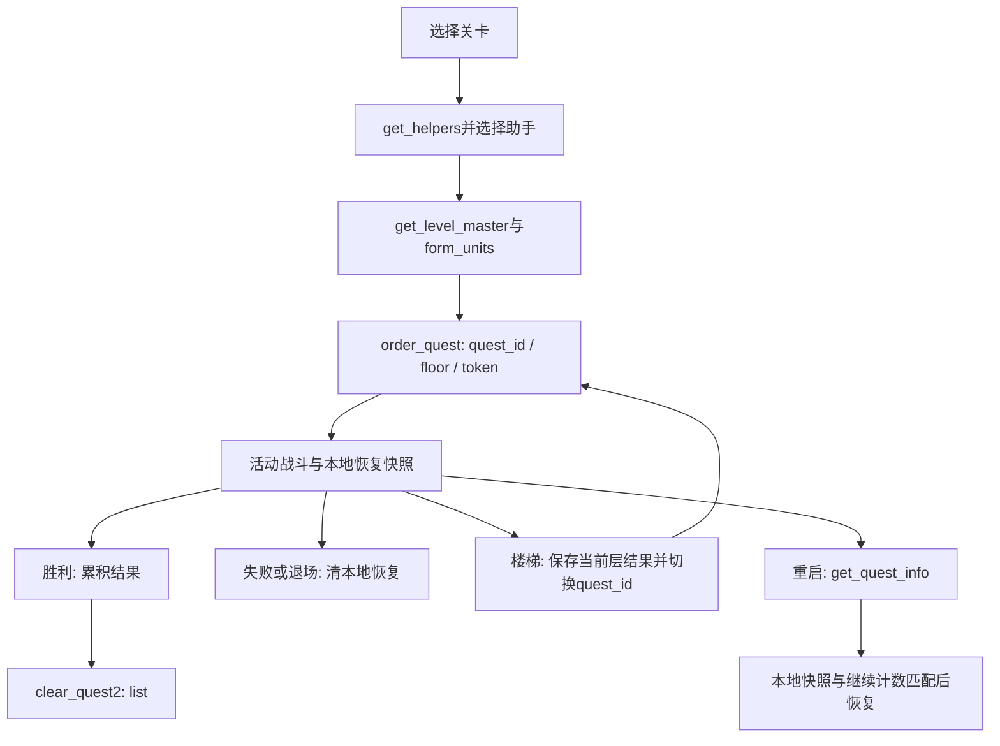

# T11 战斗生命周期与实现边界（2026-10-25）

## 最新实现范围（优先于下文历史状态）

2026-10-26：普通关 11000 已完成原快照重启恢复、再次通关、原界面扣一水晶续关、续关后客户端/API 重启恢复及自动失败退出。派生客户端修正旧恢复资料覆盖授权资料造成的 AP 显示回退；原件不改。续关当前运行最新次数重复不再扣款，失败/退出不奖励；多层、其他普通关和教程快照恢复未支持。细节与运行环境限制见 [LOCAL_BATTLE_RECOVERY](../rules/LOCAL_BATTLE_RECOVERY.md)。下文“普通关/继续/挑战不支持”是早期取证记录，不代表当前实现；挑战与礼物、好友也已有独立增量。

10001已有严格入场与有界clear_quest2：固定掉落子多重集、六槽战斗队伍、5本书上限、依代累计经验、rank主表阈值/已确认flags、首次水晶及原子回执。15项服务端测试覆盖重复请求、API重启和相同奖励的新正常retry=0重刷；活动新运行中与旧回执碰撞的retry>0明确拒绝，不误返回旧成功。

全新隔离账号实机已完成首教程/首抽后，自然打完10001、直接收到clear_quest2=4096并显示rank2/经验100/金币80500/AP21/免费水晶1，取得10020、10023及依代50000/exp105；确认首通奖励、拒绝本地NPC好友邀请后回到SELECT_AREA。实际观测地图ID10001/hash4081725474，排除仅凭请求ID推测地图。证据flow-runs/20261025-094838、20261025-100247、20261025-100753、20261025-100906。结果页两个新界面分别触发安全停止，随后固化映射继续；不是一次从头无人干预的整条回放，之后仍需统一目标验收。此前旧测试库的诊断重发结果仅作故障证据，不混作此轮验收。

教程不保存客户端恢复快照。新GUID、retry=0的10001有效订单可原子放弃同关旧运行并重新扣AP；旧运行不奖励不退费，已放弃或完成的GUID不能重新开启。它解决孤立服务端运行的再次入场，不是恢复客户端战斗进度。普通关、继续、多层、挑战仍不支持。详见[本地政策](../rules/LOCAL_POLICIES.md)和[结算静态证据](SECOND_TUTORIAL_SETTLEMENT_FINDINGS.md)。

本页是已核对的静态证据与缺口，不代表普通战斗实现完成。原始Assembly-CSharp.dll SHA256为c83aea19ee65ae973815daf6a04e430d9e87b8426b6180c1fe507e4260763ecc，REA本机重新检查与index.json一致；ComManager.cs当前SHA256为11cff27fbd5c0a5adfc42680f896a60dcb0762baf9e3c5390b3cf3bb0a1986dc。

| 操作 | 已核对来源 | 已知行为与边界 |
|---|---|---|
| get_helpers | ComManager.cs:957；MMHelper.cs:105、255 | 使用公共请求构造，序列化等待m_SeqEnd；筛选与响应应用规则待追踪 |
| order_quest | ComManager.cs:1247、1271 | 设置quest/helper/resume，生成新GUID token，继续计数归零；请求含floor、bonus_stamina及主表/地图hash |
| get_quest_info | ComManager.cs:1321、1334；TitleMenu.cs:981、1043 | 标题流程存在恢复查询；请求包含ver、retry、user_id；恢复状态应用待追踪 |
| clear_quest2 | ComManager.cs:1390、1403；MMResult.cs:249 | 批量提交QuestResult，含经验、金币、书单位、挑战ID、活动点、属性经验及party_instance_id |
| continue_quest | ComManager.cs:1465、1480；GameStatus.cs:127 | 请求floor与quest_continue，调用参数为ContinueCount+1；收费及幂等规则尚无结论 |
| post_quest_challenge_reward | MMQuest.cs:561 | 传入选中的挑战奖励主表ID；前置条件、响应与领取持久化待追踪 |

order_quest除第一教程外，发送主表类型30/31/21/20/10/11/12/13/14/32/33/90/16/17的实际hash，以及对应关卡的level_data_hash；第一教程把这些hash置0。因此第一教程成功不能证明第二教程或普通关卡的表与地图版本可用，T12仍需核对冲突。

clear_quest2逐关构造依代经验：`floor(pow(partySoul * questMaster.reward_soul, 0.65)) * 15`。这是客户端请求计算证据，不应直接信任客户端提交的奖励；服务端可允许范围仍须结合主表和实际战斗产出恢复。属性经验数组映射为none=0、fire=3、water=4、shine=1、dark=2。

本机动态证据目前仅第一教程：隔离账号真实order_quest(10000)→战斗→clear_quest2→首次buy_gacha→主界面，并完成客户端/API双重启。普通战斗、继续、退出及多阶层尚无动态证据。

响应、调用与有边界的放弃接口搜索已补全至[BATTLE_RESPONSE_FINDINGS.md](BATTLE_RESPONSE_FINDINGS.md)。在已导出的C#、ComManager地址/响应、DTO及实际退出调用路径内未发现独立放弃网络调用；标题拒绝恢复、失败退出、主动退场只清本地恢复。不能据此证明服务端活动状态也清除，更不能虚构路由。

## 已确认的时序与状态

| 状态/请求 | 服务端应维护的边界 | 当前恢复证据 |
|---|---|---|
| 新订单 | 扣体力、确定敌人/掉落、生成运行快照须同一事务；重试复用快照 | 第一教程已实现；普通关卡待T13 |
| 活动查询 | result必须数组，客户端以floor索引；状态1表示战斗中 | 第一教程已实测，其他状态语义未知 |
| 多阶层 | 递增floor且可切换quest_id，最终批量结算 | 静态证据；下一批实现明确不支持 |
| 继续 | floor/count校验、扣费及重复保护不可分离 | 客户端余额>=1只是门槛；原服收费/支付顺序未知，暂拒绝 |
| 退出/拒绝恢复 | 客户端无显式放弃通知；不可因此自动发通关奖 | 活动替换/过期需另列本地政策，尚未实现 |
| 挑战领取 | reward_id来自主表；响应只更换session_id | 是否成功仍须服务端验证资格/持久回执；暂拒绝 |

## 奖励规则与缺口

GameStatus.cs:158–185：金币为战斗所得+主表reward_money（可双倍）+被动技能加成+关卡额外加成，封顶reward_money_limit；经验为reward_exp（可双倍）+额外经验，封顶reward_exp_limit；魂使用Party.Soul。上述依代公式位于ComManager.cs:1423–1426。客户端提交书单位/挑战ID/属性经验不能视为可信服务端裁定；必须与下单快照及主表允许范围核对。

仍未知的原服规则：助手筛选/奖励、随机敌人/掉落选择、继续费用与免费/付费拆分、退出后的服务端失效/替换、多层幂等、挑战资格及领取。T11的交付是生命周期、契约和缺失规则清单，现已完成静态调查；这些未知项不伪装为已恢复，具体实现与动态验收归T12–T17。第二教程10001尤其会使经验累计到升级阈值，不能沿用仅首教程的不升级结算。

REA本机成员检查父证据ev_8f609c71e73e6dd2f081499b2fae5b1a82a5c7beb522458e2fb87f088b9fc4da，选择7个相关类型，元数据/CIL覆盖complete；用户字符串因9项终止标志异常标为partial。导出analysis/rea-battle-evidence-20261025.json。该证据不代表已执行原程序或还原原服务端。

## 后续实现证据（与静态调查分开）

10001实验入场已实现并在客户端显示首条教学对话，助手列表/队伍确认/地图/订单请求实际通过；AP19→18、15条敌人快照持久化，同token HTTP/API重启复用。普通关、10001结算及退出恢复仍未实现。精确范围见LOCAL_POLICIES与资源调查报告，不将T11 DONE等同于M2可玩。

为后续T15补充已找到的升级依据：USER_RANK_MASTER.need_exp为累计阈值，ComPlayerData.cs:57–76以相邻阈值计算进度；MMResult.cs:1064–1101模拟升级时加对应rank行的金币/好友点，flags bit1加最大AP、bit4加好友上限，并将AP补到最大。rank2行need_exp100、金币50000、好友点200、flags7。bit2作用在此路径未恢复，不能据此擅增max_cost。DialogQuestClearReward.cs:46–49确认present_type3为水晶；10001主表present_type3/param1并非已实现发奖。以上供T15测试与实现，当前服务不处理10001结算。
