> 2026-11-05纠正：本文是早期来源/替代状态快照，不是当前缺口清单。新资源已提供狼、蝎及大量其他种族，现生产278个兼容包；非ms角色也已纳入审计。原图稿缺口与临时替代分列，见[最新入口](../README.md)。下表旧“未找到”及野猪回退仅用于历史追溯。

# 资源修补前后对照报告

统计口径为昨天加载链复核后的218项模型／贴图缺口（区别于更早的209项图像表）。已修补仅指本地安装，未部署到运行服务，未完成实机验收。图像来自实际安装包解码的UV贴图缩略图，不是3D渲染；未修补项如有图片，展示此前替代资源。既有通关闪退仍未解决。

|状态|数量|
|---|---:|
|已安装兼容资源，待实机验收|194|
|无同族来源，保留原处理|22|
|已有原优先资源，保留|1|
|转换待解决|1|

## 仍未修补（23项）

### 模型：ast_ms01_fish_dark

- 状态：无同族来源，保留原处理
- 恢复方式：保留原处理
- 此前替代：ms02_four_un_01_zako
- 本次来源模型：
- 本次来源包：
- 涉及关卡与怪物：暗き海を進む(21015)／魚_Lv1[闇](41040)；暗闇のハンター(21017)／魚_Lv1[闇](41040)；暗闇の支配者(21018)／魚_Lv1[闇](41040)
- 说明：新备份未找到同族素材，沿用此前处理

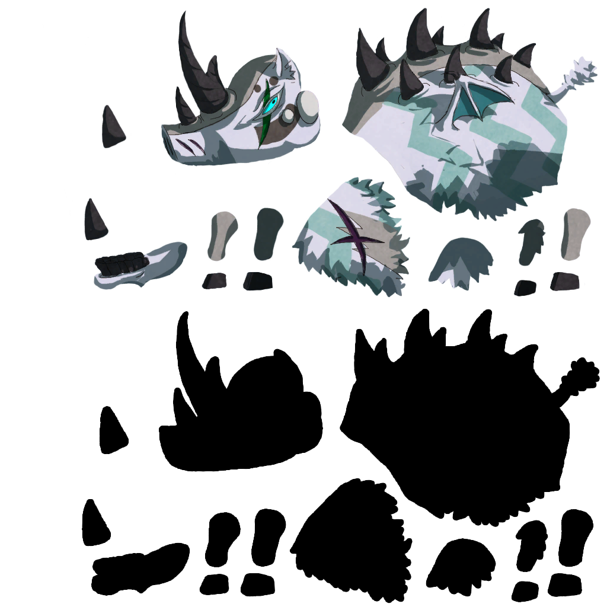

### 模型：ast_ms01_fish_fire

- 状态：无同族来源，保留原处理
- 恢复方式：保留原处理
- 此前替代：ms02_four_un_01_zako
- 本次来源模型：
- 本次来源包：
- 涉及关卡与怪物：海の怪物(21006)／魚_Lv1[火](41037)
- 说明：新备份未找到同族素材，沿用此前处理

### 模型：ast_ms01_fish_un

- 状态：无同族来源，保留原处理
- 恢复方式：保留原处理
- 此前替代：ms02_four_un_01_zako
- 本次来源模型：
- 本次来源包：
- 涉及关卡与怪物：古地図が示す先(21007)／魚_Lv1[無](41041)；上陸前の激闘(21008)／魚_Lv1[無](41041)
- 说明：新备份未找到同族素材，沿用此前处理

### 模型：ast_ms01_squ_lv2

- 状态：无同族来源，保留原处理
- 恢复方式：保留原处理
- 此前替代：ms02_four_un_01_zako
- 本次来源模型：
- 本次来源包：
- 涉及关卡与怪物：紅い牙(11011)／ハイ・スクィレル[火](10110)；白浜の牙(11021)／ハイ・スクィレル[水](10111)；灼光の牙(11031)／ハイ・スクィレル[光](10112)；黒威の牙(11041)／ハイ・スクィレル[闇](10113)；塊状界の入り口(11050)／ハイ・スクィレル[光](10112)；塊状界の入り口(11050)／ハイ・スクィレル[闇](10113)；ドラゴンへ至る道(11053)／ハイ・スクィレル[火](10110)；ドラゴンへ至る道(11053)／ハイ・スクィレル[水](10111)；新大陸への門(11100)／ハイ・スクィレル[闇](10113)；夕陰の箱庭(11101)／ハイ・スクィレル[水](10111)；秘境の望む地(11102)／ハイ・スクィレル[光](10112)；純白の突槌(11103)／ハイ・スクィレル[火](10110)；闇夜を裂く弩砲(11141)／ハイ・スクィレル[火](10110)；闇夜を裂く弩砲(11141)／ハイ・スクィレル[水](10111)；闇夜を裂く弩砲(11141)／ハイ・スクィレル[闇](10113)；はじめてのドラゴン戦！(13207)／ハイ・スクィレル[光](10112)；神々のドール・中級(20764)／ハイ・スクィレル[光](10112)；暴虐の王・初級(20781)／ハイ・スクィレル[水](10111)；暴虐の王・初級(20781)／ハイ・スクィレル[光](10112)；竜鱗砕きの異名・初級(20788)／ハイ・スクィレル[闇](10113)；孤高の少年たち・初級(20806)／ハイ・スクィレル[闇](10113)；孤高の少女たち・初級(20809)／ハイ・スクィレル[水](10111)；闇の処刑人・中級(20831)／ハイ・スクィレル[光](10112)
- 说明：新备份未找到同族素材，沿用此前处理

### 模型：ast_ms01_squ_lv3

- 状态：无同族来源，保留原处理
- 恢复方式：保留原处理
- 此前替代：ms02_four_un_01_zako
- 本次来源模型：
- 本次来源包：
- 涉及关卡与怪物：翠風の戦い(11001)／キラー・スクィレル[水]_初級ボス(41222)；新大陸への門(11100)／キラー・スクィレル[闇](10123)；夕陰の箱庭(11101)／キラー・スクィレル[水](10121)；秘境の望む地(11102)／キラー・スクィレル[光](10122)；純白の突槌(11103)／キラー・スクィレル[火](10120)；赤壁山岳(11110)／キラー・スクィレル[火](10120)；赤壁山岳(11110)／キラー・スクィレル[光](10122)；赤壁山岳(11110)／キラー・スクィレル[闇](10123)；炎蛇の祠(11112)／キラー・スクィレル[火](10120)；炎蛇の祠(11112)／キラー・スクィレル[光](10122)；炎蛇の祠(11112)／キラー・スクィレル[闇](10123)；絶対凍土の平原(11120)／キラー・スクィレル[水](10121)；絶対凍土の平原(11120)／キラー・スクィレル[光](10122)；絶対凍土の平原(11120)／キラー・スクィレル[闇](10123)；氷海の蛇神(11122)／キラー・スクィレル[水](10121)；氷海の蛇神(11122)／キラー・スクィレル[光](10122)；氷海の蛇神(11122)／キラー・スクィレル[闇](10123)；暴虐の閃空(11131)／キラー・スクィレル[火](10120)；暴虐の閃空(11131)／キラー・スクィレル[水](10121)；暴虐の閃空(11131)／キラー・スクィレル[光](10122)；静かなる暗夜(11140)／キラー・スクィレル[火](10120)；静かなる暗夜(11140)／キラー・スクィレル[水](10121)；静かなる暗夜(11140)／キラー・スクィレル[闇](10123)；魂の器[槍]・中級(12195)／キラー・スクィレル(ターン1)[火](15010)；魂の器[槍]・中級(12195)／キラー・スクィレル(ターン1)[水](15011)；魂の器[槍]・中級(12195)／キラー・スクィレル(ターン1)[光](15012)；魂の器[槍]・中級(12195)／キラー・スクィレル(ターン1)[闇](15013)；No.10：闇の洞窟(水)(20102)／キラー・スクィレル[水](10121)；No.10：闇の洞窟(水)(20102)／キラー・スクィレル[闇](10123)；No.05：水の洞窟(月)(20122)／キラー・スクィレル[水](10121)；No.05：水の洞窟(月)(20122)／キラー・スクィレル[闇](10123)；No.09：暗光の洞窟(火)(20142)／キラー・スクィレル[光](10122)；No.09：暗光の洞窟(火)(20142)／キラー・スクィレル[闇](10123)；No.24：光の洞窟(土)(20162)／キラー・スクィレル[光](10122)；No.24：光の洞窟(土)(20162)／キラー・スクィレル[闇](10123)
- 说明：新备份未找到同族素材，沿用此前处理

### 模型：ast_ms01_squ_lv4

- 状态：无同族来源，保留原处理
- 恢复方式：保留原处理
- 此前替代：ms02_four_un_01_zako
- 本次来源模型：
- 本次来源包：
- 涉及关卡与怪物：新大陸への門(11100)／カイザー・スクィレル[闇](10133)；蠢動の呼声・初級(12000)／カイザー・スクィレル[闇](10133)；業火の呼声・初級(12010)／カイザー・スクィレル[火](10130)；深海の呼声・初級(12020)／カイザー・スクィレル[水](10131)；蒼炎の呼声・初級(12030)／カイザー・スクィレル[火](10130)；蒼炎の呼声・初級(12030)／カイザー・スクィレル[水](10131)；陰陽の呼声・初級(12040)／カイザー・スクィレル[光](10132)；陰陽の呼声・初級(12040)／カイザー・スクィレル[闇](10133)；四族の呼声・初級(12050)／カイザー・スクィレル[火](10130)；四族の呼声・初級(12050)／カイザー・スクィレル[水](10131)；四族の呼声・初級(12050)／カイザー・スクィレル[光](10132)；四族の呼声・初級(12050)／カイザー・スクィレル[闇](10133)；極光の呼声・初級(12060)／カイザー・スクィレル[光](10132)；魂の器[槍]・上級(12196)／カイザー・スクィレル(ターン1)[火](15020)；魂の器[槍]・上級(12196)／カイザー・スクィレル(ターン1)[水](15021)；魂の器[槍]・上級(12196)／カイザー・スクィレル(ターン1)[光](15022)；魂の器[槍]・上級(12196)／カイザー・スクィレル(ターン1)[闇](15023)；魂の器[杖]・中級(12201)／カイザー・スクィレル[火](10130)；魂の器[杖]・中級(12201)／カイザー・スクィレル[水](10131)；魂の器[杖]・中級(12201)／カイザー・スクィレル[光](10132)；魂の器[杖]・中級(12201)／カイザー・スクィレル[闇](10133)；遅咲きのひな祭り・中級(12204)／カイザー・スクィレル[火](10130)；遅咲きのひな祭り・中級(12204)／カイザー・スクィレル[光](10132)；閃光の雷撃戦線・初級(13000)／カイザー・スクィレル[光](10132)；閃光の雷撃戦線・中級(13001)／カイザー・スクィレル[光](10132)；閃光の雷撃戦線・上級(13002)／カイザー・スクィレル[光]Ｓ(14132)；真書の使途・初級(13010)／カイザー・スクィレル[火](10130)；真書の使途・初級(13010)／カイザー・スクィレル[光](10132)；No.10：闇の洞窟(水)(20102)／カイザー・スクィレル[水](10131)；No.10：闇の洞窟(水)(20102)／カイザー・スクィレル[闇](10133)；No.05：水の洞窟(月)(20122)／カイザー・スクィレル[水](10131)；No.05：水の洞窟(月)(20122)／カイザー・スクィレル[闇](10133)；No.09：暗光の洞窟(火)(20142)／カイザー・スクィレル[光](10132)；No.09：暗光の洞窟(火)(20142)／カイザー・スクィレル[闇](10133)；No.24：光の洞窟(土)(20162)／カイザー・スクィレル[光](10132)；No.24：光の洞窟(土)(20162)／カイザー・スクィレル[闇](10133)；ワノクニの烈魂・上級(20752)／カイザー・スクィレル[火](10130)；闇の処刑人・上級(20832)／カイザー・スクィレル[光](10132)；闇の処刑人・上級(20832)／カイザー・スクィレル[闇](10133)
- 说明：新备份未找到同族素材，沿用此前处理

### 模型：ast_ms01_squ_sh_dark

- 状态：无同族来源，保留原处理
- 恢复方式：保留原处理
- 此前替代：ms02_four_un_01_zako
- 本次来源模型：
- 本次来源包：
- 涉及关卡与怪物：古の時間兵器・激烈(12223)／シャドー・スクィレル[闇](ソウル1)(10142)
- 说明：新备份未找到同族素材，沿用此前处理

### 模型：ast_ms01_squ_sh_fire

- 状态：无同族来源，保留原处理
- 恢复方式：保留原处理
- 此前替代：ms02_four_un_01_zako
- 本次来源模型：
- 本次来源包：
- 涉及关卡与怪物：古の時間兵器・激烈(12223)／シャドー・スクィレル[火](ソウル1)(10139)
- 说明：新备份未找到同族素材，沿用此前处理

### 模型：ast_ms01_squ_sh_holy

- 状态：无同族来源，保留原处理
- 恢复方式：保留原处理
- 此前替代：ms02_four_un_01_zako
- 本次来源模型：
- 本次来源包：
- 涉及关卡与怪物：古の時間兵器・激烈(12223)／シャドー・スクィレル[光](ソウル1)(10141)
- 说明：新备份未找到同族素材，沿用此前处理

### 模型：ast_ms01_squ_sh_water

- 状态：无同族来源，保留原处理
- 恢复方式：保留原处理
- 此前替代：ms02_four_un_01_zako
- 本次来源模型：
- 本次来源包：
- 涉及关卡与怪物：古の時間兵器・激烈(12223)／シャドー・スクィレル[水](ソウル1)(10140)
- 说明：新备份未找到同族素材，沿用此前处理

### 模型：ast_ms03_mind_01

- 状态：转换待解决
- 恢复方式：保留原处理
- 此前替代：ms02_four_un_01_zako
- 本次来源模型：
- 本次来源包：
- 涉及关卡与怪物：狂精神界への誘い・奇(13200)／マインドボス_無(41004)；狂精神界への誘い・承(13201)／マインドボス_無(41004)；狂精神界への誘い・転(13202)／マインドボス_無(41004)
- 说明：同族两源缺原动作所需胸颈及四肢骨链，需重新绑定骨架和权重；保留原方案

### 贴图：ms01_squ_lv2_dark

- 状态：无同族来源，保留原处理
- 恢复方式：保留原处理
- 此前替代：na
- 本次来源模型：
- 本次来源包：
- 涉及关卡与怪物：黒威の牙(11041)／ハイ・スクィレル[闇](10113)；塊状界の入り口(11050)／ハイ・スクィレル[闇](10113)；新大陸への門(11100)／ハイ・スクィレル[闇](10113)；闇夜を裂く弩砲(11141)／ハイ・スクィレル[闇](10113)；竜鱗砕きの異名・初級(20788)／ハイ・スクィレル[闇](10113)；孤高の少年たち・初級(20806)／ハイ・スクィレル[闇](10113)
- 说明：新备份未找到同族素材，沿用此前处理

### 贴图：ms01_squ_lv2_fire

- 状态：无同族来源，保留原处理
- 恢复方式：保留原处理
- 此前替代：na
- 本次来源模型：
- 本次来源包：
- 涉及关卡与怪物：紅い牙(11011)／ハイ・スクィレル[火](10110)；ドラゴンへ至る道(11053)／ハイ・スクィレル[火](10110)；純白の突槌(11103)／ハイ・スクィレル[火](10110)；闇夜を裂く弩砲(11141)／ハイ・スクィレル[火](10110)
- 说明：新备份未找到同族素材，沿用此前处理

### 贴图：ms01_squ_lv2_holy

- 状态：无同族来源，保留原处理
- 恢复方式：保留原处理
- 此前替代：na
- 本次来源模型：
- 本次来源包：
- 涉及关卡与怪物：灼光の牙(11031)／ハイ・スクィレル[光](10112)；塊状界の入り口(11050)／ハイ・スクィレル[光](10112)；秘境の望む地(11102)／ハイ・スクィレル[光](10112)；はじめてのドラゴン戦！(13207)／ハイ・スクィレル[光](10112)；神々のドール・中級(20764)／ハイ・スクィレル[光](10112)；暴虐の王・初級(20781)／ハイ・スクィレル[光](10112)；闇の処刑人・中級(20831)／ハイ・スクィレル[光](10112)
- 说明：新备份未找到同族素材，沿用此前处理

### 贴图：ms01_squ_lv2_water

- 状态：无同族来源，保留原处理
- 恢复方式：保留原处理
- 此前替代：na
- 本次来源模型：
- 本次来源包：
- 涉及关卡与怪物：白浜の牙(11021)／ハイ・スクィレル[水](10111)；ドラゴンへ至る道(11053)／ハイ・スクィレル[水](10111)；夕陰の箱庭(11101)／ハイ・スクィレル[水](10111)；闇夜を裂く弩砲(11141)／ハイ・スクィレル[水](10111)；暴虐の王・初級(20781)／ハイ・スクィレル[水](10111)；孤高の少女たち・初級(20809)／ハイ・スクィレル[水](10111)
- 说明：新备份未找到同族素材，沿用此前处理

### 贴图：ms01_squ_lv3_dark

- 状态：无同族来源，保留原处理
- 恢复方式：保留原处理
- 此前替代：na
- 本次来源模型：
- 本次来源包：
- 涉及关卡与怪物：新大陸への門(11100)／キラー・スクィレル[闇](10123)；赤壁山岳(11110)／キラー・スクィレル[闇](10123)；炎蛇の祠(11112)／キラー・スクィレル[闇](10123)；絶対凍土の平原(11120)／キラー・スクィレル[闇](10123)；氷海の蛇神(11122)／キラー・スクィレル[闇](10123)；静かなる暗夜(11140)／キラー・スクィレル[闇](10123)；魂の器[槍]・中級(12195)／キラー・スクィレル(ターン1)[闇](15013)；No.10：闇の洞窟(水)(20102)／キラー・スクィレル[闇](10123)；No.05：水の洞窟(月)(20122)／キラー・スクィレル[闇](10123)；No.09：暗光の洞窟(火)(20142)／キラー・スクィレル[闇](10123)；No.24：光の洞窟(土)(20162)／キラー・スクィレル[闇](10123)
- 说明：新备份未找到同族素材，沿用此前处理

### 贴图：ms01_squ_lv3_fire

- 状态：无同族来源，保留原处理
- 恢复方式：保留原处理
- 此前替代：na
- 本次来源模型：
- 本次来源包：
- 涉及关卡与怪物：純白の突槌(11103)／キラー・スクィレル[火](10120)；赤壁山岳(11110)／キラー・スクィレル[火](10120)；炎蛇の祠(11112)／キラー・スクィレル[火](10120)；暴虐の閃空(11131)／キラー・スクィレル[火](10120)；静かなる暗夜(11140)／キラー・スクィレル[火](10120)；魂の器[槍]・中級(12195)／キラー・スクィレル(ターン1)[火](15010)
- 说明：新备份未找到同族素材，沿用此前处理

### 贴图：ms01_squ_lv3_holy

- 状态：无同族来源，保留原处理
- 恢复方式：保留原处理
- 此前替代：na
- 本次来源模型：
- 本次来源包：
- 涉及关卡与怪物：秘境の望む地(11102)／キラー・スクィレル[光](10122)；赤壁山岳(11110)／キラー・スクィレル[光](10122)；炎蛇の祠(11112)／キラー・スクィレル[光](10122)；絶対凍土の平原(11120)／キラー・スクィレル[光](10122)；氷海の蛇神(11122)／キラー・スクィレル[光](10122)；暴虐の閃空(11131)／キラー・スクィレル[光](10122)；魂の器[槍]・中級(12195)／キラー・スクィレル(ターン1)[光](15012)；No.09：暗光の洞窟(火)(20142)／キラー・スクィレル[光](10122)；No.24：光の洞窟(土)(20162)／キラー・スクィレル[光](10122)
- 说明：新备份未找到同族素材，沿用此前处理

### 贴图：ms01_squ_lv3_water

- 状态：无同族来源，保留原处理
- 恢复方式：保留原处理
- 此前替代：na
- 本次来源模型：
- 本次来源包：
- 涉及关卡与怪物：翠風の戦い(11001)／キラー・スクィレル[水]_初級ボス(41222)；夕陰の箱庭(11101)／キラー・スクィレル[水](10121)；絶対凍土の平原(11120)／キラー・スクィレル[水](10121)；氷海の蛇神(11122)／キラー・スクィレル[水](10121)；暴虐の閃空(11131)／キラー・スクィレル[水](10121)；静かなる暗夜(11140)／キラー・スクィレル[水](10121)；魂の器[槍]・中級(12195)／キラー・スクィレル(ターン1)[水](15011)；No.10：闇の洞窟(水)(20102)／キラー・スクィレル[水](10121)；No.05：水の洞窟(月)(20122)／キラー・スクィレル[水](10121)
- 说明：新备份未找到同族素材，沿用此前处理

### 贴图：ms01_squ_lv4_dark

- 状态：无同族来源，保留原处理
- 恢复方式：保留原处理
- 此前替代：na
- 本次来源模型：
- 本次来源包：
- 涉及关卡与怪物：新大陸への門(11100)／カイザー・スクィレル[闇](10133)；蠢動の呼声・初級(12000)／カイザー・スクィレル[闇](10133)；陰陽の呼声・初級(12040)／カイザー・スクィレル[闇](10133)；四族の呼声・初級(12050)／カイザー・スクィレル[闇](10133)；魂の器[槍]・上級(12196)／カイザー・スクィレル(ターン1)[闇](15023)；魂の器[杖]・中級(12201)／カイザー・スクィレル[闇](10133)；No.10：闇の洞窟(水)(20102)／カイザー・スクィレル[闇](10133)；No.05：水の洞窟(月)(20122)／カイザー・スクィレル[闇](10133)；No.09：暗光の洞窟(火)(20142)／カイザー・スクィレル[闇](10133)；No.24：光の洞窟(土)(20162)／カイザー・スクィレル[闇](10133)；闇の処刑人・上級(20832)／カイザー・スクィレル[闇](10133)
- 说明：新备份未找到同族素材，沿用此前处理

### 贴图：ms01_squ_lv4_fire

- 状态：无同族来源，保留原处理
- 恢复方式：保留原处理
- 此前替代：na
- 本次来源模型：
- 本次来源包：
- 涉及关卡与怪物：業火の呼声・初級(12010)／カイザー・スクィレル[火](10130)；蒼炎の呼声・初級(12030)／カイザー・スクィレル[火](10130)；四族の呼声・初級(12050)／カイザー・スクィレル[火](10130)；魂の器[槍]・上級(12196)／カイザー・スクィレル(ターン1)[火](15020)；魂の器[杖]・中級(12201)／カイザー・スクィレル[火](10130)；遅咲きのひな祭り・中級(12204)／カイザー・スクィレル[火](10130)；真書の使途・初級(13010)／カイザー・スクィレル[火](10130)；ワノクニの烈魂・上級(20752)／カイザー・スクィレル[火](10130)
- 说明：新备份未找到同族素材，沿用此前处理

### 贴图：ms01_squ_lv4_holy

- 状态：无同族来源，保留原处理
- 恢复方式：保留原处理
- 此前替代：na
- 本次来源模型：
- 本次来源包：
- 涉及关卡与怪物：陰陽の呼声・初級(12040)／カイザー・スクィレル[光](10132)；四族の呼声・初級(12050)／カイザー・スクィレル[光](10132)；極光の呼声・初級(12060)／カイザー・スクィレル[光](10132)；魂の器[槍]・上級(12196)／カイザー・スクィレル(ターン1)[光](15022)；魂の器[杖]・中級(12201)／カイザー・スクィレル[光](10132)；遅咲きのひな祭り・中級(12204)／カイザー・スクィレル[光](10132)；閃光の雷撃戦線・初級(13000)／カイザー・スクィレル[光](10132)；閃光の雷撃戦線・中級(13001)／カイザー・スクィレル[光](10132)；閃光の雷撃戦線・上級(13002)／カイザー・スクィレル[光]Ｓ(14132)；真書の使途・初級(13010)／カイザー・スクィレル[光](10132)；No.09：暗光の洞窟(火)(20142)／カイザー・スクィレル[光](10132)；No.24：光の洞窟(土)(20162)／カイザー・スクィレル[光](10132)；闇の処刑人・上級(20832)／カイザー・スクィレル[光](10132)
- 说明：新备份未找到同族素材，沿用此前处理

### 贴图：ms01_squ_lv4_water

- 状态：无同族来源，保留原处理
- 恢复方式：保留原处理
- 此前替代：na
- 本次来源模型：
- 本次来源包：
- 涉及关卡与怪物：深海の呼声・初級(12020)／カイザー・スクィレル[水](10131)；蒼炎の呼声・初級(12030)／カイザー・スクィレル[水](10131)；四族の呼声・初級(12050)／カイザー・スクィレル[水](10131)；魂の器[槍]・上級(12196)／カイザー・スクィレル(ターン1)[水](15021)；魂の器[杖]・中級(12201)／カイザー・スクィレル[水](10131)；No.10：闇の洞窟(水)(20102)／カイザー・スクィレル[水](10131)；No.05：水の洞窟(月)(20122)／カイザー・スクィレル[水](10131)
- 说明：新备份未找到同族素材，沿用此前处理

## 已修补（194项）

### 模型：ast_ms00_book_el_01

- 状态：已安装兼容资源，待实机验收
- 恢复方式：同名素材
- 此前替代：见昨日加载链报告
- 本次来源模型：ms00_book_el_01
- 本次来源包：resources/unpacked/assets/assets/quest/ms00_book_el_01.unity3d
- 涉及关卡与怪物：金塊の間(20501)／光の亡霊Lv1[光](40105)；金塊の間(20501)／闇の亡霊Lv1[闇](40106)；経験の間(20502)／火の亡霊Lv1[火](40103)；経験の間(20502)／水の亡霊Lv1[水](40104)；進化の間(20505)／水の亡霊Lv1[水](40104)；強化の間(20506)／火の亡霊Lv1[火](40103)；金塊の間(20513)／光の亡霊Lv1[光](40105)；金塊の間(20513)／闇の亡霊Lv1[闇](40106)；経験の間(20514)／火の亡霊Lv1[火](40103)；経験の間(20514)／水の亡霊Lv1[水](40104)；進化の間(20517)／水の亡霊Lv1[水](40104)；強化の間(20518)／火の亡霊Lv1[火](40103)；幻の間(20600)／火の亡霊Lv1[火](40103)；幻の間(20600)／水の亡霊Lv1[水](40104)；幻の間(20600)／光の亡霊Lv1[光](40105)；幻の間(20600)／闇の亡霊Lv1[闇](40106)；幻の間(20601)／火の亡霊Lv1[火](40103)；幻の間(20601)／水の亡霊Lv1[水](40104)；幻の間(20601)／光の亡霊Lv1[光](40105)；幻の間(20601)／闇の亡霊Lv1[闇](40106)；金塊の間(20800)／光の亡霊Lv1[光](40105)；金塊の間(20800)／闇の亡霊Lv1[闇](40106)；経験の間(20801)／火の亡霊Lv1[火](40103)；経験の間(20801)／水の亡霊Lv1[水](40104)；進化の間(20804)／水の亡霊Lv1[水](40104)；強化の間(20805)／火の亡霊Lv1[火](40103)
- 说明：已安装兼容包；尚待实机验收

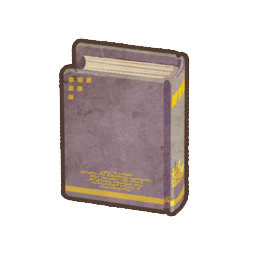

### 模型：ast_ms00_book_el_02

- 状态：已安装兼容资源，待实机验收
- 恢复方式：同名素材
- 此前替代：见昨日加载链报告
- 本次来源模型：ms00_book_el_02
- 本次来源包：resources/unpacked/assets/assets/quest/ms00_book_el_02.unity3d
- 涉及关卡与怪物：進化の間(20505)／水の遺霊Lv2[水](40108)；強化の間(20506)／火の遺霊Lv2[火](40107)；進化の間(20517)／水の遺霊Lv2[水](40108)；強化の間(20518)／火の遺霊Lv2[火](40107)；幻の間(20600)／火の遺霊Lv2[火](40107)；幻の間(20600)／水の遺霊Lv2[水](40108)；幻の間(20600)／光の遺霊Lv2[光](40109)；幻の間(20600)／闇の遺霊Lv2[闇](40110)；幻の間(20601)／火の遺霊Lv2[火](40107)；幻の間(20601)／水の遺霊Lv2[水](40108)；幻の間(20601)／光の遺霊Lv2[光](40109)；幻の間(20601)／闇の遺霊Lv2[闇](40110)；進化の間(20804)／水の遺霊Lv2[水](40108)；強化の間(20805)／火の遺霊Lv2[火](40107)；幻魂の塔(21009)／火の遺霊Lv2[火](40107)；幻魂の塔(21009)／水の遺霊Lv2[水](40108)；幻魂の塔(21009)／光の遺霊Lv2[光](40109)；幻魂の塔(21009)／闇の遺霊Lv2[闇](40110)
- 说明：已安装兼容包；尚待实机验收

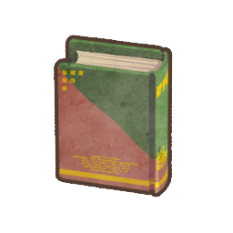

### 模型：ast_ms00_book_el_03

- 状态：已安装兼容资源，待实机验收
- 恢复方式：同名素材
- 此前替代：见昨日加载链报告
- 本次来源模型：ms00_book_el_03
- 本次来源包：resources/unpacked/assets/assets/quest/ms00_book_el_03.unity3d
- 涉及关卡与怪物：戦火の兆し(20700)／ワノクニの雑兵[水](41026)；四天王と呼ばれる男(20701)／ワノクニの雑兵[水](41026)；意志を継ぐ者(20702)／ワノクニの雑兵[水](41026)；炎火の使役竜(20703)／ワノクニの雑兵[火](41025)；妖刀使い(20704)／ワノクニの雑兵[火](41025)；戦況を変える力(20705)／ワノクニの雑兵[火](41025)；手荒な歓迎(20707)／ワノクニの雑兵[光](41027)；弓術王の間合い(20708)／ワノクニの雑兵[光](41027)；射抜くべき敵(20709)／ワノクニの雑兵[光](41027)；召喚(20710)／ワノクニの雑兵[闇](41028)；降臨(20711)／ワノクニの雑兵[闇](41028)；それでも私は…(20712)／ワノクニの雑兵[闇](41028)；幻魂の塔(21009)／火の魄霊Lv3[火](40111)；幻魂の塔(21009)／水の魄霊Lv3[水](40112)；幻魂の塔(21009)／光の魄霊Lv3[光](40113)；幻魂の塔(21009)／闇の魄霊Lv3[闇](40114)
- 说明：已安装兼容包；尚待实机验收

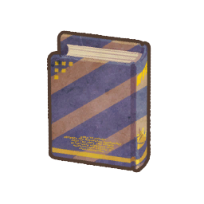

### 模型：ast_ms00_book_el_05

- 状态：已安装兼容资源，待实机验收
- 恢复方式：同名素材
- 此前替代：见昨日加载链报告
- 本次来源模型：ms00_book_el_05
- 本次来源包：resources/unpacked/assets/assets/quest/ms00_book_el_05.unity3d
- 涉及关卡与怪物：四天王と呼ばれる男(20701)／[四天王]ジカイLv1[水](41017)；妖刀使い(20704)／[四天王]ホムラLv1[火](41015)；弓術王の間合い(20708)／[四天王]キヌガサLv1[光](41019)；降臨(20711)／[四天王]ヒミコLv1[闇](41021)；闇の処刑人・初級(20830)／[処刑王]クロノ_Lv1[闇](41075)；闇の処刑人・中級(20831)／[処刑王]クロノ_Lv1[闇](41075)；荒ぶる狩りの血・初級(20844)／[獣王]フェンリス_Lv1[火](41102)；荒ぶる狩りの血・中級(20845)／[獣王]フェンリス_Lv1[火](41102)；荒ぶる狩りの血・上級(20846)／[獣王]フェンリス_Lv1[火](41102)
- 说明：已安装兼容包；尚待实机验收

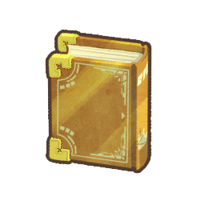

### 模型：ast_ms00_book_el_06

- 状态：已安装兼容资源，待实机验收
- 恢复方式：同名素材
- 此前替代：见昨日加载链报告
- 本次来源模型：ms00_book_el_06
- 本次来源包：resources/unpacked/assets/assets/quest/ms00_book_el_06.unity3d
- 涉及关卡与怪物：意志を継ぐ者(20702)／[蒼天王]ジカイLv2[水](41018)；戦況を変える力(20705)／[朱天王]ホムラLv2[火](41016)；射抜くべき敵(20709)／[白天王]キヌガサLv2[光](41020)；それでも私は…(20712)／[玄天王]ヒミコLv2[闇](41022)；闇の処刑人・上級(20832)／[帝王]クロノ_Lv2[闇](41076)
- 说明：已安装兼容包；尚待实机验收

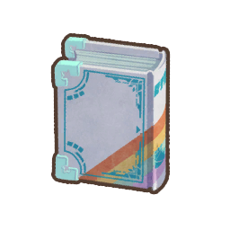

### 模型：ast_ms00_death_01_zako

- 状态：已安装兼容资源，待实机验收
- 恢复方式：同名素材
- 此前替代：ms00_death_01；ms02_four_un_01_zako
- 本次来源模型：ms00_death_01_zako
- 本次来源包：resources/unpacked/assets/assets/quest/ms00_death_01_zako.unity3d
- 涉及关卡与怪物：ホワイトデー戦線・超級(12209)／ハデス(ボス３)(21033)；ロード・トゥ・ドラコ(13101)／ハデス(ザコモデル)(31032)；月の遺跡(全6洞窟)(20000)／ハデス(ザコモデル)２(21034)；No.01：魂の洞窟(月)(20100)／ハデス(ザコモデル)(31032)
- 说明：已安装兼容包；尚待实机验收

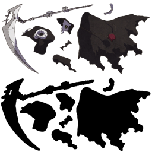

### 模型：ast_ms00_death_shadow

- 状态：已安装兼容资源，待实机验收
- 恢复方式：同名素材
- 此前替代：ms02_four_un_01_zako
- 本次来源模型：ms00_death_shadow
- 本次来源包：resources/unpacked/assets/assets/quest/ms00_death_shadow.unity3d
- 涉及关卡与怪物：No.21：殺神の洞窟(土)(20121)／シャドー・ハデス(31033)；幻魂の塔(21009)／シャドー・ハデス(31033)
- 说明：已安装兼容包；尚待实机验收

### 模型：ast_ms00_floor_move_l

- 状态：已安装兼容资源，待实机验收
- 恢复方式：同名素材
- 此前替代：见昨日加载链报告
- 本次来源模型：ms00_floor_move_l
- 本次来源包：resources/unpacked/assets/assets/quest/ms00_floor_move_l.unity3d
- 涉及关卡与怪物：No.01：魂の洞窟(月)(20100)／移動床_上(65002)；No.13：逃走の洞窟(木)(20101)／移動床_上(65002)；No.02：蠢動の洞窟(月)(20103)／移動床_上(65002)；No.03：永時の洞窟(月)(20110)／移動床_上(65002)；No.07：死神の洞窟(火)(20111)／移動床_上(65002)；No.14：火の洞窟(木)(20112)／移動床_上(65002)；No.04：直走の洞窟(月)(20120)／移動床_上(65002)；No.21：殺神の洞窟(土)(20121)／移動床_上(65002)；No.05：水の洞窟(月)(20122)／移動床_上(65002)；No.15：火流の洞窟(木)(20130)／移動床_上(65002)；No.06：戦逃の洞窟(月)(20131)／移動床_上(65002)；No.16：蒼炎の洞窟(木)(20133)／移動床_上(65002)；No.18：三択の洞窟(金)(20140)／移動床_上(65002)；No.25：魂器の洞窟(日)(20141)／移動床_上(65002)；No.22：全力の洞窟(土)(20150)／移動床_上(65002)；No.12：運の洞窟(水)(20151)／移動床_上(65002)；No.27：走破の洞窟(日)(20160)／移動床_上(65002)；No.20：明闇の洞窟(金)(20161)／移動床_上(65002)
- 说明：已安装兼容包；尚待实机验收

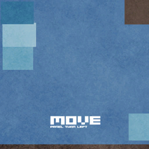

### 模型：ast_ms00_floor_move_r

- 状态：已安装兼容资源，待实机验收
- 恢复方式：同名素材
- 此前替代：见昨日加载链报告
- 本次来源模型：ms00_floor_move_r
- 本次来源包：resources/unpacked/assets/assets/quest/ms00_floor_move_r.unity3d
- 涉及关卡与怪物：No.01：魂の洞窟(月)(20100)／移動床_下(65004)；No.13：逃走の洞窟(木)(20101)／移動床_下(65004)；No.02：蠢動の洞窟(月)(20103)／移動床_下(65004)；No.03：永時の洞窟(月)(20110)／移動床_下(65004)；No.07：死神の洞窟(火)(20111)／移動床_下(65004)；No.14：火の洞窟(木)(20112)／移動床_下(65004)；No.04：直走の洞窟(月)(20120)／移動床_下(65004)；No.21：殺神の洞窟(土)(20121)／移動床_下(65004)；No.05：水の洞窟(月)(20122)／移動床_下(65004)；No.15：火流の洞窟(木)(20130)／移動床_下(65004)；No.06：戦逃の洞窟(月)(20131)／移動床_下(65004)；No.16：蒼炎の洞窟(木)(20133)／移動床_下(65004)；No.18：三択の洞窟(金)(20140)／移動床_下(65004)；No.25：魂器の洞窟(日)(20141)／移動床_下(65004)；No.22：全力の洞窟(土)(20150)／移動床_下(65004)；No.12：運の洞窟(水)(20151)／移動床_下(65004)；No.27：走破の洞窟(日)(20160)／移動床_下(65004)；No.20：明闇の洞窟(金)(20161)／移動床_下(65004)
- 说明：已安装兼容包；尚待实机验收

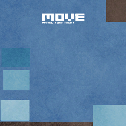

### 模型：ast_ms00_floor_move_s

- 状态：已安装兼容资源，待实机验收
- 恢复方式：同名素材
- 此前替代：见昨日加载链报告
- 本次来源模型：ms00_floor_move_s
- 本次来源包：resources/unpacked/assets/assets/quest/ms00_floor_move_s.unity3d
- 涉及关卡与怪物：No.01：魂の洞窟(月)(20100)／移動床_直進(65003)；No.13：逃走の洞窟(木)(20101)／移動床_直進(65003)；No.02：蠢動の洞窟(月)(20103)／移動床_直進(65003)；No.03：永時の洞窟(月)(20110)／移動床_直進(65003)；No.07：死神の洞窟(火)(20111)／移動床_直進(65003)；No.14：火の洞窟(木)(20112)／移動床_直進(65003)；No.04：直走の洞窟(月)(20120)／移動床_直進(65003)；No.21：殺神の洞窟(土)(20121)／移動床_直進(65003)；No.05：水の洞窟(月)(20122)／移動床_直進(65003)；No.15：火流の洞窟(木)(20130)／移動床_直進(65003)；No.06：戦逃の洞窟(月)(20131)／移動床_直進(65003)；No.16：蒼炎の洞窟(木)(20133)／移動床_直進(65003)；No.18：三択の洞窟(金)(20140)／移動床_直進(65003)；No.25：魂器の洞窟(日)(20141)／移動床_直進(65003)；No.22：全力の洞窟(土)(20150)／移動床_直進(65003)；No.12：運の洞窟(水)(20151)／移動床_直進(65003)；No.27：走破の洞窟(日)(20160)／移動床_直進(65003)；No.20：明闇の洞窟(金)(20161)／移動床_直進(65003)
- 说明：已安装兼容包；尚待实机验收

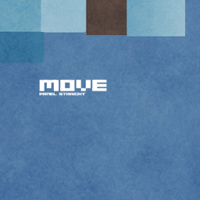

### 模型：ast_ms00_kaidan_iseki

- 状态：已安装兼容资源，待实机验收
- 恢复方式：同名素材
- 此前替代：见昨日加载链报告
- 本次来源模型：ms00_kaidan_iseki
- 本次来源包：resources/unpacked/assets/assets/quest/ms00_kaidan_iseki.unity3d
- 涉及关卡与怪物：月の遺跡(全6洞窟)(20000)／下り階段(65001)
- 说明：已安装兼容包；尚待实机验收

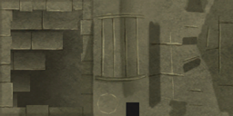

### 模型：ast_ms01_bear_lv1

- 状态：已安装兼容资源，待实机验收
- 恢复方式：同名素材
- 此前替代：ms02_four_un_01_zako
- 本次来源模型：ms01_bear_lv1
- 本次来源包：resources/unpacked/assets/assets/quest/ms01_bear_lv1.unity3d
- 涉及关卡与怪物：炎蛇の祠(11112)／グリズリー[火](10400)；炎蛇の祠(11112)／グリズリー[光](10402)；炎蛇の祠(11112)／グリズリー[闇](10403)；炎獄より生まれしもの(11113)／グリズリー[火](10400)；炎獄より生まれしもの(11113)／グリズリー[光](10402)；炎獄より生まれしもの(11113)／グリズリー[闇](10403)；氷海の蛇神(11122)／グリズリー[水](10401)；氷海の蛇神(11122)／グリズリー[光](10402)；氷海の蛇神(11122)／グリズリー[闇](10403)；深界へ誘うもの(11123)／グリズリー[水](10401)；深界へ誘うもの(11123)／グリズリー[光](10402)；深界へ誘うもの(11123)／グリズリー[闇](10403)；皇鱗纏う大蛇(11132)／グリズリー[火](10400)；皇鱗纏う大蛇(11132)／グリズリー[水](10401)；皇鱗纏う大蛇(11132)／グリズリー[光](10402)；電撃の未来少女・初級(13020)／グリズリー[光](10402)；ボクの名はアルフォンス(13206)／グリズリー[光](10402)；No.04：直走の洞窟(月)(20120)／グリズリー[水](10401)；No.04：直走の洞窟(月)(20120)／グリズリー[闇](10403)；No.15：火流の洞窟(木)(20130)／グリズリー[火](10400)；No.15：火流の洞窟(木)(20130)／グリズリー[水](10401)；No.27：走破の洞窟(日)(20160)／グリズリー[光](10402)；No.27：走破の洞窟(日)(20160)／グリズリー[闇](10403)；No.20：明闇の洞窟(金)(20161)／グリズリー[光](10402)；No.20：明闇の洞窟(金)(20161)／グリズリー[闇](10403)；滅びの使者たち・中級(20776)／グリズリー[光](10402)；滅びの使者たち・中級(20776)／グリズリー[闇](10403)；闇の処刑人・初級(20830)／グリズリー[闇](10403)；書を歓ぶ者たち(20833)／グリズリー[火](10400)；書を歓ぶ者たち(20833)／グリズリー[水](10401)；書を歓ぶ者たち(20833)／グリズリー[光](10402)；書を歓ぶ者たち(20833)／グリズリー[闇](10403)；弓の大器(20842)／グリズリー[光](10402)
- 说明：已安装兼容包；尚待实机验收

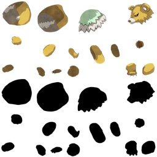
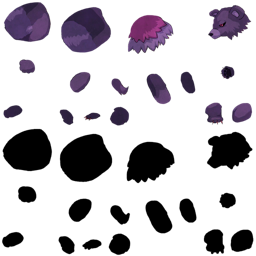
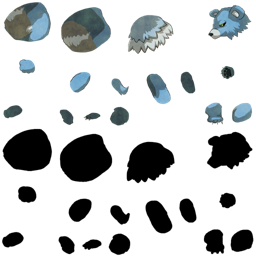
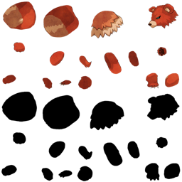

### 模型：ast_ms01_bear_lv2

- 状态：已安装兼容资源，待实机验收
- 恢复方式：同名素材
- 此前替代：ms02_four_un_01_zako
- 本次来源模型：ms01_bear_lv2
- 本次来源包：resources/unpacked/assets/assets/quest/ms01_bear_lv2.unity3d
- 涉及关卡与怪物：塊状界の入り口(11050)／ハイ・グリズリー[火]_初級ボス(41236)；光翼王の降臨(11133)／ハイ・グリズリー[火](10410)；光翼王の降臨(11133)／ハイ・グリズリー[水](10411)；光翼王の降臨(11133)／ハイ・グリズリー[光](10412)；深淵からの使者(11143)／ハイ・グリズリー[火](10410)；深淵からの使者(11143)／ハイ・グリズリー[水](10411)；深淵からの使者(11143)／ハイ・グリズリー[闇](10413)；閃光の雷撃戦線・初級(13000)／ハイ・グリズリー[光](10412)；電撃の未来少女・初級(13020)／ハイ・グリズリー[光](10412)；No.04：直走の洞窟(月)(20120)／ハイ・グリズリー[水](10411)；No.04：直走の洞窟(月)(20120)／ハイ・グリズリー[闇](10413)；No.15：火流の洞窟(木)(20130)／ハイ・グリズリー[火](10410)；No.15：火流の洞窟(木)(20130)／ハイ・グリズリー[水](10411)；No.27：走破の洞窟(日)(20160)／ハイ・グリズリー[光](10412)；No.27：走破の洞窟(日)(20160)／ハイ・グリズリー[闇](10413)；No.20：明闇の洞窟(金)(20161)／ハイ・グリズリー[光](10412)；No.20：明闇の洞窟(金)(20161)／ハイ・グリズリー[闇](10413)；ワノクニの烈魂・中級(20751)／ハイ・グリズリー[火](10410)
- 说明：已安装兼容包；尚待实机验收

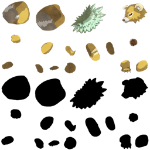
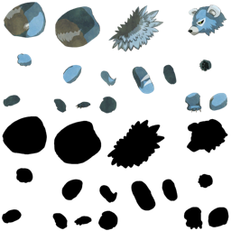
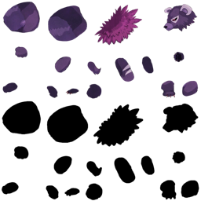
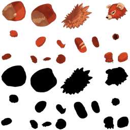

### 模型：ast_ms01_bear_lv4

- 状态：已安装兼容资源，待实机验收
- 恢复方式：同名素材
- 此前替代：ms01_bear_lv3；ms02_four_un_01_zako
- 本次来源模型：ms01_bear_lv4
- 本次来源包：resources/unpacked/assets/assets/quest/ms01_bear_lv4.unity3d
- 涉及关卡与怪物：蠢動の呼声・中級(12001)／カイザー・グリズリー[闇](10433)；蠢動の呼声・上級(12002)／カイザー・グリズリー[水]Ｓ(14431)；蠢動の呼声・上級(12002)／カイザー・グリズリー[闇]Ｓ(14433)；業火の呼声・中級(12011)／カイザー・グリズリー[火](10430)；業火の呼声・上級(12012)／カイザー・グリズリー[火]Ｓ(14430)；業火の呼声・上級(12012)／カイザー・グリズリー[光]Ｓ(14432)；深海の呼声・中級(12021)／カイザー・グリズリー[水](10431)；深海の呼声・上級(12022)／カイザー・グリズリー[水]Ｓ(14431)；深海の呼声・上級(12022)／カイザー・グリズリー[闇]Ｓ(14433)；蒼炎の呼声・中級(12031)／カイザー・グリズリー[火](10430)；蒼炎の呼声・中級(12031)／カイザー・グリズリー[水](10431)；蒼炎の呼声・上級(12032)／カイザー・グリズリー[火]Ｓ(14430)；蒼炎の呼声・上級(12032)／カイザー・グリズリー[水]Ｓ(14431)；陰陽の呼声・中級(12041)／カイザー・グリズリー[光](10432)；陰陽の呼声・中級(12041)／カイザー・グリズリー[闇](10433)；陰陽の呼声・上級(12042)／カイザー・グリズリー[光]Ｓ(14432)；陰陽の呼声・上級(12042)／カイザー・グリズリー[闇]Ｓ(14433)；四族の呼声・中級(12051)／カイザー・グリズリー[火](10430)；四族の呼声・中級(12051)／カイザー・グリズリー[水](10431)；四族の呼声・中級(12051)／カイザー・グリズリー[光](10432)；四族の呼声・中級(12051)／カイザー・グリズリー[闇](10433)；極光の呼声・中級(12061)／カイザー・グリズリー[光](10432)；極光の呼声・上級(12062)／カイザー・グリズリー[火]Ｓ(14430)；極光の呼声・上級(12062)／カイザー・グリズリー[光]Ｓ(14432)；バレンタイン作戦・上級(12172)／カイザー・グリズリー[火]Ｓ(14430)；バレンタイン作戦・上級(12172)／カイザー・グリズリー[水]Ｓ(14431)；バレンタイン作戦・上級(12172)／カイザー・グリズリー[光]Ｓ(14432)；バレンタイン作戦・上級(12172)／カイザー・グリズリー[闇]Ｓ(14433)；魂の器[剣]・上級(12193)／カイザー・グリズリー[火]Ｓ(14430)；魂の器[剣]・上級(12193)／カイザー・グリズリー[水]Ｓ(14431)；魂の器[剣]・上級(12193)／カイザー・グリズリー[光]Ｓ(14432)；魂の器[剣]・上級(12193)／カイザー・グリズリー[闇]Ｓ(14433)；魂の器[杖]・上級(12202)／カイザー・グリズリー[火](10430)；魂の器[杖]・上級(12202)／カイザー・グリズリー[水](10431)；魂の器[杖]・上級(12202)／カイザー・グリズリー[光](10432)；魂の器[杖]・上級(12202)／カイザー・グリズリー[闇](10433)；遅咲きのひな祭り・上級(12205)／カイザー・グリズリー[火]Ｓ(14430)；遅咲きのひな祭り・上級(12205)／カイザー・グリズリー[光]Ｓ(14432)；ホワイトデー戦線・上級(12208)／カイザー・グリズリー[水]Ｓ(14431)；ホワイトデー戦線・上級(12208)／カイザー・グリズリー[闇]Ｓ(14433)；ホワイトデー戦線・超級(12209)／カイザー・グリズリー[水]Ｓ(14431)；ホワイトデー戦線・超級(12209)／カイザー・グリズリー[闇]Ｓ(14433)；閃光の雷撃戦線・上級(13002)／カイザー・グリズリー[光]Ｓ(14432)；真書の使途・中級(13011)／カイザー・グリズリー[火](10430)；真書の使途・中級(13011)／カイザー・グリズリー[光](10432)；真書の使途・上級(13012)／カイザー・グリズリー[火]Ｓ(14430)；真書の使途・上級(13012)／カイザー・グリズリー[光]Ｓ(14432)；真書の使途・超級(13013)／カイザー・グリズリー[火]Ｓ(14430)；真書の使途・超級(13013)／カイザー・グリズリー[水]Ｓ(14431)；真書の使途・超級(13013)／カイザー・グリズリー[光]Ｓ(14432)；真書の使途・激烈(13014)／カイザー・グリズリー[火]Ｓ(14430)；真書の使途・激烈(13014)／カイザー・グリズリー[光]Ｓ(14432)；真書の使途・激烈(13014)／カイザー・グリズリー[闇]Ｓ(14433)；電撃の未来少女・上級(13022)／カイザー・グリズリー[光]Ｓ(14432)；電撃の未来少女・上級(13022)／カイザー・グリズリー[闇]Ｓ(14433)；閃光の雷撃戦線・超級(13030)／カイザー・グリズリー[光]Ｓ(14432)；閃光の雷撃戦線・激烈(13031)／カイザー・グリズリー[光]Ｓ(14432)；No.10：闇の洞窟(水)(20102)／カイザー・グリズリー[水](10431)；No.10：闇の洞窟(水)(20102)／カイザー・グリズリー[闇](10433)；No.17：氷炎の洞窟(金)(20132)／カイザー・グリズリー[火](10430)；No.17：氷炎の洞窟(金)(20132)／カイザー・グリズリー[水](10431)；No.25：魂器の洞窟(日)(20141)／カイザー・グリズリー[光]Ｓ(ソウル15)(14442)；No.25：魂器の洞窟(日)(20141)／カイザー・グリズリー[闇]Ｓ(ソウル15)(14443)；ワノクニの烈魂・上級(20752)／カイザー・グリズリー[火](10430)；神々のドール・上級(20765)／カイザー・グリズリー[光](10432)；孤高の少年たち・上級(20808)／カイザー・グリズリー[光](10432)；孤高の少年たち・上級(20808)／カイザー・グリズリー[闇](10433)；孤高の少女たち・上級(20811)／カイザー・グリズリー[火](10430)；孤高の少女たち・上級(20811)／カイザー・グリズリー[水](10431)；闇の処刑人・上級(20832)／カイザー・グリズリー[光](10432)；闇の処刑人・上級(20832)／カイザー・グリズリー[闇](10433)
- 说明：已安装兼容包；尚待实机验收

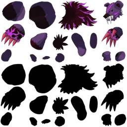
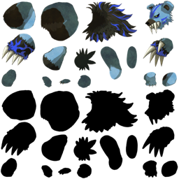
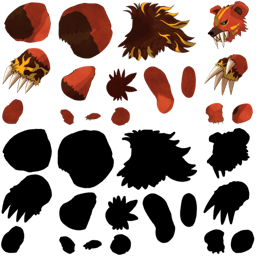
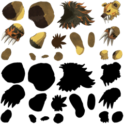

### 模型：ast_ms01_bird_lv1_dark

- 状态：已安装兼容资源，待实机验收
- 恢复方式：同名素材
- 此前替代：ms02_four_un_01_zako
- 本次来源模型：ms01_bird_lv1_dark
- 本次来源包：resources/unpacked/assets/assets/quest/ms01_bird_lv1_dark.unity3d
- 涉及关卡与怪物：No.02：蠢動の洞窟(月)(20103)／ガルダ[闇](12303)；No.11：深海の洞窟(水)(20123)／ガルダ[闇](12303)；No.19：陰陽の洞窟(金)(20143)／ガルダ[闇](12303)；No.23：四族の洞窟(土)(20153)／ガルダ[闇](12303)；No.28：極光の洞窟(日)(20163)／ガルダ[闇](12303)；進化の間(20505)／ガルダ[闇](12303)；進化の間(20517)／ガルダ[闇](12303)；進化の間(20804)／ガルダ[闇](12303)
- 说明：已安装兼容包；尚待实机验收

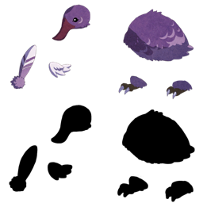

### 模型：ast_ms01_bird_lv1_fire

- 状态：已安装兼容资源，待实机验收
- 恢复方式：同名素材
- 此前替代：ms02_four_un_01_zako
- 本次来源模型：ms01_bird_lv1_fire
- 本次来源包：resources/unpacked/assets/assets/quest/ms01_bird_lv1_fire.unity3d
- 涉及关卡与怪物：No.08：業火の洞窟(火)(20113)／ガルダ[火](12300)；No.16：蒼炎の洞窟(木)(20133)／ガルダ[火](12300)；進化の間(20505)／ガルダ[火](12300)；進化の間(20517)／ガルダ[火](12300)；進化の間(20804)／ガルダ[火](12300)
- 说明：已安装兼容包；尚待实机验收

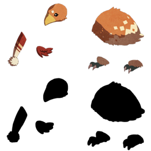

### 模型：ast_ms01_bird_lv1_holy

- 状态：已安装兼容资源，待实机验收
- 恢复方式：同名素材
- 此前替代：ms02_four_un_01_zako
- 本次来源模型：ms01_bird_lv1_holy
- 本次来源包：resources/unpacked/assets/assets/quest/ms01_bird_lv1_holy.unity3d
- 涉及关卡与怪物：No.08：業火の洞窟(火)(20113)／ガルダ[光](12302)；No.19：陰陽の洞窟(金)(20143)／ガルダ[光](12302)；No.23：四族の洞窟(土)(20153)／ガルダ[光](12302)；No.28：極光の洞窟(日)(20163)／ガルダ[光](12302)；進化の間(20505)／ガルダ[光](12302)；進化の間(20517)／ガルダ[光](12302)；進化の間(20804)／ガルダ[光](12302)
- 说明：已安装兼容包；尚待实机验收

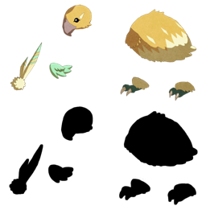

### 模型：ast_ms01_bird_lv1_water

- 状态：已安装兼容资源，待实机验收
- 恢复方式：同名素材
- 此前替代：ms02_four_un_01_zako
- 本次来源模型：ms01_bird_lv1_water
- 本次来源包：resources/unpacked/assets/assets/quest/ms01_bird_lv1_water.unity3d
- 涉及关卡与怪物：No.02：蠢動の洞窟(月)(20103)／ガルダ[水](12301)；No.11：深海の洞窟(水)(20123)／ガルダ[水](12301)；No.16：蒼炎の洞窟(木)(20133)／ガルダ[水](12301)；進化の間(20505)／ガルダ[水](12301)；進化の間(20517)／ガルダ[水](12301)；進化の間(20804)／ガルダ[水](12301)
- 说明：已安装兼容包；尚待实机验收

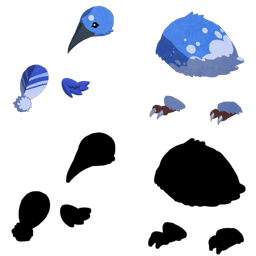

### 模型：ast_ms01_bird_lv2_dark

- 状态：已安装兼容资源，待实机验收
- 恢复方式：同名素材
- 此前替代：ms02_four_un_01_zako
- 本次来源模型：ms01_bird_lv2_dark
- 本次来源包：resources/unpacked/assets/assets/quest/ms01_bird_lv2_dark.unity3d
- 涉及关卡与怪物：No.02：蠢動の洞窟(月)(20103)／ハイ・ガルダ[闇](12308)；No.11：深海の洞窟(水)(20123)／ハイ・ガルダ[闇](12308)；No.19：陰陽の洞窟(金)(20143)／ハイ・ガルダ[闇](12308)；No.23：四族の洞窟(土)(20153)／ハイ・ガルダ[闇](12308)；No.28：極光の洞窟(日)(20163)／ハイ・ガルダ[闇](12308)；進化の間(20505)／ハイ・ガルダ[闇](12308)；進化の間(20517)／ハイ・ガルダ[闇](12308)；進化の間(20804)／ハイ・ガルダ[闇](12308)
- 说明：已安装兼容包；尚待实机验收

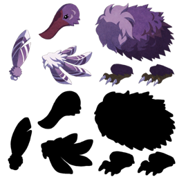

### 模型：ast_ms01_bird_lv2_fire

- 状态：已安装兼容资源，待实机验收
- 恢复方式：同名素材
- 此前替代：ms02_four_un_01_zako
- 本次来源模型：ms01_bird_lv2_fire
- 本次来源包：resources/unpacked/assets/assets/quest/ms01_bird_lv2_fire.unity3d
- 涉及关卡与怪物：No.08：業火の洞窟(火)(20113)／ハイ・ガルダ[火](12305)；No.16：蒼炎の洞窟(木)(20133)／ハイ・ガルダ[火](12305)；進化の間(20505)／ハイ・ガルダ[火](12305)；進化の間(20517)／ハイ・ガルダ[火](12305)；進化の間(20804)／ハイ・ガルダ[火](12305)
- 说明：已安装兼容包；尚待实机验收

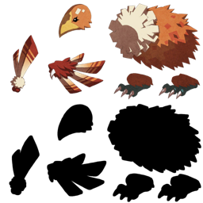

### 模型：ast_ms01_bird_lv2_holy

- 状态：已安装兼容资源，待实机验收
- 恢复方式：同名素材
- 此前替代：ms02_four_un_01_zako
- 本次来源模型：ms01_bird_lv2_holy
- 本次来源包：resources/unpacked/assets/assets/quest/ms01_bird_lv2_holy.unity3d
- 涉及关卡与怪物：No.08：業火の洞窟(火)(20113)／ハイ・ガルダ[光](12307)；No.19：陰陽の洞窟(金)(20143)／ハイ・ガルダ[光](12307)；No.23：四族の洞窟(土)(20153)／ハイ・ガルダ[光](12307)；No.28：極光の洞窟(日)(20163)／ハイ・ガルダ[光](12307)；進化の間(20505)／ハイ・ガルダ[光](12307)；進化の間(20517)／ハイ・ガルダ[光](12307)；進化の間(20804)／ハイ・ガルダ[光](12307)
- 说明：已安装兼容包；尚待实机验收

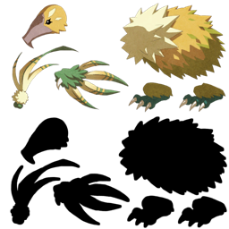

### 模型：ast_ms01_bird_lv2_water

- 状态：已安装兼容资源，待实机验收
- 恢复方式：同名素材
- 此前替代：ms02_four_un_01_zako
- 本次来源模型：ms01_bird_lv2_water
- 本次来源包：resources/unpacked/assets/assets/quest/ms01_bird_lv2_water.unity3d
- 涉及关卡与怪物：No.02：蠢動の洞窟(月)(20103)／ハイ・ガルダ[水](12306)；No.11：深海の洞窟(水)(20123)／ハイ・ガルダ[水](12306)；No.16：蒼炎の洞窟(木)(20133)／ハイ・ガルダ[水](12306)；進化の間(20505)／ハイ・ガルダ[水](12306)；進化の間(20517)／ハイ・ガルダ[水](12306)；進化の間(20804)／ハイ・ガルダ[水](12306)
- 说明：已安装兼容包；尚待实机验收

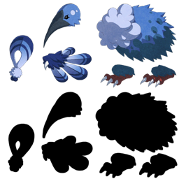

### 模型：ast_ms01_crab_lv1_dark

- 状态：已安装兼容资源，待实机验收
- 恢复方式：同名素材
- 此前替代：ms02_four_un_01_zako
- 本次来源模型：ms01_crab_lv1_dark
- 本次来源包：resources/unpacked/assets/assets/quest/ms01_crab_lv1_dark.unity3d
- 涉及关卡与怪物：No.02：蠢動の洞窟(月)(20103)／シェロブ[闇](12313)；No.11：深海の洞窟(水)(20123)／シェロブ[闇](12313)；No.19：陰陽の洞窟(金)(20143)／シェロブ[闇](12313)；No.28：極光の洞窟(日)(20163)／シェロブ[闇](12313)
- 说明：已安装兼容包；尚待实机验收

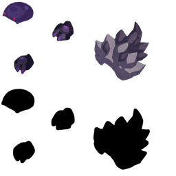

### 模型：ast_ms01_crab_lv1_fire

- 状态：已安装兼容资源，待实机验收
- 恢复方式：同名素材
- 此前替代：ms02_four_un_01_zako
- 本次来源模型：ms01_crab_lv1_fire
- 本次来源包：resources/unpacked/assets/assets/quest/ms01_crab_lv1_fire.unity3d
- 涉及关卡与怪物：No.08：業火の洞窟(火)(20113)／シェロブ[火](12310)；No.16：蒼炎の洞窟(木)(20133)／シェロブ[火](12310)；No.23：四族の洞窟(土)(20153)／シェロブ[火](12310)；ワノクニの烈魂・上級(20752)／シェロブ[火](12310)
- 说明：已安装兼容包；尚待实机验收

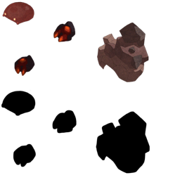

### 模型：ast_ms01_crab_lv1_holy

- 状态：已安装兼容资源，待实机验收
- 恢复方式：同名素材
- 此前替代：ms02_four_un_01_zako
- 本次来源模型：ms01_crab_lv1_holy
- 本次来源包：resources/unpacked/assets/assets/quest/ms01_crab_lv1_holy.unity3d
- 涉及关卡与怪物：No.08：業火の洞窟(火)(20113)／シェロブ[光](12312)；No.19：陰陽の洞窟(金)(20143)／シェロブ[光](12312)；No.28：極光の洞窟(日)(20163)／シェロブ[光](12312)
- 说明：已安装兼容包；尚待实机验收

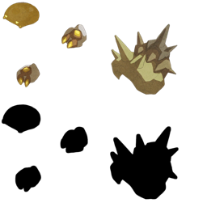

### 模型：ast_ms01_crab_lv1_water

- 状态：已安装兼容资源，待实机验收
- 恢复方式：同名素材
- 此前替代：ms02_four_un_01_zako
- 本次来源模型：ms01_crab_lv1_water
- 本次来源包：resources/unpacked/assets/assets/quest/ms01_crab_lv1_water.unity3d
- 涉及关卡与怪物：No.02：蠢動の洞窟(月)(20103)／シェロブ[水](12311)；No.11：深海の洞窟(水)(20123)／シェロブ[水](12311)；No.16：蒼炎の洞窟(木)(20133)／シェロブ[水](12311)；No.23：四族の洞窟(土)(20153)／シェロブ[水](12311)
- 说明：已安装兼容包；尚待实机验收

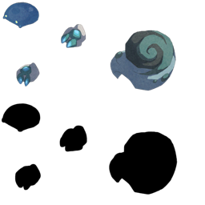

### 模型：ast_ms01_crab_lv2_dark

- 状态：已安装兼容资源，待实机验收
- 恢复方式：同名素材
- 此前替代：ms02_four_un_01_zako
- 本次来源模型：ms01_crab_lv2_dark
- 本次来源包：resources/unpacked/assets/assets/quest/ms01_crab_lv2_dark.unity3d
- 涉及关卡与怪物：No.02：蠢動の洞窟(月)(20103)／ハイ・シェロブ[闇](12318)；No.11：深海の洞窟(水)(20123)／ハイ・シェロブ[闇](12318)；No.19：陰陽の洞窟(金)(20143)／ハイ・シェロブ[闇](12318)；No.28：極光の洞窟(日)(20163)／ハイ・シェロブ[闇](12318)
- 说明：已安装兼容包；尚待实机验收

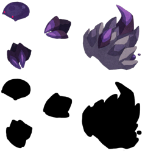

### 模型：ast_ms01_crab_lv2_fire

- 状态：已安装兼容资源，待实机验收
- 恢复方式：同名素材
- 此前替代：ms02_four_un_01_zako
- 本次来源模型：ms01_crab_lv2_fire
- 本次来源包：resources/unpacked/assets/assets/quest/ms01_crab_lv2_fire.unity3d
- 涉及关卡与怪物：No.08：業火の洞窟(火)(20113)／ハイ・シェロブ[火](12315)；No.16：蒼炎の洞窟(木)(20133)／ハイ・シェロブ[火](12315)；No.23：四族の洞窟(土)(20153)／ハイ・シェロブ[火](12315)
- 说明：已安装兼容包；尚待实机验收

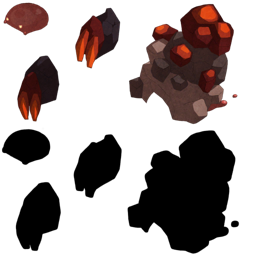

### 模型：ast_ms01_crab_lv2_holy

- 状态：已安装兼容资源，待实机验收
- 恢复方式：同名素材
- 此前替代：ms02_four_un_01_zako
- 本次来源模型：ms01_crab_lv2_holy
- 本次来源包：resources/unpacked/assets/assets/quest/ms01_crab_lv2_holy.unity3d
- 涉及关卡与怪物：No.08：業火の洞窟(火)(20113)／ハイ・シェロブ[光](12317)；No.19：陰陽の洞窟(金)(20143)／ハイ・シェロブ[光](12317)；No.28：極光の洞窟(日)(20163)／ハイ・シェロブ[光](12317)
- 说明：已安装兼容包；尚待实机验收

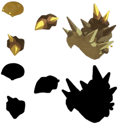

### 模型：ast_ms01_crab_lv2_water

- 状态：已安装兼容资源，待实机验收
- 恢复方式：同名素材
- 此前替代：ms02_four_un_01_zako
- 本次来源模型：ms01_crab_lv2_water
- 本次来源包：resources/unpacked/assets/assets/quest/ms01_crab_lv2_water.unity3d
- 涉及关卡与怪物：No.02：蠢動の洞窟(月)(20103)／ハイ・シェロブ[水](12316)；No.11：深海の洞窟(水)(20123)／ハイ・シェロブ[水](12316)；No.16：蒼炎の洞窟(木)(20133)／ハイ・シェロブ[水](12316)；No.23：四族の洞窟(土)(20153)／ハイ・シェロブ[水](12316)
- 说明：已安装兼容包；尚待实机验收

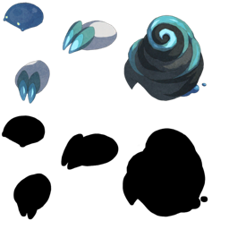

### 模型：ast_ms01_dra_lv1

- 状态：已安装兼容资源，待实机验收
- 恢复方式：同名素材
- 此前替代：ms02_four_un_01_zako
- 本次来源模型：ms01_dra_lv1
- 本次来源包：resources/unpacked/assets/assets/quest/ms01_dra_lv1.unity3d
- 涉及关卡与怪物：試練のはじまり(11002)／ドラン[光]_初級ボス(41223)；赤壁山岳(11110)／ドラン[火](10300)；赤壁山岳(11110)／ドラン[光](10302)；赤壁山岳(11110)／ドラン[闇](10303)；赤熱の鉄槌(11111)／ドラン[火](10300)；赤熱の鉄槌(11111)／ドラン[光](10302)；赤熱の鉄槌(11111)／ドラン[闇](10303)；炎蛇の祠(11112)／ドラン[火](10300)；炎蛇の祠(11112)／ドラン[光](10302)；炎蛇の祠(11112)／ドラン[闇](10303)；炎獄より生まれしもの(11113)／ドラン[火](10300)；炎獄より生まれしもの(11113)／ドラン[光](10302)；炎獄より生まれしもの(11113)／ドラン[闇](10303)；絶対凍土の平原(11120)／ドラン[水](10301)；絶対凍土の平原(11120)／ドラン[光](10302)；絶対凍土の平原(11120)／ドラン[闇](10303)；氷岩獣王の縄張り(11121)／ドラン[水](10301)；氷岩獣王の縄張り(11121)／ドラン[光](10302)；氷岩獣王の縄張り(11121)／ドラン[闇](10303)；深界へ誘うもの(11123)／ドラン[水](10301)；深界へ誘うもの(11123)／ドラン[光](10302)；深界へ誘うもの(11123)／ドラン[闇](10303)；陽光の断崖(11130)／ドラン[火](10300)；陽光の断崖(11130)／ドラン[水](10301)；陽光の断崖(11130)／ドラン[光](10302)；皇鱗纏う大蛇(11132)／ドラン[火](10300)；皇鱗纏う大蛇(11132)／ドラン[水](10301)；光翼王の降臨(11133)／ドラン[火](10300)；光翼王の降臨(11133)／ドラン[水](10301)；光翼王の降臨(11133)／ドラン[光](10302)；闇夜を裂く弩砲(11141)／ドラン[火](10300)；闇夜を裂く弩砲(11141)／ドラン[水](10301)；闇夜を裂く弩砲(11141)／ドラン[闇](10303)；影巣食う蛇竜(11142)／ドラン[火](10300)；影巣食う蛇竜(11142)／ドラン[水](10301)；影巣食う蛇竜(11142)／ドラン[闇](10303)；No.13：逃走の洞窟(木)(20101)／ドラン[水](10301)；No.13：逃走の洞窟(木)(20101)／ドラン[闇](10303)；No.04：直走の洞窟(月)(20120)／ドラン[水](10301)；No.04：直走の洞窟(月)(20120)／ドラン[闇](10303)；No.15：火流の洞窟(木)(20130)／ドラン[火](10300)；No.15：火流の洞窟(木)(20130)／ドラン[水](10301)；No.27：走破の洞窟(日)(20160)／ドラン[光](10302)；No.27：走破の洞窟(日)(20160)／ドラン[闇](10303)；No.20：明闇の洞窟(金)(20161)／ドラン[光](10302)；No.20：明闇の洞窟(金)(20161)／ドラン[闇](10303)；戦火の兆し(20700)／ドラン[水](10301)；四天王と呼ばれる男(20701)／ドラン[水](10301)；意志を継ぐ者(20702)／ドラン[水](10301)；炎火の使役竜(20703)／ドラン[火](10300)；妖刀使い(20704)／ドラン[火](10300)；戦況を変える力(20705)／ドラン[火](10300)；手荒な歓迎(20707)／ドラン[光](10302)；弓術王の間合い(20708)／ドラン[光](10302)；射抜くべき敵(20709)／ドラン[光](10302)；召喚(20710)／ドラン[闇](10303)；降臨(20711)／ドラン[闇](10303)；それでも私は…(20712)／ドラン[闇](10303)；ワノクニの烈魂・初級(20750)／ドラン[火](10300)；神々のドール・初級(20763)／ドラン[光](10302)；滅びの使者たち・初級(20775)／ドラン[光](10302)；滅びの使者たち・初級(20775)／ドラン[闇](10303)；咎色の印・中級(20792)／ドラン[火](10300)；咎色の印・中級(20792)／ドラン[水](10301)；孤高の少年たち・中級(20807)／ドラン[光](10302)；書を歓ぶ者たち(20833)／ドラン[火](10300)；書を歓ぶ者たち(20833)／ドラン[水](10301)；杖の大器(20843)／ドラン[闇](10303)
- 说明：已安装兼容包；尚待实机验收

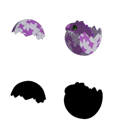
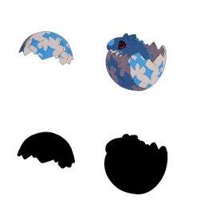
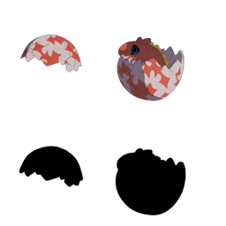
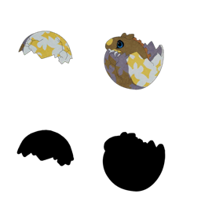

### 模型：ast_ms01_dra_lv2

- 状态：已安装兼容资源，待实机验收
- 恢复方式：同名素材
- 此前替代：ms01_dra_lv4；ms02_four_un_01_zako
- 本次来源模型：ms01_dra_lv2
- 本次来源包：resources/unpacked/assets/assets/quest/ms01_dra_lv2.unity3d
- 涉及关卡与怪物：紅い牙(11011)／ハイ・ドラン[火]_初級ボス(41225)；白浜の牙(11021)／ハイ・ドラン[水]_初級ボス(41228)；灼光の牙(11031)／ハイ・ドラン[光]_初級ボス(41231)；黒威の牙(11041)／ハイ・ドラン[闇]_初級ボス(41234)；皇鱗纏う大蛇(11132)／ハイ・ドラン[光](10312)；光翼王の降臨(11133)／ハイ・ドラン[火](10310)；光翼王の降臨(11133)／ハイ・ドラン[水](10311)；光翼王の降臨(11133)／ハイ・ドラン[光](10312)；深淵からの使者(11143)／ハイ・ドラン[火](10310)；深淵からの使者(11143)／ハイ・ドラン[水](10311)；深淵からの使者(11143)／ハイ・ドラン[闇](10313)；蠢動の呼声・入門(11999)／ハイ・ドラン(曜日入門)[闇](12326)；業火の呼声・入門(12009)／ハイ・ドラン(曜日入門)[火](12327)；深海の呼声・入門(12019)／ハイ・ドラン(曜日入門)[水](12328)；極光の呼声・入門(12059)／ハイ・ドラン(曜日入門)[光](12332)；条件：ドラゴン100体(13208)／ハイ・ドラン[光](10312)；No.13：逃走の洞窟(木)(20101)／ハイ・ドラン[水](10311)；No.13：逃走の洞窟(木)(20101)／ハイ・ドラン[闇](10313)；No.04：直走の洞窟(月)(20120)／ハイ・ドラン[水](10311)；No.04：直走の洞窟(月)(20120)／ハイ・ドラン[闇](10313)；No.15：火流の洞窟(木)(20130)／ハイ・ドラン[火](10310)；No.15：火流の洞窟(木)(20130)／ハイ・ドラン[水](10311)；No.27：走破の洞窟(日)(20160)／ハイ・ドラン[光](10312)；No.27：走破の洞窟(日)(20160)／ハイ・ドラン[闇](10313)；No.20：明闇の洞窟(金)(20161)／ハイ・ドラン[光](10312)；No.20：明闇の洞窟(金)(20161)／ハイ・ドラン[闇](10313)；四天王と呼ばれる男(20701)／ハイ・ドラン[水](10311)；意志を継ぐ者(20702)／ハイ・ドラン[水](10311)；妖刀使い(20704)／ハイ・ドラン[火](10310)；戦況を変える力(20705)／ハイ・ドラン[火](10310)；手荒な歓迎(20707)／ハイ・ドラン[光](10312)；弓術王の間合い(20708)／ハイ・ドラン[光](10312)；射抜くべき敵(20709)／ハイ・ドラン[光](10312)；降臨(20711)／ハイ・ドラン[闇](10313)；それでも私は…(20712)／ハイ・ドラン[闇](10313)；神々のドール・中級(20764)／ハイ・ドラン[光](10312)；滅びの使者たち・中級(20776)／ハイ・ドラン[光](10312)；滅びの使者たち・中級(20776)／ハイ・ドラン[闇](10313)；暴虐の王・中級(20782)／ハイ・ドラン[水](10311)；暴虐の王・中級(20782)／ハイ・ドラン[光](10312)；竜鱗砕きの異名・中級(20789)／ハイ・ドラン[闇](10313)；咎色の印・中級(20792)／ハイ・ドラン[光](10312)；咎色の印・中級(20792)／ハイ・ドラン[闇](10313)；孤高の少年たち・中級(20807)／ハイ・ドラン[光](10312)；闇の処刑人・中級(20831)／ハイ・ドラン[闇](10313)
- 说明：已安装兼容包；尚待实机验收

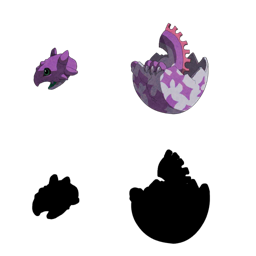
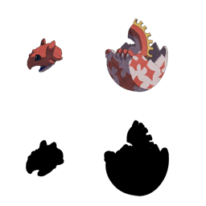
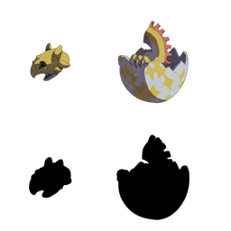
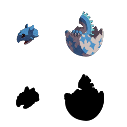

### 模型：ast_ms01_dra_lv3

- 状态：已安装兼容资源，待实机验收
- 恢复方式：同名素材
- 此前替代：ms01_dra_lv4；ms02_four_un_01_zako
- 本次来源模型：ms01_dra_lv3
- 本次来源包：resources/unpacked/assets/assets/quest/ms01_dra_lv3.unity3d
- 涉及关卡与怪物：秘境の望む地(11102)／キラー・ドラン[光](10322)；蠢動の呼声・初級(12000)／キラー・ドラン[闇](10323)；業火の呼声・初級(12010)／キラー・ドラン[火](10320)；深海の呼声・初級(12020)／キラー・ドラン[水](10321)；蒼炎の呼声・初級(12030)／キラー・ドラン[火](10320)；蒼炎の呼声・初級(12030)／キラー・ドラン[水](10321)；陰陽の呼声・初級(12040)／キラー・ドラン[光](10322)；陰陽の呼声・初級(12040)／キラー・ドラン[闇](10323)；四族の呼声・初級(12050)／キラー・ドラン[火](10320)；四族の呼声・初級(12050)／キラー・ドラン[水](10321)；四族の呼声・初級(12050)／キラー・ドラン[光](10322)；四族の呼声・初級(12050)／キラー・ドラン[闇](10323)；極光の呼声・初級(12060)／キラー・ドラン[光](10322)；条件：ドラゴン100体(13208)／キラー・ドラン[光](10322)；No.13：逃走の洞窟(木)(20101)／キラー・ドラン[闇](10323)；No.25：魂器の洞窟(日)(20141)／キラー・ドラン[光](ソウル12)(10327)；No.25：魂器の洞窟(日)(20141)／キラー・ドラン[闇](ソウル12)(10328)；意志を継ぐ者(20702)／キラー・ドラン[水](10321)；戦況を変える力(20705)／キラー・ドラン[火](10320)；射抜くべき敵(20709)／キラー・ドラン[光](10322)；それでも私は…(20712)／キラー・ドラン[闇](10323)；ワノクニの烈魂・中級(20751)／キラー・ドラン[火](10320)；竜鱗砕きの異名・中級(20789)／キラー・ドラン[闇](10323)
- 说明：已安装兼容包；尚待实机验收

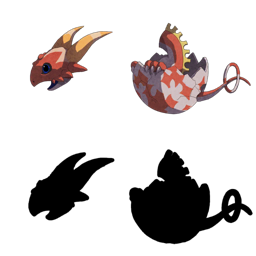
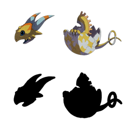
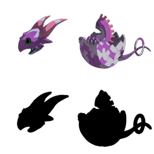

### 模型：ast_ms01_dra_sh_fire

- 状态：已安装兼容资源，待实机验收
- 恢复方式：同名素材
- 此前替代：ms01_dra_lv4
- 本次来源模型：ms01_dra_sh_fire
- 本次来源包：resources/unpacked/assets/assets/quest/ms01_dra_sh_fire.unity3d
- 涉及关卡与怪物：ワノクニの烈魂・初級(20750)／シャドー・ドラン[火](10335)
- 说明：已安装兼容包；尚待实机验收

### 模型：ast_ms01_fugu_lv1_dark

- 状态：已安装兼容资源，待实机验收
- 恢复方式：同族素材（推测）
- 此前替代：ms02_four_un_01_zako
- 本次来源模型：ms01_fugu_lv2_holy
- 本次来源包：resources/unpacked/assets/assets/quest/ms01_fugu_lv2_holy.unity3d
- 涉及关卡与怪物：暗闇のハンター(21017)／フグ_Lv1[闇](41045)；暗闇の支配者(21018)／フグ_Lv1[闇](41045)
- 说明：已安装兼容包；尚待实机验收

### 模型：ast_ms01_fugu_lv1_fire

- 状态：已安装兼容资源，待实机验收
- 恢复方式：同族素材（推测）
- 此前替代：ms02_four_un_01_zako
- 本次来源模型：ms01_fugu_lv2_holy
- 本次来源包：resources/unpacked/assets/assets/quest/ms01_fugu_lv2_holy.unity3d
- 涉及关卡与怪物：おもかじいっぱい！(21003)／フグ_Lv1[火](41042)；立ち込める闇(21005)／フグ_Lv1[火](41042)；海の怪物(21006)／フグ_Lv1[火](41042)；古地図が示す先(21007)／フグ_Lv1[火](41042)；上陸前の激闘(21008)／フグ_Lv1[火](41042)
- 说明：已安装兼容包；尚待实机验收

### 模型：ast_ms01_fugu_lv1_water

- 状态：已安装兼容资源，待实机验收
- 恢复方式：同族素材（推测）
- 此前替代：ms02_four_un_01_zako
- 本次来源模型：ms01_fugu_lv2_water
- 本次来源包：resources/unpacked/assets/assets/quest/ms01_fugu_lv2_water.unity3d
- 涉及关卡与怪物：選ばれし六戦士(21000)／フグ_Lv1[水](41043)；襲撃！海のハンター(21002)／フグ_Lv1[水](41043)；古地図が示す先(21007)／フグ_Lv1[水](41043)；上陸前の激闘(21008)／フグ_Lv1[水](41043)
- 说明：已安装兼容包；尚待实机验收

### 模型：ast_ms01_fugu_lv2_dark

- 状态：已安装兼容资源，待实机验收
- 恢复方式：同族素材（推测）
- 此前替代：ms02_four_un_01_zako
- 本次来源模型：ms01_fugu_lv2_holy
- 本次来源包：resources/unpacked/assets/assets/quest/ms01_fugu_lv2_holy.unity3d
- 涉及关卡与怪物：暗き海を進む(21015)／フグ_Lv2[闇](41049)；暗闇のハンター(21017)／フグ_Lv2[闇](41049)；暗闇の支配者(21018)／フグ_Lv2[闇](41049)
- 说明：已安装兼容包；尚待实机验收

### 模型：ast_ms01_fugu_lv2_fire

- 状态：已安装兼容资源，待实机验收
- 恢复方式：同族素材（推测）
- 此前替代：ms02_four_un_01_zako
- 本次来源模型：ms01_fugu_lv2_holy
- 本次来源包：resources/unpacked/assets/assets/quest/ms01_fugu_lv2_holy.unity3d
- 涉及关卡与怪物：おもかじいっぱい！(21003)／フグ_Lv2[火](41046)；立ち込める闇(21005)／フグ_Lv2[火](41046)；海の怪物(21006)／フグ_Lv2[火](41046)；上陸前の激闘(21008)／フグ_Lv2[火](41046)
- 说明：已安装兼容包；尚待实机验收

### 模型：ast_ms01_fugu_lv2_water

- 状态：已安装兼容资源，待实机验收
- 恢复方式：同名素材
- 此前替代：ms02_four_un_01_zako
- 本次来源模型：ms01_fugu_lv2_water
- 本次来源包：resources/unpacked/assets/assets/quest/ms01_fugu_lv2_water.unity3d
- 涉及关卡与怪物：選ばれし六戦士(21000)／フグ_Lv2[水](41047)；襲撃！海のハンター(21002)／フグ_Lv2[水](41047)；上陸前の激闘(21008)／フグ_Lv2[水](41047)
- 说明：已安装兼容包；尚待实机验收

### 模型：ast_ms01_golem_dark

- 状态：已安装兼容资源，待实机验收
- 恢复方式：同名素材
- 此前替代：ms02_four_un_01_zako
- 本次来源模型：ms01_golem_dark
- 本次来源包：resources/unpacked/assets/assets/quest/ms01_golem_dark.unity3d
- 涉及关卡与怪物：No.01：魂の洞窟(月)(20100)／ゴーレム[闇](40004)；No.10：闇の洞窟(水)(20102)／ゴーレム[闇](40004)；No.02：蠢動の洞窟(月)(20103)／ゴーレム[闇](40004)；No.25：魂器の洞窟(日)(20141)／ゴーレム[闇](40004)；No.19：陰陽の洞窟(金)(20143)／ゴーレム[闇](40004)；No.23：四族の洞窟(土)(20153)／ゴーレム[闇](40004)
- 说明：已安装兼容包；尚待实机验收

### 模型：ast_ms01_golem_fire

- 状态：已安装兼容资源，待实机验收
- 恢复方式：同名素材
- 此前替代：ms02_four_un_01_zako
- 本次来源模型：ms01_golem_fire
- 本次来源包：resources/unpacked/assets/assets/quest/ms01_golem_fire.unity3d
- 涉及关卡与怪物：No.03：永時の洞窟(月)(20110)／ゴーレム[火](40001)；No.07：死神の洞窟(火)(20111)／ゴーレム[火](40001)；No.14：火の洞窟(木)(20112)／ゴーレム[火](40001)；No.08：業火の洞窟(火)(20113)／ゴーレム[火](40001)；No.15：火流の洞窟(木)(20130)／ゴーレム[火](40001)；No.17：氷炎の洞窟(金)(20132)／ゴーレム[火](40001)；No.22：全力の洞窟(土)(20150)／ゴーレム[火](40001)；孤高の少女たち・上級(20811)／ゴーレム[火](40001)
- 说明：已安装兼容包；尚待实机验收

### 模型：ast_ms01_golem_holy

- 状态：已安装兼容资源，待实机验收
- 恢复方式：同名素材
- 此前替代：ms02_four_un_01_zako
- 本次来源模型：ms01_golem_holy
- 本次来源包：resources/unpacked/assets/assets/quest/ms01_golem_holy.unity3d
- 涉及关卡与怪物：No.18：三択の洞窟(金)(20140)／ゴーレム[光](40003)；No.09：暗光の洞窟(火)(20142)／ゴーレム[光](40003)；No.26：力の洞窟(日)(20152)／ゴーレム[光](40003)；No.27：走破の洞窟(日)(20160)／ゴーレム[光](40003)；No.24：光の洞窟(土)(20162)／ゴーレム[光](40003)；No.28：極光の洞窟(日)(20163)／ゴーレム[光](40003)
- 说明：已安装兼容包；尚待实机验收

### 模型：ast_ms01_golem_un

- 状态：已安装兼容资源，待实机验收
- 恢复方式：同名素材
- 此前替代：ms02_four_un_01_zako
- 本次来源模型：ms01_golem_un
- 本次来源包：resources/unpacked/assets/assets/quest/ms01_golem_un.unity3d
- 涉及关卡与怪物：No.13：逃走の洞窟(木)(20101)／ゴーレム[無](40005)；No.07：死神の洞窟(火)(20111)／ゴーレム[無](40005)；No.21：殺神の洞窟(土)(20121)／ゴーレム[無](40005)；No.18：三択の洞窟(金)(20140)／ゴーレム[無](40005)；No.12：運の洞窟(水)(20151)／ゴーレム[無](40005)；No.20：明闇の洞窟(金)(20161)／ゴーレム[無](40005)；咎色の印・初級(20791)／ゴーレム[無](40005)；孤高の少女たち・上級(20811)／ゴーレム[無](40005)
- 说明：已安装兼容包；尚待实机验收

### 模型：ast_ms01_golem_water

- 状态：已安装兼容资源，待实机验收
- 恢复方式：同名素材
- 此前替代：ms02_four_un_01_zako
- 本次来源模型：ms01_golem_water
- 本次来源包：resources/unpacked/assets/assets/quest/ms01_golem_water.unity3d
- 涉及关卡与怪物：No.04：直走の洞窟(月)(20120)／ゴーレム[水](40002)；No.21：殺神の洞窟(土)(20121)／ゴーレム[水](40002)；No.05：水の洞窟(月)(20122)／ゴーレム[水](40002)；No.11：深海の洞窟(水)(20123)／ゴーレム[水](40002)；No.06：戦逃の洞窟(月)(20131)／ゴーレム[水](40002)；No.16：蒼炎の洞窟(木)(20133)／ゴーレム[水](40002)；No.12：運の洞窟(水)(20151)／ゴーレム[水](40002)；孤高の少女たち・上級(20811)／ゴーレム[水](40002)
- 说明：已安装兼容包；尚待实机验收

### 模型：ast_ms01_mind_dark

- 状态：已安装兼容资源，待实机验收
- 恢复方式：同名素材
- 此前替代：ms02_four_un_01_zako
- 本次来源模型：ms01_mind_dark
- 本次来源包：resources/unpacked/assets/assets/quest/ms01_mind_dark.unity3d
- 涉及关卡与怪物：狂精神界への誘い・奇(13200)／マインドザコ_闇(41003)；狂精神界への誘い・承(13201)／マインドザコ_闇(41003)；狂精神界への誘い・転(13202)／マインドザコ_闇(41003)
- 说明：已安装兼容包；尚待实机验收

### 模型：ast_ms01_mind_fire

- 状态：已安装兼容资源，待实机验收
- 恢复方式：同名素材
- 此前替代：ms02_four_un_01_zako
- 本次来源模型：ms01_mind_fire
- 本次来源包：resources/unpacked/assets/assets/quest/ms01_mind_fire.unity3d
- 涉及关卡与怪物：狂精神界への誘い・奇(13200)／マインドザコ_火(41000)；狂精神界への誘い・承(13201)／マインドザコ_火(41000)；狂精神界への誘い・転(13202)／マインドザコ_火(41000)
- 说明：已安装兼容包；尚待实机验收

### 模型：ast_ms01_mind_holy

- 状态：已安装兼容资源，待实机验收
- 恢复方式：同族素材（推测）
- 此前替代：ms02_four_un_01_zako
- 本次来源模型：ms01_mind_dark
- 本次来源包：resources/unpacked/assets/assets/quest/ms01_mind_dark.unity3d
- 涉及关卡与怪物：狂精神界への誘い・奇(13200)／マインドザコ_光(41002)；狂精神界への誘い・承(13201)／マインドザコ_光(41002)；狂精神界への誘い・転(13202)／マインドザコ_光(41002)
- 说明：已安装兼容包；尚待实机验收

### 模型：ast_ms01_mind_water

- 状态：已安装兼容资源，待实机验收
- 恢复方式：同族素材（推测）
- 此前替代：ms02_four_un_01_zako
- 本次来源模型：ms01_mind_dark
- 本次来源包：resources/unpacked/assets/assets/quest/ms01_mind_dark.unity3d
- 涉及关卡与怪物：狂精神界への誘い・奇(13200)／マインドザコ_水(41001)；狂精神界への誘い・承(13201)／マインドザコ_水(41001)；狂精神界への誘い・転(13202)／マインドザコ_水(41001)
- 说明：已安装兼容包；尚待实机验收

### 模型：ast_ms01_sco_lv1

- 状态：已安装兼容资源，待实机验收
- 恢复方式：同族素材（推测）
- 此前替代：ms02_four_un_01_zako
- 本次来源模型：ms01_sco_dark_02
- 本次来源包：resources/unpacked/assets/assets/quest/ms01_sco_dark_02.unity3d
- 涉及关卡与怪物：赤熱の鉄槌(11111)／スコーピオン[火](10500)；赤熱の鉄槌(11111)／スコーピオン[光](10502)；赤熱の鉄槌(11111)／スコーピオン[闇](10503)；氷岩獣王の縄張り(11121)／スコーピオン[水](10501)；氷岩獣王の縄張り(11121)／スコーピオン[光](10502)；氷岩獣王の縄張り(11121)／スコーピオン[闇](10503)；氷海の蛇神(11122)／スコーピオン[水](10501)；氷海の蛇神(11122)／スコーピオン[光](10502)；氷海の蛇神(11122)／スコーピオン[闇](10503)；月の遺跡(全6洞窟)(20000)／スコーピオン[闇](10503)；神々のドール・初級(20763)／スコーピオン[光](10502)；滅びの使者たち・初級(20775)／スコーピオン[光](10502)；滅びの使者たち・初級(20775)／スコーピオン[闇](10503)；闇の処刑人・初級(20830)／スコーピオン[闇](10503)；槍の大器(20841)／スコーピオン[水](10501)
- 说明：已安装兼容包；尚待实机验收

### 模型：ast_ms01_sco_lv2

- 状态：已安装兼容资源，待实机验收
- 恢复方式：同族素材（推测）
- 此前替代：ms02_four_un_01_zako
- 本次来源模型：ms01_sco_dark_02
- 本次来源包：resources/unpacked/assets/assets/quest/ms01_sco_dark_02.unity3d
- 涉及关卡与怪物：暴虐の閃空(11131)／ハイ・スコーピオン[火](10510)；暴虐の閃空(11131)／ハイ・スコーピオン[水](10511)；暴虐の閃空(11131)／ハイ・スコーピオン[光](10512)；皇鱗纏う大蛇(11132)／ハイ・スコーピオン[火](10510)；皇鱗纏う大蛇(11132)／ハイ・スコーピオン[水](10511)；皇鱗纏う大蛇(11132)／ハイ・スコーピオン[光](10512)；月の遺跡(全6洞窟)(20000)／ハイ・スコーピオン[闇](10513)；No.06：戦逃の洞窟(月)(20131)／ハイ・スコーピオン[火](10510)；No.06：戦逃の洞窟(月)(20131)／ハイ・スコーピオン[水](10511)；七色の結晶・中級(20755)／ハイ・スコーピオン[火](10510)；七色の結晶・中級(20755)／ハイ・スコーピオン[水](10511)；七色の結晶・中級(20755)／ハイ・スコーピオン[光](10512)；七色の結晶・中級(20755)／ハイ・スコーピオン[闇](10513)；滅びの使者たち・中級(20776)／ハイ・スコーピオン[光](10512)；滅びの使者たち・中級(20776)／ハイ・スコーピオン[闇](10513)；暴虐の王・中級(20782)／ハイ・スコーピオン[水](10511)；暴虐の王・中級(20782)／ハイ・スコーピオン[光](10512)；咎色の印・中級(20792)／ハイ・スコーピオン[火](10510)；咎色の印・中級(20792)／ハイ・スコーピオン[水](10511)；孤高の少女たち・中級(20810)／ハイ・スコーピオン[火](10510)
- 说明：已安装兼容包；尚待实机验收

### 模型：ast_ms01_sco_lv3

- 状态：已安装兼容资源，待实机验收
- 恢复方式：同族素材（推测）
- 此前替代：ms02_four_un_01_zako
- 本次来源模型：ms01_sco_dark_02
- 本次来源包：resources/unpacked/assets/assets/quest/ms01_sco_dark_02.unity3d
- 涉及关卡与怪物：黄赤の番人(11052)／キラー・スコーピオン[光]_初級ボス(41238)；闇夜を裂く弩砲(11141)／キラー・スコーピオン[火](10520)；闇夜を裂く弩砲(11141)／キラー・スコーピオン[水](10521)；闇夜を裂く弩砲(11141)／キラー・スコーピオン[闇](10523)；深淵からの使者(11143)／キラー・スコーピオン[火](10520)；深淵からの使者(11143)／キラー・スコーピオン[水](10521)；深淵からの使者(11143)／キラー・スコーピオン[闇](10523)；月の遺跡(全6洞窟)(20000)／キラー・スコーピオン[闇](10523)；No.06：戦逃の洞窟(月)(20131)／キラー・スコーピオン[火](10520)；No.26：力の洞窟(日)(20152)／キラー・スコーピオン[光](10522)；No.26：力の洞窟(日)(20152)／キラー・スコーピオン[闇](10523)；ワノクニの烈魂・中級(20751)／キラー・スコーピオン[火](10520)；孤高の少女たち・中級(20810)／キラー・スコーピオン[火](10520)；造りだされし魂・中級(20951)／キラー・スコーピオン[水](10521)；造りだされし魂・中級(20951)／キラー・スコーピオン[闇](10523)；造りだされし魂・中級(25071)／キラー・スコーピオン[水](10521)；造りだされし魂・中級(25071)／キラー・スコーピオン[闇](10523)
- 说明：已安装兼容包；尚待实机验收

### 模型：ast_ms01_sco_lv4

- 状态：已安装兼容资源，待实机验收
- 恢复方式：同族素材（推测）
- 此前替代：ms02_four_un_01_zako
- 本次来源模型：ms01_sco_dark_02
- 本次来源包：resources/unpacked/assets/assets/quest/ms01_sco_dark_02.unity3d
- 涉及关卡与怪物：蠢動の呼声・中級(12001)／カイザー・スコーピオン[闇](10533)；蠢動の呼声・上級(12002)／カイザー・スコーピオン[闇]Ｓ(14533)；業火の呼声・中級(12011)／カイザー・スコーピオン[火](10530)；業火の呼声・上級(12012)／カイザー・スコーピオン[火]Ｓ(14530)；深海の呼声・中級(12021)／カイザー・スコーピオン[水](10531)；深海の呼声・上級(12022)／カイザー・スコーピオン[水]Ｓ(14531)；蒼炎の呼声・中級(12031)／カイザー・スコーピオン[火](10530)；蒼炎の呼声・中級(12031)／カイザー・スコーピオン[水](10531)；蒼炎の呼声・上級(12032)／カイザー・スコーピオン[火]Ｓ(14530)；蒼炎の呼声・上級(12032)／カイザー・スコーピオン[水]Ｓ(14531)；陰陽の呼声・中級(12041)／カイザー・スコーピオン[光](10532)；陰陽の呼声・中級(12041)／カイザー・スコーピオン[闇](10533)；陰陽の呼声・上級(12042)／カイザー・スコーピオン[光]Ｓ(14532)；陰陽の呼声・上級(12042)／カイザー・スコーピオン[闇]Ｓ(14533)；四族の呼声・中級(12051)／カイザー・スコーピオン[火](10530)；四族の呼声・中級(12051)／カイザー・スコーピオン[水](10531)；四族の呼声・中級(12051)／カイザー・スコーピオン[光](10532)；四族の呼声・中級(12051)／カイザー・スコーピオン[闇](10533)；極光の呼声・中級(12061)／カイザー・スコーピオン[光](10532)；極光の呼声・上級(12062)／カイザー・スコーピオン[光]Ｓ(14532)；バレンタイン作戦・上級(12172)／カイザー・スコーピオン[火]Ｓ(14530)；バレンタイン作戦・上級(12172)／カイザー・スコーピオン[水]Ｓ(14531)；バレンタイン作戦・上級(12172)／カイザー・スコーピオン[光]Ｓ(14532)；バレンタイン作戦・上級(12172)／カイザー・スコーピオン[闇]Ｓ(14533)；魂の器[剣]・上級(12193)／カイザー・スコーピオン[火]Ｓ(14530)；魂の器[剣]・上級(12193)／カイザー・スコーピオン[水]Ｓ(14531)；魂の器[剣]・上級(12193)／カイザー・スコーピオン[光]Ｓ(14532)；魂の器[剣]・上級(12193)／カイザー・スコーピオン[闇]Ｓ(14533)；魂の器[弓]・中級(12198)／カイザー・スコーピオン[火](10530)；魂の器[弓]・中級(12198)／カイザー・スコーピオン[水](10531)；魂の器[弓]・中級(12198)／カイザー・スコーピオン[光](10532)；魂の器[弓]・中級(12198)／カイザー・スコーピオン[闇](10533)；魂の器[弓]・上級(12199)／カイザー・スコーピオン[火]Ｓ(14530)；魂の器[弓]・上級(12199)／カイザー・スコーピオン[水]Ｓ(14531)；魂の器[弓]・上級(12199)／カイザー・スコーピオン[光]Ｓ(14532)；魂の器[弓]・上級(12199)／カイザー・スコーピオン[闇]Ｓ(14533)；遅咲きのひな祭り・中級(12204)／カイザー・スコーピオン[火](10530)；遅咲きのひな祭り・中級(12204)／カイザー・スコーピオン[光](10532)；遅咲きのひな祭り・上級(12205)／カイザー・スコーピオン[火]Ｓ(14530)；遅咲きのひな祭り・上級(12205)／カイザー・スコーピオン[光]Ｓ(14532)；ホワイトデー戦線・中級(12207)／カイザー・スコーピオン[水](10531)；ホワイトデー戦線・中級(12207)／カイザー・スコーピオン[闇](10533)；ホワイトデー戦線・上級(12208)／カイザー・スコーピオン[水]Ｓ(14531)；ホワイトデー戦線・上級(12208)／カイザー・スコーピオン[闇]Ｓ(14533)；ホワイトデー戦線・超級(12209)／カイザー・スコーピオン[水]Ｓ(14531)；ホワイトデー戦線・超級(12209)／カイザー・スコーピオン[闇]Ｓ(14533)；真書の使途・中級(13011)／カイザー・スコーピオン[火](10530)；真書の使途・中級(13011)／カイザー・スコーピオン[光](10532)；真書の使途・上級(13012)／カイザー・スコーピオン[火]Ｓ(14530)；真書の使途・上級(13012)／カイザー・スコーピオン[光]Ｓ(14532)；真書の使途・超級(13013)／カイザー・スコーピオン[火]Ｓ(14530)；真書の使途・超級(13013)／カイザー・スコーピオン[水]Ｓ(14531)；真書の使途・超級(13013)／カイザー・スコーピオン[光]Ｓ(14532)；真書の使途・激烈(13014)／カイザー・スコーピオン[火]Ｓ(14530)；真書の使途・激烈(13014)／カイザー・スコーピオン[光]Ｓ(14532)；真書の使途・激烈(13014)／カイザー・スコーピオン[闇]Ｓ(14533)；電撃の未来少女・中級(13021)／カイザー・スコーピオン[光](10532)；電撃の未来少女・中級(13021)／カイザー・スコーピオン[闇](10533)；閃光の雷撃戦線・激烈(13031)／カイザー・スコーピオン[光]Ｓ(14532)；月の遺跡(全6洞窟)(20000)／カイザー・スコーピオン[闇](10533)；No.25：魂器の洞窟(日)(20141)／カイザー・スコーピオン[闇]Ｓ(ソウル10)(14550)；No.26：力の洞窟(日)(20152)／カイザー・スコーピオン[光](10532)；No.26：力の洞窟(日)(20152)／カイザー・スコーピオン[闇](10533)；孤高の少年たち・上級(20808)／カイザー・スコーピオン[光](10532)；孤高の少年たち・上級(20808)／カイザー・スコーピオン[闇](10533)；闇の処刑人・上級(20832)／カイザー・スコーピオン[光](10532)；闇の処刑人・上級(20832)／カイザー・スコーピオン[闇](10533)
- 说明：已安装兼容包；尚待实机验收

### 模型：ast_ms01_sco_sh_dark

- 状态：已安装兼容资源，待实机验收
- 恢复方式：同族素材（推测）
- 此前替代：ms02_four_un_01_zako
- 本次来源模型：ms01_sco_dark_02
- 本次来源包：resources/unpacked/assets/assets/quest/ms01_sco_dark_02.unity3d
- 涉及关卡与怪物：古の時間兵器・激烈(12223)／シャドー・スコーピオン[闇](ソウル1)(14542)；月の遺跡(全6洞窟)(20000)／シャドー・スコーピオン[闇](14538)
- 说明：已安装兼容包；尚待实机验收

### 模型：ast_ms01_sco_sh_fire

- 状态：已安装兼容资源，待实机验收
- 恢复方式：同族素材（推测）
- 此前替代：ms02_four_un_01_zako
- 本次来源模型：ms01_sco_fire_02
- 本次来源包：resources/unpacked/assets/assets/quest/ms01_sco_fire_02.unity3d
- 涉及关卡与怪物：古の時間兵器・激烈(12223)／シャドー・スコーピオン[火](ソウル1)(14539)
- 说明：已安装兼容包；尚待实机验收

### 模型：ast_ms01_sco_sh_holy

- 状态：已安装兼容资源，待实机验收
- 恢复方式：同族素材（推测）
- 此前替代：ms02_four_un_01_zako
- 本次来源模型：ms01_sco_holy_02
- 本次来源包：resources/unpacked/assets/assets/quest/ms01_sco_holy_02.unity3d
- 涉及关卡与怪物：古の時間兵器・激烈(12223)／シャドー・スコーピオン[光](ソウル1)(14541)
- 说明：已安装兼容包；尚待实机验收

### 模型：ast_ms01_sco_sh_water

- 状态：已安装兼容资源，待实机验收
- 恢复方式：同族素材（推测）
- 此前替代：ms02_four_un_01_zako
- 本次来源模型：ms01_sco_water_02
- 本次来源包：resources/unpacked/assets/assets/quest/ms01_sco_water_02.unity3d
- 涉及关卡与怪物：古の時間兵器・激烈(12223)／シャドー・スコーピオン[水](ソウル1)(14540)
- 说明：已安装兼容包；尚待实机验收

### 模型：ast_ms01_sla_lv1_silver

- 状态：已安装兼容资源，待实机验收
- 恢复方式：同族素材（推测）
- 此前替代：ms02_four_un_01_zako
- 本次来源模型：240_ms01_sla_u_01
- 本次来源包：resources/unpacked/assets/assets/quest/240_ms01_sla_u_01.unity3d
- 涉及关卡与怪物：暴赫の竜咆(11012)／メタル・スライム(12100)；蒼壁の竜咆(11022)／メタル・スライム(12100)；天雷の竜咆(11032)／メタル・スライム(12100)；暗哭の竜咆(11042)／メタル・スライム(12100)；蠢動の呼声・入門(11999)／メタル・スライム＄(12104)；業火の呼声・入門(12009)／メタル・スライム＄(12104)；深海の呼声・入門(12019)／メタル・スライム＄(12104)；蒼炎の呼声・入門(12029)／メタル・スライム＄(12104)；陰陽の呼声・入門(12039)／メタル・スライム＄(12104)；四族の呼声・入門(12049)／メタル・スライム＄(12104)；極光の呼声・入門(12059)／メタル・スライム＄(12104)；ボクの名はアルフォンス(13206)／メタル・スライム＄(12104)；造りだされし魂・中級(20951)／メタル・スライム＄(12104)；造りだされし魂・中級(25071)／メタル・スライム＄(12104)
- 说明：已安装兼容包；尚待实机验收

### 模型：ast_ms01_sla_lv2

- 状态：已安装兼容资源，待实机验收
- 恢复方式：同族素材（推测）
- 此前替代：ms02_four_un_01_zako
- 本次来源模型：240_ms01_sla_u_01
- 本次来源包：resources/unpacked/assets/assets/quest/240_ms01_sla_u_01.unity3d
- 涉及关卡与怪物：尖炎の断崖(11010)／ハイ・スライム[火](10010)；蒼白の海岸(11020)／ハイ・スライム[水](10011)；白煌の砂海(11030)／ハイ・スライム[光](10012)；深遠なる海(11040)／ハイ・スライム[闇](10013)；塊状界の入り口(11050)／ハイ・スライム[火](10010)；塊状界の入り口(11050)／ハイ・スライム[水](10011)；黄赤の番人(11052)／ハイ・スライム[火](10010)；黄赤の番人(11052)／ハイ・スライム[光](10012)；新大陸への門(11100)／ハイ・スライム[闇](10013)；夕陰の箱庭(11101)／ハイ・スライム[水](10011)；秘境の望む地(11102)／ハイ・スライム[光](10012)；純白の突槌(11103)／ハイ・スライム[火](10010)；はじめてのドラゴン戦！(13207)／ハイ・スライム[光](10012)；暴虐の王・初級(20781)／ハイ・スライム[水](10011)；暴虐の王・初級(20781)／ハイ・スライム[光](10012)；竜鱗砕きの異名・初級(20788)／ハイ・スライム[闇](10013)；咎色の印・初級(20791)／ハイ・スライム[火](10010)；咎色の印・初級(20791)／ハイ・スライム[水](10011)；咎色の印・初級(20791)／ハイ・スライム[光](10012)；咎色の印・初級(20791)／ハイ・スライム[闇](10013)；孤高の少年たち・初級(20806)／ハイ・スライム[闇](10013)；孤高の少女たち・中級(20810)／ハイ・スライム[火](10010)；闇の処刑人・中級(20831)／ハイ・スライム[光](10012)
- 说明：已安装兼容包；尚待实机验收

### 模型：ast_ms01_sla_lv2_gold

- 状态：已安装兼容资源，待实机验收
- 恢复方式：同族素材（推测）
- 此前替代：ms01_sla_lv1_gold；ms02_four_un_01_zako
- 本次来源模型：240_ms01_sla_u_01
- 本次来源包：resources/unpacked/assets/assets/quest/240_ms01_sla_u_01.unity3d
- 涉及关卡与怪物：炎蛇の祠(11112)／ハイ・ゴルスラ(12201)；氷海の蛇神(11122)／ハイ・ゴルスラ(12201)；皇鱗纏う大蛇(11132)／ハイ・ゴルスラ(12201)；影巣食う蛇竜(11142)／ハイ・ゴルスラ(12201)；閃光の雷撃戦線・中級(13001)／ハイ・ゴルスラ(12201)；金塊の間(20501)／ハイ・ゴルスラ＄＄＄(40133)；金塊の間(20513)／ハイ・ゴルスラ＄＄＄(40133)；金塊の間(20800)／ハイ・ゴルスラ＄＄＄(40133)
- 说明：已安装兼容包；尚待实机验收

### 模型：ast_ms01_sla_lv2_silver

- 状态：已安装兼容资源，待实机验收
- 恢复方式：同族素材（推测）
- 此前替代：ms01_sla_lv1_gold；ms02_four_un_01_zako
- 本次来源模型：240_ms01_sla_u_01
- 本次来源包：resources/unpacked/assets/assets/quest/240_ms01_sla_u_01.unity3d
- 涉及关卡与怪物：黄赤の番人(11052)／ハイ・メタスラ(12101)；剣の大器(20840)／ハイ・メタスラ＄(12105)；槍の大器(20841)／ハイ・メタスラ＄(12105)；弓の大器(20842)／ハイ・メタスラ＄(12105)；杖の大器(20843)／ハイ・メタスラ＄(12105)
- 说明：已安装兼容包；尚待实机验收

### 模型：ast_ms01_sla_lv3

- 状态：已安装兼容资源，待实机验收
- 恢复方式：同族素材（推测）
- 此前替代：ms01_sla_lv1；ms02_four_un_01_zako
- 本次来源模型：240_ms01_sla_u_01
- 本次来源包：resources/unpacked/assets/assets/quest/240_ms01_sla_u_01.unity3d
- 涉及关卡与怪物：旅立ちの平原(11000)／キラー・スライム[火]_初級ボス(41221)；新大陸への門(11100)／キラー・スライム[闇](10023)；夕陰の箱庭(11101)／キラー・スライム[水](10021)；秘境の望む地(11102)／キラー・スライム[光](10022)；純白の突槌(11103)／キラー・スライム[火](10020)；赤壁山岳(11110)／キラー・スライム[火](10020)；赤壁山岳(11110)／キラー・スライム[光](10022)；赤壁山岳(11110)／キラー・スライム[闇](10023)；絶対凍土の平原(11120)／キラー・スライム[水](10021)；絶対凍土の平原(11120)／キラー・スライム[光](10022)；絶対凍土の平原(11120)／キラー・スライム[闇](10023)；陽光の断崖(11130)／キラー・スライム[火](10020)；陽光の断崖(11130)／キラー・スライム[水](10021)；陽光の断崖(11130)／キラー・スライム[光](10022)；No.14：火の洞窟(木)(20112)／キラー・スライム[火](10020)；No.14：火の洞窟(木)(20112)／キラー・スライム[光](10022)；No.05：水の洞窟(月)(20122)／キラー・スライム[水](10021)；No.05：水の洞窟(月)(20122)／キラー・スライム[闇](10023)；No.17：氷炎の洞窟(金)(20132)／キラー・スライム[火](10020)；No.17：氷炎の洞窟(金)(20132)／キラー・スライム[水](10021)；No.26：力の洞窟(日)(20152)／キラー・スライム[火](10020)；No.26：力の洞窟(日)(20152)／キラー・スライム[水](10021)；No.24：光の洞窟(土)(20162)／キラー・スライム[光](10022)；No.24：光の洞窟(土)(20162)／キラー・スライム[闇](10023)；孤高の少女たち・中級(20810)／キラー・スライム[火](10020)
- 说明：已安装兼容包；尚待实机验收

### 模型：ast_ms01_sla_lv3_gold

- 状态：已安装兼容资源，待实机验收
- 恢复方式：同族素材（推测）
- 此前替代：ms01_sla_lv4_gold；ms02_four_un_01_zako
- 本次来源模型：240_ms01_sla_u_01
- 本次来源包：resources/unpacked/assets/assets/quest/240_ms01_sla_u_01.unity3d
- 涉及关卡与怪物：炎獄より生まれしもの(11113)／キラー・ゴルスラ(12202)；深界へ誘うもの(11123)／キラー・ゴルスラ(12202)；光翼王の降臨(11133)／キラー・ゴルスラ(12202)；深淵からの使者(11143)／キラー・ゴルスラ(12202)；蠢動の呼声・中級(12001)／キラー・ゴルスラ(12202)；業火の呼声・中級(12011)／キラー・ゴルスラ(12202)；深海の呼声・中級(12021)／キラー・ゴルスラ(12202)；蒼炎の呼声・中級(12031)／キラー・ゴルスラ(12202)；陰陽の呼声・中級(12041)／キラー・ゴルスラ(12202)；四族の呼声・中級(12051)／キラー・ゴルスラ(12202)；極光の呼声・中級(12061)／キラー・ゴルスラ(12202)；幻影の金脈・上級(12175)／キラー・ゴルスラＳ(12210)；幻影の金脈・上級(12178)／キラー・ゴルスラＳ(12210)；幻影の金脈・上級(12181)／キラー・ゴルスラＳ(12210)；幻影の金脈・上級(12184)／キラー・ゴルスラＳ(12210)；魂の器[槍]・中級(12195)／キラー・ゴルスラ＄(12206)；魂の器[弓]・中級(12198)／キラー・ゴルスラ＄(12206)；魂の器[杖]・中級(12201)／キラー・ゴルスラ＄(12206)；閃光の雷撃戦線・上級(13002)／キラー・ゴルスラ(12202)；真書の使途・中級(13011)／キラー・ゴルスラ(12202)；電撃の未来少女・中級(13021)／キラー・ゴルスラ＄(12206)；No.13：逃走の洞窟(木)(20101)／キラー・ゴルスラ(12202)；No.07：死神の洞窟(火)(20111)／キラー・ゴルスラ(12202)；No.21：殺神の洞窟(土)(20121)／キラー・ゴルスラ(12202)；No.06：戦逃の洞窟(月)(20131)／キラー・ゴルスラ(12202)；No.25：魂器の洞窟(日)(20141)／キラー・ゴルスラ(12202)；No.12：運の洞窟(水)(20151)／キラー・ゴルスラ(12202)；金塊の間(20501)／キラー・ゴルスラ＄＄＄(40134)；金塊の間(20513)／キラー・ゴルスラ＄＄＄(40134)；金塊の間(20800)／キラー・ゴルスラ＄＄＄(40134)
- 说明：已安装兼容包；尚待实机验收

### 模型：ast_ms01_sla_lv3_silver

- 状态：已安装兼容资源，待实机验收
- 恢复方式：同族素材（推测）
- 此前替代：ms01_sla_lv4_gold；ms02_four_un_01_zako
- 本次来源模型：240_ms01_sla_u_01
- 本次来源包：resources/unpacked/assets/assets/quest/240_ms01_sla_u_01.unity3d
- 涉及关卡与怪物：ドラゴンへ至る道(11053)／キラー・メタスラ(12102)；純白の突槌(11103)／キラー・メタスラ(12102)；蠢動の呼声・初級(12000)／キラー・メタスラ(12102)；業火の呼声・初級(12010)／キラー・メタスラ(12102)；深海の呼声・初級(12020)／キラー・メタスラ(12102)；蒼炎の呼声・初級(12030)／キラー・メタスラ(12102)；陰陽の呼声・初級(12040)／キラー・メタスラ(12102)；四族の呼声・初級(12050)／キラー・メタスラ(12102)；極光の呼声・初級(12060)／キラー・メタスラ(12102)；幻影の金脈・初級(12173)／キラー・メタスラＳ(12110)；幻影の金脈・中級(12174)／キラー・メタスラＳ(12110)；幻影の金脈・初級(12176)／キラー・メタスラＳ(12110)；幻影の金脈・中級(12177)／キラー・メタスラＳ(12110)；幻影の金脈・初級(12179)／キラー・メタスラＳ(12110)；幻影の金脈・中級(12180)／キラー・メタスラＳ(12110)；幻影の金脈・初級(12182)／キラー・メタスラＳ(12110)；幻影の金脈・中級(12183)／キラー・メタスラＳ(12110)；魂の器[剣]・初級(12191)／キラー・メタスラ＄(12106)；魂の器[槍]・初級(12194)／キラー・メタスラ＄(12106)；魂の器[弓]・初級(12197)／キラー・メタスラ＄(12106)；魂の器[杖]・初級(12200)／キラー・メタスラ＄(12106)；遅咲きのひな祭り・初級(12203)／キラー・メタスラ＄(12106)；真書の使途・初級(13010)／キラー・メタスラ(12102)；電撃の未来少女・初級(13020)／キラー・メタスラ＄(12106)；はじめてのドラゴン戦！(13207)／キラー・メタスラ＄(12106)；No.01：魂の洞窟(月)(20100)／キラー・メタスラ(12102)；No.03：永時の洞窟(月)(20110)／キラー・メタスラ(12102)；No.04：直走の洞窟(月)(20120)／キラー・メタスラ(12102)；No.15：火流の洞窟(木)(20130)／キラー・メタスラ(12102)；No.18：三択の洞窟(金)(20140)／キラー・メタスラ(12102)；No.22：全力の洞窟(土)(20150)／キラー・メタスラ(12102)；No.27：走破の洞窟(日)(20160)／キラー・メタスラ(12102)；No.20：明闇の洞窟(金)(20161)／キラー・メタスラ(12102)；ワノクニの烈魂・初級(20750)／キラー・メタスラ＄(12106)；七色の結晶・初級(20754)／キラー・メタスラ＄(12106)；神々のドール・初級(20763)／キラー・メタスラ＄(12106)；滅びの使者たち・初級(20775)／キラー・メタスラ＄(12106)；暴虐の王・初級(20781)／キラー・メタスラ＄(12106)；竜鱗砕きの異名・初級(20788)／キラー・メタスラ＄(12106)；咎色の印・初級(20791)／キラー・メタスラ＄(12106)；孤高の少年たち・初級(20806)／キラー・メタスラ＄(12106)；孤高の少女たち・初級(20809)／キラー・メタスラ＄(12106)；闇の処刑人・初級(20830)／キラー・メタスラ＄(12106)；荒ぶる狩りの血・初級(20844)／キラー・メタスラ＄(12106)
- 说明：已安装兼容包；尚待实机验收

### 模型：ast_ms01_sla_lv4

- 状态：已安装兼容资源，待实机验收
- 恢复方式：同族素材（推测）
- 此前替代：ms01_sla_lv4_gold；ms02_four_un_01_zako
- 本次来源模型：240_ms01_sla_u_01
- 本次来源包：resources/unpacked/assets/assets/quest/240_ms01_sla_u_01.unity3d
- 涉及关卡与怪物：尖炎の断崖(11010)／カイザー・スライム[火]_初級ボス(41224)；蒼白の海岸(11020)／カイザー・スライム[水]_初級ボス(41227)；白煌の砂海(11030)／カイザー・スライム[光]_初級ボス(41230)；深遠なる海(11040)／カイザー・スライム[闇]_初級ボス(41233)；静かなる暗夜(11140)／カイザー・スライム[火](10030)；静かなる暗夜(11140)／カイザー・スライム[水](10031)；静かなる暗夜(11140)／カイザー・スライム[闇](10033)；蠢動の呼声・初級(12000)／カイザー・スライム[闇](10033)；業火の呼声・初級(12010)／カイザー・スライム[火](10030)；深海の呼声・初級(12020)／カイザー・スライム[水](10031)；蒼炎の呼声・入門(12029)／カイザー・スライム(曜日入門)[火](12329)；蒼炎の呼声・初級(12030)／カイザー・スライム[火](10030)；蒼炎の呼声・初級(12030)／カイザー・スライム[水](10031)；陰陽の呼声・入門(12039)／カイザー・スライム(曜日入門)[闇](12330)；陰陽の呼声・初級(12040)／カイザー・スライム[光](10032)；陰陽の呼声・初級(12040)／カイザー・スライム[闇](10033)；四族の呼声・入門(12049)／カイザー・スライム(曜日入門)[水](12331)；極光の呼声・初級(12060)／カイザー・スライム[光](10032)；魂の器[杖]・中級(12201)／カイザー・スライム[火](10030)；魂の器[杖]・中級(12201)／カイザー・スライム[水](10031)；魂の器[杖]・中級(12201)／カイザー・スライム[光](10032)；魂の器[杖]・中級(12201)／カイザー・スライム[闇](10033)；閃光の雷撃戦線・初級(13000)／カイザー・スライム[光](10032)；真書の使途・初級(13010)／カイザー・スライム[火](10030)；真書の使途・初級(13010)／カイザー・スライム[光](10032)；電撃の未来少女・初級(13020)／カイザー・スライム[光](10032)；電撃の未来少女・初級(13020)／カイザー・スライム[闇](10033)；ロード・トゥ・ドラコ(13101)／カイザー・スライム[火](10030)；ロード・トゥ・ドラコ(13101)／カイザー・スライム[水](10031)；ロード・トゥ・ドラコ(13101)／カイザー・スライム[光](10032)；ロード・トゥ・ドラコ(13101)／カイザー・スライム[闇](10033)；No.14：火の洞窟(木)(20112)／カイザー・スライム[火](10030)；No.14：火の洞窟(木)(20112)／カイザー・スライム[光](10032)；No.05：水の洞窟(月)(20122)／カイザー・スライム[水](10031)；No.05：水の洞窟(月)(20122)／カイザー・スライム[闇](10033)；No.17：氷炎の洞窟(金)(20132)／カイザー・スライム[火](10030)；No.17：氷炎の洞窟(金)(20132)／カイザー・スライム[水](10031)；No.25：魂器の洞窟(日)(20141)／カイザー・スライム[光](ソウル10)(10037)；No.25：魂器の洞窟(日)(20141)／カイザー・スライム[闇](ソウル10)(10038)；No.26：力の洞窟(日)(20152)／カイザー・スライム[火](10030)；No.26：力の洞窟(日)(20152)／カイザー・スライム[水](10031)；No.24：光の洞窟(土)(20162)／カイザー・スライム[光](10032)；No.24：光の洞窟(土)(20162)／カイザー・スライム[闇](10033)；神々のドール・上級(20765)／カイザー・スライム[光](10032)；闇の処刑人・上級(20832)／カイザー・スライム[光](10032)；闇の処刑人・上級(20832)／カイザー・スライム[闇](10033)
- 说明：已安装兼容包；尚待实机验收

### 模型：ast_ms01_sla_lv4_silver

- 状态：已安装兼容资源，待实机验收
- 恢复方式：同族素材（推测）
- 此前替代：ms01_sla_lv4_gold；ms02_four_un_01_zako
- 本次来源模型：240_ms01_sla_u_01
- 本次来源包：resources/unpacked/assets/assets/quest/240_ms01_sla_u_01.unity3d
- 涉及关卡与怪物：蠢動の呼声・初級(12000)／カイザー・メタスラ＄(12107)；蠢動の呼声・上級(12002)／カイザー・メタスラ(12103)；業火の呼声・初級(12010)／カイザー・メタスラ＄(12107)；業火の呼声・上級(12012)／カイザー・メタスラ(12103)；深海の呼声・初級(12020)／カイザー・メタスラ＄(12107)；深海の呼声・上級(12022)／カイザー・メタスラ(12103)；蒼炎の呼声・初級(12030)／カイザー・メタスラ＄(12107)；蒼炎の呼声・上級(12032)／カイザー・メタスラ(12103)；陰陽の呼声・初級(12040)／カイザー・メタスラ＄(12107)；陰陽の呼声・上級(12042)／カイザー・メタスラ(12103)；四族の呼声・初級(12050)／カイザー・メタスラ＄(12107)；四族の呼声・上級(12052)／カイザー・メタスラ(12103)；極光の呼声・初級(12060)／カイザー・メタスラ＄(12107)；極光の呼声・上級(12062)／カイザー・メタスラ(12103)；幻影の金脈・初級(12173)／カイザー・メタスラＧ(12212)；幻影の金脈・中級(12174)／カイザー・メタスラＧ(12212)；幻影の金脈・初級(12176)／カイザー・メタスラＧ(12212)；幻影の金脈・中級(12177)／カイザー・メタスラＧ(12212)；幻影の金脈・初級(12179)／カイザー・メタスラＧ(12212)；幻影の金脈・中級(12180)／カイザー・メタスラＧ(12212)；幻影の金脈・初級(12182)／カイザー・メタスラＧ(12212)；幻影の金脈・中級(12183)／カイザー・メタスラＧ(12212)；魂の器[剣]・中級(12192)／カイザー・メタスラ＄(12107)；魂の器[剣]・上級(12193)／カイザー・メタスラ＄(12107)；魂の器[槍]・上級(12196)／カイザー・メタスラ＄(12107)；魂の器[弓]・上級(12199)／カイザー・メタスラ＄(12107)；魂の器[杖]・上級(12202)／カイザー・メタスラ＄(12107)；遅咲きのひな祭り・中級(12204)／カイザー・メタスラ＄(12107)；真書の使途・初級(13010)／カイザー・メタスラ＄(12107)；真書の使途・上級(13012)／カイザー・メタスラ(12103)；真書の使途・超級(13013)／カイザー・メタスラ＄(12107)；真書の使途・激烈(13014)／カイザー・メタスラ＄(12107)；電撃の未来少女・初級(13020)／カイザー・メタスラ＄(12107)；電撃の未来少女・上級(13022)／カイザー・メタスラ＄(12107)；ロード・トゥ・ドラコ(13101)／カイザー・メタスラ＄(12107)；No.10：闇の洞窟(水)(20102)／カイザー・メタスラ(12103)；No.14：火の洞窟(木)(20112)／カイザー・メタスラ(12103)；No.05：水の洞窟(月)(20122)／カイザー・メタスラ(12103)；No.17：氷炎の洞窟(金)(20132)／カイザー・メタスラ(12103)；No.09：暗光の洞窟(火)(20142)／カイザー・メタスラ(12103)；No.26：力の洞窟(日)(20152)／カイザー・メタスラ(12103)；No.24：光の洞窟(土)(20162)／カイザー・メタスラ(12103)；経験の間(20502)／カイザー・メタスラ(12103)；経験の間(20514)／カイザー・メタスラ(12103)；ワノクニの烈魂・中級(20751)／カイザー・メタスラ＄(12107)；七色の結晶・中級(20755)／カイザー・メタスラ＄(12107)；神々のドール・中級(20764)／カイザー・メタスラ＄(12107)；滅びの使者たち・中級(20776)／カイザー・メタスラ＄(12107)；暴虐の王・中級(20782)／カイザー・メタスラ＄(12107)；竜鱗砕きの異名・中級(20789)／カイザー・メタスラ＄(12107)；咎色の印・中級(20792)／カイザー・メタスラ＄(12107)；経験の間(20801)／カイザー・メタスラ(12103)；孤高の少年たち・中級(20807)／カイザー・メタスラ＄(12107)；孤高の少女たち・中級(20810)／カイザー・メタスラ＄(12107)；闇の処刑人・中級(20831)／カイザー・メタスラ＄(12107)；剣の大器(20840)／カイザー・メタスラ＄(12107)；槍の大器(20841)／カイザー・メタスラ＄(12107)；弓の大器(20842)／カイザー・メタスラ＄(12107)；杖の大器(20843)／カイザー・メタスラ＄(12107)；荒ぶる狩りの血・中級(20845)／カイザー・メタスラ＄(12107)；造りだされし魂・中級(20951)／カイザー・メタスラ＄(12107)；造りだされし魂・中級(25071)／カイザー・メタスラ＄(12107)
- 说明：已安装兼容包；尚待实机验收

### 模型：ast_ms01_sla_sh_water

- 状态：已安装兼容资源，待实机验收
- 恢复方式：同族素材（推测）
- 此前替代：ms01_sla_lv1_gold
- 本次来源模型：240_ms01_sla_u_01
- 本次来源包：resources/unpacked/assets/assets/quest/240_ms01_sla_u_01.unity3d
- 涉及关卡与怪物：七色の結晶・初級(20754)／シャドー・スライム[水](10041)
- 说明：已安装兼容包；尚待实机验收

### 模型：ast_ms01_tatu_lv1_dark

- 状态：已安装兼容资源，待实机验收
- 恢复方式：同名素材
- 此前替代：ms02_four_un_01_zako
- 本次来源模型：ms01_tatu_lv1_dark
- 本次来源包：resources/unpacked/assets/assets/quest/ms01_tatu_lv1_dark.unity3d
- 涉及关卡与怪物：暗闇のハンター(21017)／タツノオトシゴ_Lv1[闇](41053)；暗闇の支配者(21018)／タツノオトシゴ_Lv1[闇](41053)
- 说明：已安装兼容包；尚待实机验收

### 模型：ast_ms01_tatu_lv1_fire

- 状态：已安装兼容资源，待实机验收
- 恢复方式：同名素材
- 此前替代：ms02_four_un_01_zako
- 本次来源模型：ms01_tatu_lv1_fire
- 本次来源包：resources/unpacked/assets/assets/quest/ms01_tatu_lv1_fire.unity3d
- 涉及关卡与怪物：おもかじいっぱい！(21003)／タツノオトシゴ_Lv1[火](41050)；立ち込める闇(21005)／タツノオトシゴ_Lv1[火](41050)；海の怪物(21006)／タツノオトシゴ_Lv1[火](41050)；古地図が示す先(21007)／タツノオトシゴ_Lv1[火](41050)；上陸前の激闘(21008)／タツノオトシゴ_Lv1[火](41050)
- 说明：已安装兼容包；尚待实机验收

### 模型：ast_ms01_tatu_lv1_water

- 状态：已安装兼容资源，待实机验收
- 恢复方式：同名素材
- 此前替代：ms02_four_un_01_zako
- 本次来源模型：ms01_tatu_lv1_water
- 本次来源包：resources/unpacked/assets/assets/quest/ms01_tatu_lv1_water.unity3d
- 涉及关卡与怪物：選ばれし六戦士(21000)／タツノオトシゴ_Lv1[水](41051)；襲撃！海のハンター(21002)／タツノオトシゴ_Lv1[水](41051)；古地図が示す先(21007)／タツノオトシゴ_Lv1[水](41051)；上陸前の激闘(21008)／タツノオトシゴ_Lv1[水](41051)
- 说明：已安装兼容包；尚待实机验收

### 模型：ast_ms01_tatu_lv2_dark

- 状态：已安装兼容资源，待实机验收
- 恢复方式：同名素材
- 此前替代：ms02_four_un_01_zako
- 本次来源模型：ms01_tatu_lv2_dark
- 本次来源包：resources/unpacked/assets/assets/quest/ms01_tatu_lv2_dark.unity3d
- 涉及关卡与怪物：暗闇のハンター(21017)／タツノオトシゴ_Lv2[闇](41058)；暗闇の支配者(21018)／タツノオトシゴ_Lv2[闇](41058)
- 说明：已安装兼容包；尚待实机验收

### 模型：ast_ms01_tatu_lv2_fire

- 状态：已安装兼容资源，待实机验收
- 恢复方式：同名素材
- 此前替代：ms02_four_un_01_zako
- 本次来源模型：ms01_tatu_lv2_fire
- 本次来源包：resources/unpacked/assets/assets/quest/ms01_tatu_lv2_fire.unity3d
- 涉及关卡与怪物：立ち込める闇(21005)／タツノオトシゴ_Lv2[火](41055)；海の怪物(21006)／タツノオトシゴ_Lv2[火](41055)；上陸前の激闘(21008)／タツノオトシゴ_Lv2[火](41055)
- 说明：已安装兼容包；尚待实机验收

### 模型：ast_ms01_tatu_lv2_water

- 状态：已安装兼容资源，待实机验收
- 恢复方式：同名素材
- 此前替代：ms02_four_un_01_zako
- 本次来源模型：ms01_tatu_lv2_water
- 本次来源包：resources/unpacked/assets/assets/quest/ms01_tatu_lv2_water.unity3d
- 涉及关卡与怪物：襲撃！海のハンター(21002)／タツノオトシゴ_Lv2[水](41056)；上陸前の激闘(21008)／タツノオトシゴ_Lv2[水](41056)
- 说明：已安装兼容包；尚待实机验收

### 模型：ast_ms01_wolf_lv1

- 状态：已安装兼容资源，待实机验收
- 恢复方式：同族素材（推测）
- 此前替代：ms02_four_un_01_zako
- 本次来源模型：330_ms01_wolf_lv1_d_01
- 本次来源包：resources/unpacked/assets/assets/quest/330_ms01_wolf_lv1_d_01.unity3d
- 涉及关卡与怪物：暴赫の竜咆(11012)／ウルフ[火](10200)；蒼壁の竜咆(11022)／ウルフ[水](10201)；天雷の竜咆(11032)／ウルフ[光](10202)；暗哭の竜咆(11042)／ウルフ[闇](10203)；岩塊の群狼(11051)／ウルフ[火](10200)；岩塊の群狼(11051)／ウルフ[水](10201)；岩塊の群狼(11051)／ウルフ[光](10202)；岩塊の群狼(11051)／ウルフ[闇](10203)；黄赤の番人(11052)／ウルフ[水](10201)；黄赤の番人(11052)／ウルフ[闇](10203)；ドラゴンへ至る道(11053)／ウルフ[光](10202)；ドラゴンへ至る道(11053)／ウルフ[闇](10203)；蠢動の呼声・入門(11999)／ウルフ[闇](10203)；業火の呼声・入門(12009)／ウルフ[火](10200)；深海の呼声・入門(12019)／ウルフ[水](10201)；極光の呼声・入門(12059)／ウルフ[光](10202)；遅咲きのひな祭り・初級(12203)／ウルフ[火](10200)；遅咲きのひな祭り・初級(12203)／ウルフ[光](10202)；はじめてのドラゴン戦！(13207)／ウルフ[光](10202)；No.13：逃走の洞窟(木)(20101)／ウルフ[水](10201)；No.13：逃走の洞窟(木)(20101)／ウルフ[闇](10203)；No.12：運の洞窟(水)(20151)／ウルフ[火](10200)；No.12：運の洞窟(水)(20151)／ウルフ[水](10201)；No.12：運の洞窟(水)(20151)／ウルフ[光](10202)；No.12：運の洞窟(水)(20151)／ウルフ[闇](10203)；ワノクニの烈魂・初級(20750)／ウルフ[火](10200)；滅びの使者たち・初級(20775)／ウルフ[光](10202)；滅びの使者たち・初級(20775)／ウルフ[闇](10203)；孤高の少年たち・中級(20807)／ウルフ[光](10202)；孤高の少女たち・初級(20809)／ウルフ[水](10201)；書を歓ぶ者たち(20833)／ウルフ[光](10202)；書を歓ぶ者たち(20833)／ウルフ[闇](10203)；剣の大器(20840)／ウルフ[火](10200)；荒ぶる狩りの血・初級(20844)／ウルフ[火](10200)
- 说明：已安装兼容包；尚待实机验收

### 模型：ast_ms01_wolf_lv2

- 状态：已安装兼容资源，待实机验收
- 恢复方式：同族素材（推测）
- 此前替代：ms02_four_un_01_zako
- 本次来源模型：330_ms01_wolf_lv1_d_01
- 本次来源包：resources/unpacked/assets/assets/quest/330_ms01_wolf_lv1_d_01.unity3d
- 涉及关卡与怪物：暴赫の竜咆(11012)／ハイ・ウルフ[火](10210)；蒼壁の竜咆(11022)／ハイ・ウルフ[水](10211)；天雷の竜咆(11032)／ハイ・ウルフ[光](10212)；暗哭の竜咆(11042)／ハイ・ウルフ[闇](10213)；岩塊の群狼(11051)／ハイ・ウルフ[火](10210)；岩塊の群狼(11051)／ハイ・ウルフ[水](10211)；岩塊の群狼(11051)／ハイ・ウルフ[光](10212)；岩塊の群狼(11051)／ハイ・ウルフ[闇](10213)；黄赤の番人(11052)／ハイ・ウルフ[水](10211)；黄赤の番人(11052)／ハイ・ウルフ[闇](10213)；ドラゴンへ至る道(11053)／ハイ・ウルフ[光](10212)；ドラゴンへ至る道(11053)／ハイ・ウルフ[闇](10213)；新大陸への門(11100)／ハイ・ウルフ[闇](10213)；夕陰の箱庭(11101)／ハイ・ウルフ[水](10211)；秘境の望む地(11102)／ハイ・ウルフ[光](10212)；純白の突槌(11103)／ハイ・ウルフ[火](10210)；赤熱の鉄槌(11111)／ハイ・ウルフ[火](10210)；赤熱の鉄槌(11111)／ハイ・ウルフ[光](10212)；赤熱の鉄槌(11111)／ハイ・ウルフ[闇](10213)；炎獄より生まれしもの(11113)／ハイ・ウルフ[火](10210)；炎獄より生まれしもの(11113)／ハイ・ウルフ[光](10212)；炎獄より生まれしもの(11113)／ハイ・ウルフ[闇](10213)；氷岩獣王の縄張り(11121)／ハイ・ウルフ[水](10211)；氷岩獣王の縄張り(11121)／ハイ・ウルフ[光](10212)；氷岩獣王の縄張り(11121)／ハイ・ウルフ[闇](10213)；深界へ誘うもの(11123)／ハイ・ウルフ[水](10211)；深界へ誘うもの(11123)／ハイ・ウルフ[光](10212)；深界へ誘うもの(11123)／ハイ・ウルフ[闇](10213)；暴虐の閃空(11131)／ハイ・ウルフ[火](10210)；暴虐の閃空(11131)／ハイ・ウルフ[水](10211)；暴虐の閃空(11131)／ハイ・ウルフ[光](10212)；影巣食う蛇竜(11142)／ハイ・ウルフ[火](10210)；影巣食う蛇竜(11142)／ハイ・ウルフ[水](10211)；影巣食う蛇竜(11142)／ハイ・ウルフ[闇](10213)；条件：ドラゴン100体(13208)／ハイ・ウルフ[光](10212)；No.13：逃走の洞窟(木)(20101)／ハイ・ウルフ[水](10211)；No.13：逃走の洞窟(木)(20101)／ハイ・ウルフ[闇](10213)；No.06：戦逃の洞窟(月)(20131)／ハイ・ウルフ[火](10210)；No.06：戦逃の洞窟(月)(20131)／ハイ・ウルフ[水](10211)；No.12：運の洞窟(水)(20151)／ハイ・ウルフ[火](10210)；No.12：運の洞窟(水)(20151)／ハイ・ウルフ[水](10211)；No.12：運の洞窟(水)(20151)／ハイ・ウルフ[光](10212)；No.12：運の洞窟(水)(20151)／ハイ・ウルフ[闇](10213)；ワノクニの烈魂・中級(20751)／ハイ・ウルフ[火](10210)；竜鱗砕きの異名・中級(20789)／ハイ・ウルフ[闇](10213)；孤高の少年たち・中級(20807)／ハイ・ウルフ[光](10212)；孤高の少女たち・初級(20809)／ハイ・ウルフ[水](10211)；闇の処刑人・中級(20831)／ハイ・ウルフ[闇](10213)；荒ぶる狩りの血・中級(20845)／ハイ・ウルフ[火](10210)；造りだされし魂・中級(20951)／ハイ・ウルフ[水](10211)；造りだされし魂・中級(20951)／ハイ・ウルフ[闇](10213)；造りだされし魂・中級(25071)／ハイ・ウルフ[水](10211)；造りだされし魂・中級(25071)／ハイ・ウルフ[闇](10213)
- 说明：已安装兼容包；尚待实机验收

### 模型：ast_ms01_wolf_lv3

- 状态：已安装兼容资源，待实机验收
- 恢复方式：同族素材（推测）
- 此前替代：ms02_four_un_01_zako
- 本次来源模型：330_ms01_wolf_lv1_d_01
- 本次来源包：resources/unpacked/assets/assets/quest/330_ms01_wolf_lv1_d_01.unity3d
- 涉及关卡与怪物：陽光の断崖(11130)／キラー・ウルフ[火](10220)；陽光の断崖(11130)／キラー・ウルフ[水](10221)；陽光の断崖(11130)／キラー・ウルフ[光](10222)；静かなる暗夜(11140)／キラー・ウルフ[火](10220)；静かなる暗夜(11140)／キラー・ウルフ[水](10221)；静かなる暗夜(11140)／キラー・ウルフ[闇](10223)；影巣食う蛇竜(11142)／キラー・ウルフ[火](10220)；影巣食う蛇竜(11142)／キラー・ウルフ[水](10221)；影巣食う蛇竜(11142)／キラー・ウルフ[闇](10223)；条件：ドラゴン100体(13208)／キラー・ウルフ[光](10222)；No.14：火の洞窟(木)(20112)／キラー・ウルフ[火](10220)；No.14：火の洞窟(木)(20112)／キラー・ウルフ[光](10222)；No.09：暗光の洞窟(火)(20142)／キラー・ウルフ[光](10222)；No.09：暗光の洞窟(火)(20142)／キラー・ウルフ[闇](10223)；神々のドール・中級(20764)／キラー・ウルフ[光](10222)；暴虐の王・中級(20782)／キラー・ウルフ[水](10221)；暴虐の王・中級(20782)／キラー・ウルフ[光](10222)；竜鱗砕きの異名・中級(20789)／キラー・ウルフ[闇](10223)；荒ぶる狩りの血・中級(20845)／キラー・ウルフ[火](10220)
- 说明：已安装兼容包；尚待实机验收

### 模型：ast_ms01_wolf_lv4

- 状态：已安装兼容资源，待实机验收
- 恢复方式：同族素材（推测）
- 此前替代：ms02_four_un_01_zako
- 本次来源模型：330_ms01_wolf_lv1_d_01
- 本次来源包：resources/unpacked/assets/assets/quest/330_ms01_wolf_lv1_d_01.unity3d
- 涉及关卡与怪物：岩塊の群狼(11051)／カイザー・ウルフ[火]_初級ボス(41237)；夕陰の箱庭(11101)／カイザー・ウルフ[水](10231)；蠢動の呼声・初級(12000)／カイザー・ウルフ[闇](10233)；蠢動の呼声・中級(12001)／カイザー・ウルフ[水](10231)；蠢動の呼声・中級(12001)／カイザー・ウルフ[闇](10233)；蠢動の呼声・上級(12002)／カイザー・ウルフ[水]Ｓ(14231)；蠢動の呼声・上級(12002)／カイザー・ウルフ[闇]Ｓ(14233)；業火の呼声・初級(12010)／カイザー・ウルフ[火](10230)；業火の呼声・中級(12011)／カイザー・ウルフ[火](10230)；業火の呼声・中級(12011)／カイザー・ウルフ[光](10232)；業火の呼声・上級(12012)／カイザー・ウルフ[火]Ｓ(14230)；業火の呼声・上級(12012)／カイザー・ウルフ[光]Ｓ(14232)；深海の呼声・初級(12020)／カイザー・ウルフ[水](10231)；深海の呼声・中級(12021)／カイザー・ウルフ[水](10231)；深海の呼声・中級(12021)／カイザー・ウルフ[闇](10233)；深海の呼声・上級(12022)／カイザー・ウルフ[水]Ｓ(14231)；深海の呼声・上級(12022)／カイザー・ウルフ[闇]Ｓ(14233)；蒼炎の呼声・初級(12030)／カイザー・ウルフ[火](10230)；蒼炎の呼声・初級(12030)／カイザー・ウルフ[水](10231)；蒼炎の呼声・中級(12031)／カイザー・ウルフ[火](10230)；蒼炎の呼声・中級(12031)／カイザー・ウルフ[水](10231)；陰陽の呼声・初級(12040)／カイザー・ウルフ[光](10232)；陰陽の呼声・初級(12040)／カイザー・ウルフ[闇](10233)；陰陽の呼声・中級(12041)／カイザー・ウルフ[光](10232)；陰陽の呼声・中級(12041)／カイザー・ウルフ[闇](10233)；四族の呼声・初級(12050)／カイザー・ウルフ[火](10230)；四族の呼声・初級(12050)／カイザー・ウルフ[水](10231)；四族の呼声・初級(12050)／カイザー・ウルフ[光](10232)；四族の呼声・初級(12050)／カイザー・ウルフ[闇](10233)；四族の呼声・中級(12051)／カイザー・ウルフ[火](10230)；四族の呼声・中級(12051)／カイザー・ウルフ[水](10231)；四族の呼声・中級(12051)／カイザー・ウルフ[光](10232)；四族の呼声・中級(12051)／カイザー・ウルフ[闇](10233)；極光の呼声・初級(12060)／カイザー・ウルフ[光](10232)；極光の呼声・中級(12061)／カイザー・ウルフ[火](10230)；極光の呼声・中級(12061)／カイザー・ウルフ[光](10232)；極光の呼声・上級(12062)／カイザー・ウルフ[火]Ｓ(14230)；極光の呼声・上級(12062)／カイザー・ウルフ[光]Ｓ(14232)；バレンタイン作戦・中級(12171)／カイザー・ウルフ[火](10230)；バレンタイン作戦・中級(12171)／カイザー・ウルフ[水](10231)；バレンタイン作戦・中級(12171)／カイザー・ウルフ[光](10232)；バレンタイン作戦・中級(12171)／カイザー・ウルフ[闇](10233)；魂の器[剣]・中級(12192)／カイザー・ウルフ[火](10230)；魂の器[剣]・中級(12192)／カイザー・ウルフ[水](10231)；魂の器[剣]・中級(12192)／カイザー・ウルフ[光](10232)；魂の器[剣]・中級(12192)／カイザー・ウルフ[闇](10233)；魂の器[弓]・上級(12199)／カイザー・ウルフ[火]Ｓ(14230)；魂の器[弓]・上級(12199)／カイザー・ウルフ[水]Ｓ(14231)；魂の器[弓]・上級(12199)／カイザー・ウルフ[光]Ｓ(14232)；魂の器[弓]・上級(12199)／カイザー・ウルフ[闇]Ｓ(14233)；ホワイトデー戦線・超級(12209)／カイザー・ウルフ[水]Ｓ(14231)；ホワイトデー戦線・超級(12209)／カイザー・ウルフ[闇]Ｓ(14233)；閃光の雷撃戦線・初級(13000)／カイザー・ウルフ[光](10232)；閃光の雷撃戦線・中級(13001)／カイザー・ウルフ[光](10232)；閃光の雷撃戦線・上級(13002)／カイザー・ウルフ[光]Ｓ(14232)；真書の使途・初級(13010)／カイザー・ウルフ[火](10230)；真書の使途・初級(13010)／カイザー・ウルフ[光](10232)；真書の使途・中級(13011)／カイザー・ウルフ[火](10230)；真書の使途・中級(13011)／カイザー・ウルフ[光](10232)；真書の使途・超級(13013)／カイザー・ウルフ[火]Ｓ(14230)；真書の使途・超級(13013)／カイザー・ウルフ[水]Ｓ(14231)；真書の使途・超級(13013)／カイザー・ウルフ[光]Ｓ(14232)；真書の使途・激烈(13014)／カイザー・ウルフ[火]Ｓ(14230)；真書の使途・激烈(13014)／カイザー・ウルフ[光]Ｓ(14232)；真書の使途・激烈(13014)／カイザー・ウルフ[闇]Ｓ(14233)；電撃の未来少女・上級(13022)／カイザー・ウルフ[光]Ｓ(14232)；電撃の未来少女・上級(13022)／カイザー・ウルフ[闇]Ｓ(14233)；閃光の雷撃戦線・超級(13030)／カイザー・ウルフ[光]Ｓ(14232)；閃光の雷撃戦線・激烈(13031)／カイザー・ウルフ[光]Ｓ(14232)；No.14：火の洞窟(木)(20112)／カイザー・ウルフ[火](10230)；No.14：火の洞窟(木)(20112)／カイザー・ウルフ[光](10232)；No.25：魂器の洞窟(日)(20141)／カイザー・ウルフ[光]Ｓ(ソウル12)(14242)；No.25：魂器の洞窟(日)(20141)／カイザー・ウルフ[闇]Ｓ(ソウル12)(14243)；No.09：暗光の洞窟(火)(20142)／カイザー・ウルフ[光](10232)；No.09：暗光の洞窟(火)(20142)／カイザー・ウルフ[闇](10233)；ワノクニの烈魂・上級(20752)／カイザー・ウルフ[火](10230)；神々のドール・上級(20765)／カイザー・ウルフ[光](10232)；滅びの使者たち・中級(20776)／カイザー・ウルフ[光](10232)；滅びの使者たち・中級(20776)／カイザー・ウルフ[闇](10233)；荒ぶる狩りの血・上級(20846)／カイザー・ウルフ[火](10230)；荒ぶる狩りの血・上級(20846)／カイザー・ウルフ[火]Ｓ(14230)
- 说明：已安装兼容包；尚待实机验收

### 模型：ast_ms01_wolf_sh_dark

- 状态：已安装兼容资源，待实机验收
- 恢复方式：同族素材（推测）
- 此前替代：ms02_four_un_01_zako
- 本次来源模型：330_ms01_wolf_lv1_d_01
- 本次来源包：resources/unpacked/assets/assets/quest/330_ms01_wolf_lv1_d_01.unity3d
- 涉及关卡与怪物：古の時間兵器・激烈(12223)／シャドー・ウルフ[闇](ソウル1)(10242)
- 说明：已安装兼容包；尚待实机验收

### 模型：ast_ms01_wolf_sh_fire

- 状态：已安装兼容资源，待实机验收
- 恢复方式：同族素材（推测）
- 此前替代：ms02_four_un_01_zako
- 本次来源模型：330_ms01_wolf_lv1_f_01
- 本次来源包：resources/unpacked/assets/assets/quest/330_ms01_wolf_lv1_f_01.unity3d
- 涉及关卡与怪物：古の時間兵器・激烈(12223)／シャドー・ウルフ[火](ソウル1)(10239)；荒ぶる狩りの血・上級(20846)／シャドー・ウルフ[火](10235)
- 说明：已安装兼容包；尚待实机验收

### 模型：ast_ms01_wolf_sh_holy

- 状态：已安装兼容资源，待实机验收
- 恢复方式：同族素材（推测）
- 此前替代：ms02_four_un_01_zako
- 本次来源模型：330_ms01_wolf_lv1_h_01
- 本次来源包：resources/unpacked/assets/assets/quest/330_ms01_wolf_lv1_h_01.unity3d
- 涉及关卡与怪物：古の時間兵器・激烈(12223)／シャドー・ウルフ[光](ソウル1)(10241)
- 说明：已安装兼容包；尚待实机验收

### 模型：ast_ms01_wolf_sh_water

- 状态：已安装兼容资源，待实机验收
- 恢复方式：同族素材（推测）
- 此前替代：ms02_four_un_01_zako
- 本次来源模型：330_ms01_wolf_lv1_u_01
- 本次来源包：resources/unpacked/assets/assets/quest/330_ms01_wolf_lv1_u_01.unity3d
- 涉及关卡与怪物：古の時間兵器・激烈(12223)／シャドー・ウルフ[水](ソウル1)(10240)
- 说明：已安装兼容包；尚待实机验收

### 模型：ast_ms02_dra_dark_01

- 状态：已安装兼容资源，待实机验收
- 恢复方式：同族素材（推测）
- 此前替代：ms02_four_un_01_zako
- 本次来源模型：290_ms02_dra_d_01
- 本次来源包：resources/unpacked/assets/assets/quest/290_ms02_dra_d_01.unity3d
- 涉及关卡与怪物：影巣食う蛇竜(11142)／ダーク・ヒドラ(中級用)(41545)；蠢動の呼声・初級(12000)／ダーク・ヒドラ(11003)；孤高の少年たち・初級(20806)／ダーク・ヒドラ(11003)
- 说明：已安装兼容包；尚待实机验收

### 模型：ast_ms02_dra_fire_01

- 状态：已安装兼容资源，待实机验收
- 恢复方式：同族素材（推测）
- 此前替代：ms02_four_un_01_zako
- 本次来源模型：290_ms02_dra_f_01
- 本次来源包：resources/unpacked/assets/assets/quest/290_ms02_dra_f_01.unity3d
- 涉及关卡与怪物：炎蛇の祠(11112)／レッド・ヒドラ(中級用)(41539)；業火の呼声・初級(12010)／レッド・ヒドラ(11000)
- 说明：已安装兼容包；尚待实机验收

### 模型：ast_ms02_dra_holy_01

- 状态：已安装兼容资源，待实机验收
- 恢复方式：同族素材（推测）
- 此前替代：ms02_four_un_01_zako
- 本次来源模型：290_ms02_dra_h_01
- 本次来源包：resources/unpacked/assets/assets/quest/290_ms02_dra_h_01.unity3d
- 涉及关卡与怪物：皇鱗纏う大蛇(11132)／ピュア・ヒドラ(中級用)(41543)；極光の呼声・初級(12060)／ピュア・ヒドラ(11002)；閃光の雷撃戦線・初級(13000)／ピュア・ヒドラ改(11007)；はじめてのドラゴン戦！(13207)／ピュア・ヒドラ(11002)；神々のドール・中級(20764)／ピュア・ヒドラ(11002)
- 说明：已安装兼容包；尚待实机验收

### 模型：ast_ms02_dra_un_02

- 状态：已安装兼容资源，待实机验收
- 恢复方式：同族素材（推测）
- 此前替代：ms02_four_un_01_zako
- 本次来源模型：250_ms02_dra_u_01
- 本次来源包：resources/unpacked/assets/assets/quest/250_ms02_dra_u_01.unity3d
- 涉及关卡与怪物：四族の呼声・初級(12050)／ドラゴン亜種(21000)；No.02：蠢動の洞窟(月)(20103)／ドラゴン亜種Ｓ(21010)；暴虐の王・初級(20781)／ドラゴン亜種(21000)
- 说明：已安装兼容包；尚待实机验收

### 模型：ast_ms02_dra_un_04

- 状态：已安装兼容资源，待实机验收
- 恢复方式：同族素材（推测）
- 此前替代：ms02_four_un_01_zako
- 本次来源模型：250_ms02_dra_u_01
- 本次来源包：resources/unpacked/assets/assets/quest/250_ms02_dra_u_01.unity3d
- 涉及关卡与怪物：幻の間(20600)／囚われたヒドラ[無](40101)；幻の間(20601)／囚われたヒドラ[無](40101)
- 说明：已安装兼容包；尚待实机验收

### 模型：ast_ms02_dra_water_01

- 状态：已安装兼容资源，待实机验收
- 恢复方式：同族素材（推测）
- 此前替代：ms02_four_un_01_zako
- 本次来源模型：250_ms02_dra_u_01
- 本次来源包：resources/unpacked/assets/assets/quest/250_ms02_dra_u_01.unity3d
- 涉及关卡与怪物：氷海の蛇神(11122)／アクア・ヒドラ(中級用)(41541)；深海の呼声・初級(12020)／アクア・ヒドラ(11001)
- 说明：已安装兼容包；尚待实机验收

### 模型：ast_ms02_four_dark_01_zako

- 状态：已安装兼容资源，待实机验收
- 恢复方式：同族素材（推测）
- 此前替代：ms02_four_un_01_zako
- 本次来源模型：ms02_four_dark_05
- 本次来源包：resources/unpacked/assets/assets/quest/ms02_four_dark_05.unity3d
- 涉及关卡与怪物：蠢動の呼声・上級(12002)／ダーク・バハムートンＳ(ザコモデル)(11123)；陰陽の呼声・上級(12042)／ダーク・バハムートンＳ(ザコモデル)(11123)；四族の呼声・上級(12052)／ダーク・バハムートン(ザコモデル)改(11028)；四族の呼声・上級(12052)／ダーク・バハムートンＳ(ザコモデル)(11123)；経験の間(20502)／ダーク・バハムートン(ザコモデル)改(11028)；強化の間(20506)／ダーク・バハムートン(ザコモデル)(11023)；強化の間(20506)／ダーク・バハムートンＳ(ザコモデル)(11123)；経験の間(20514)／ダーク・バハムートン(ザコモデル)改(11028)；強化の間(20518)／ダーク・バハムートン(ザコモデル)(11023)；強化の間(20518)／ダーク・バハムートンＳ(ザコモデル)(11123)；咎色の印・中級(20792)／ダーク・バハムートン(ザコモデル)(11023)；経験の間(20801)／ダーク・バハムートン(ザコモデル)改(11028)；強化の間(20805)／ダーク・バハムートン(ザコモデル)(11023)；強化の間(20805)／ダーク・バハムートンＳ(ザコモデル)(11123)；孤高の少年たち・上級(20808)／ダーク・バハムートン(ザコモデル)(11023)
- 说明：已安装兼容包；尚待实机验收

### 模型：ast_ms02_four_dark_05

- 状态：已安装兼容资源，待实机验收
- 恢复方式：同名素材
- 此前替代：ms02_four_un_01_zako
- 本次来源模型：ms02_four_dark_05
- 本次来源包：resources/unpacked/assets/assets/quest/ms02_four_dark_05.unity3d
- 涉及关卡与怪物：暗闇のハンター(21017)／サメ_Lv1[闇](41064)
- 说明：已安装兼容包；尚待实机验收

### 模型：ast_ms02_four_fire_01

- 状态：已安装兼容资源，待实机验收
- 恢复方式：同族素材（推测）
- 此前替代：ms02_four_un_01_zako
- 本次来源模型：ms02_four_fire_05
- 本次来源包：resources/unpacked/assets/assets/quest/ms02_four_fire_05.unity3d
- 涉及关卡与怪物：暴赫の竜咆(11012)／レッド・バハムートン_初級ボス(41226)；赤熱の鉄槌(11111)／レッド・バハムートン(11010)；遅咲きのひな祭り・初級(12203)／レッド・バハムートン(11010)
- 说明：已安装兼容包；尚待实机验收

### 模型：ast_ms02_four_fire_01_zako

- 状态：已安装兼容资源，待实机验收
- 恢复方式：同族素材（推测）
- 此前替代：ms02_four_un_01_zako
- 本次来源模型：ms02_four_fire_05
- 本次来源包：resources/unpacked/assets/assets/quest/ms02_four_fire_05.unity3d
- 涉及关卡与怪物：業火の呼声・上級(12012)／レッド・バハムートンＳ(ザコモデル)(11120)；蒼炎の呼声・上級(12032)／レッド・バハムートンＳ(ザコモデル)(11120)；四族の呼声・上級(12052)／レッド・バハムートン(ザコモデル)改(11025)；四族の呼声・上級(12052)／レッド・バハムートンＳ(ザコモデル)(11120)；真書の使途・上級(13012)／レッド・バハムートンＳ(ザコモデル)(11120)；経験の間(20502)／レッド・バハムートン(ザコモデル)改(11025)；強化の間(20506)／レッド・バハムートン(ザコモデル)(11020)；強化の間(20506)／レッド・バハムートンＳ(ザコモデル)(11120)；経験の間(20514)／レッド・バハムートン(ザコモデル)改(11025)；強化の間(20518)／レッド・バハムートン(ザコモデル)(11020)；強化の間(20518)／レッド・バハムートンＳ(ザコモデル)(11120)；経験の間(20801)／レッド・バハムートン(ザコモデル)改(11025)；強化の間(20805)／レッド・バハムートン(ザコモデル)(11020)；強化の間(20805)／レッド・バハムートンＳ(ザコモデル)(11120)
- 说明：已安装兼容包；尚待实机验收

### 模型：ast_ms02_four_fire_05

- 状态：已安装兼容资源，待实机验收
- 恢复方式：同名素材
- 此前替代：ms02_four_un_01_zako
- 本次来源模型：ms02_four_fire_05
- 本次来源包：resources/unpacked/assets/assets/quest/ms02_four_fire_05.unity3d
- 涉及关卡与怪物：立ち込める闇(21005)／サメ_Lv1[火](41061)
- 说明：已安装兼容包；尚待实机验收

### 模型：ast_ms02_four_holy_01

- 状态：已安装兼容资源，待实机验收
- 恢复方式：同族素材（推测）
- 此前替代：ms02_four_un_01_zako
- 本次来源模型：ms02_four_holy_05
- 本次来源包：resources/unpacked/assets/assets/quest/ms02_four_holy_05.unity3d
- 涉及关卡与怪物：天雷の竜咆(11032)／ピュア・バハムートン_初級ボス(41232)；暴虐の閃空(11131)／ピュア・バハムートン(11012)；神々のドール・初級(20763)／ピュア・バハムートン(11012)；滅びの使者たち・初級(20775)／ピュア・バハムートン(11012)
- 说明：已安装兼容包；尚待实机验收

### 模型：ast_ms02_four_holy_01_zako

- 状态：已安装兼容资源，待实机验收
- 恢复方式：同族素材（推测）
- 此前替代：ms02_four_un_01_zako
- 本次来源模型：ms02_four_holy_05
- 本次来源包：resources/unpacked/assets/assets/quest/ms02_four_holy_05.unity3d
- 涉及关卡与怪物：陰陽の呼声・上級(12042)／ピュア・バハムートンＳ(ザコモデル)(11122)；四族の呼声・上級(12052)／ピュア・バハムートン(ザコモデル)改(11027)；四族の呼声・上級(12052)／ピュア・バハムートンＳ(ザコモデル)(11122)；極光の呼声・上級(12062)／ピュア・バハムートン(ザコモデル)改(11027)；真書の使途・上級(13012)／ピュア・バハムートンＳ(ザコモデル)(11122)；条件：ドラゴン100体(13208)／ピュア・バハムートン(ザコモデル)(11022)；経験の間(20502)／ピュア・バハムートン(ザコモデル)改(11027)；強化の間(20506)／ピュア・バハムートン(ザコモデル)(11022)；強化の間(20506)／ピュア・バハムートンＳ(ザコモデル)(11122)；経験の間(20514)／ピュア・バハムートン(ザコモデル)改(11027)；強化の間(20518)／ピュア・バハムートン(ザコモデル)(11022)；強化の間(20518)／ピュア・バハムートンＳ(ザコモデル)(11122)；神々のドール・上級(20765)／ピュア・バハムートン(ザコモデル)(11022)；咎色の印・中級(20792)／ピュア・バハムートン(ザコモデル)(11022)；経験の間(20801)／ピュア・バハムートン(ザコモデル)改(11027)；強化の間(20805)／ピュア・バハムートン(ザコモデル)(11022)；強化の間(20805)／ピュア・バハムートンＳ(ザコモデル)(11122)；孤高の少年たち・上級(20808)／ピュア・バハムートン(ザコモデル)(11022)
- 说明：已安装兼容包；尚待实机验收

### 模型：ast_ms02_four_un_02

- 状态：已安装兼容资源，待实机验收
- 恢复方式：同族素材（推测）
- 此前替代：ms02_four_un_01_zako
- 本次来源模型：ms02_four_un_05
- 本次来源包：resources/unpacked/assets/assets/quest/ms02_four_un_05.unity3d
- 涉及关卡与怪物：魂の器[杖]・中級(12201)／イノシシ亜種(21001)；No.19：陰陽の洞窟(金)(20143)／イノシシ亜種Ｓ(21011)；暴虐の王・中級(20782)／イノシシ亜種(21001)
- 说明：已安装兼容包；尚待实机验收

### 模型：ast_ms02_four_un_05

- 状态：已安装兼容资源，待实机验收
- 恢复方式：同名素材
- 此前替代：ms02_four_un_01_zako
- 本次来源模型：ms02_four_un_05
- 本次来源包：resources/unpacked/assets/assets/quest/ms02_four_un_05.unity3d
- 涉及关卡与怪物：古地図が示す先(21007)／サメ_Lv1[無](41065)
- 说明：已安装兼容包；尚待实机验收

### 模型：ast_ms02_four_water_01

- 状态：已安装兼容资源，待实机验收
- 恢复方式：同族素材（推测）
- 此前替代：ms02_four_un_01_zako
- 本次来源模型：250_ms02_four_u_01
- 本次来源包：resources/unpacked/assets/assets/quest/250_ms02_four_u_01.unity3d
- 涉及关卡与怪物：蒼壁の竜咆(11022)／アクア・バハムートン_初級ボス(41229)；氷岩獣王の縄張り(11121)／アクア・バハムートン(11011)；孤高の少女たち・初級(20809)／アクア・バハムートン(11011)
- 说明：已安装兼容包；尚待实机验收

### 模型：ast_ms02_four_water_01_zako

- 状态：已安装兼容资源，待实机验收
- 恢复方式：同族素材（推测）
- 此前替代：ms02_four_un_01_zako
- 本次来源模型：250_ms02_four_u_01
- 本次来源包：resources/unpacked/assets/assets/quest/250_ms02_four_u_01.unity3d
- 涉及关卡与怪物：深海の呼声・上級(12022)／アクア・バハムートンＳ(ザコモデル)(11121)；蒼炎の呼声・上級(12032)／アクア・バハムートンＳ(ザコモデル)(11121)；四族の呼声・上級(12052)／アクア・バハムートン(ザコモデル)改(11026)；四族の呼声・上級(12052)／アクア・バハムートンＳ(ザコモデル)(11121)；経験の間(20502)／アクア・バハムートン(ザコモデル)改(11026)；強化の間(20506)／アクア・バハムートン(ザコモデル)(11021)；強化の間(20506)／アクア・バハムートンＳ(ザコモデル)(11121)；経験の間(20514)／アクア・バハムートン(ザコモデル)改(11026)；強化の間(20518)／アクア・バハムートン(ザコモデル)(11021)；強化の間(20518)／アクア・バハムートンＳ(ザコモデル)(11121)；経験の間(20801)／アクア・バハムートン(ザコモデル)改(11026)；強化の間(20805)／アクア・バハムートン(ザコモデル)(11021)；強化の間(20805)／アクア・バハムートンＳ(ザコモデル)(11121)
- 说明：已安装兼容包；尚待实机验收

### 模型：ast_ms02_four_water_05

- 状态：已安装兼容资源，待实机验收
- 恢复方式：同名素材
- 此前替代：ms02_four_un_01_zako
- 本次来源模型：ms02_four_water_05
- 本次来源包：resources/unpacked/assets/assets/quest/ms02_four_water_05.unity3d
- 涉及关卡与怪物：襲撃！海のハンター(21002)／サメ_Lv1[水](41062)
- 说明：已安装兼容包；尚待实机验收

### 模型：ast_ms03_dra_dark_01

- 状态：已安装兼容资源，待实机验收
- 恢复方式：同族素材（推测）
- 此前替代：ms02_four_un_01_zako
- 本次来源模型：310_ms03_dra_d_01
- 本次来源包：resources/unpacked/assets/assets/quest/310_ms03_dra_d_01.unity3d
- 涉及关卡与怪物：深淵からの使者(11143)／ダーク・ニーズヘッグ(中級用)(41546)；蠢動の呼声・中級(12001)／ダーク・ニーズヘッグ(20003)；No.10：闇の洞窟(水)(20102)／ダーク・ニーズヘッグ(20003)；滅びの使者たち・中級(20776)／ダーク・ニーズヘッグ(20003)
- 说明：已安装兼容包；尚待实机验收

### 模型：ast_ms03_dra_dark_04

- 状态：已安装兼容资源，待实机验收
- 恢复方式：同名素材
- 此前替代：ms02_four_un_01_zako
- 本次来源模型：ms03_dra_dark_04
- 本次来源包：resources/unpacked/assets/assets/quest/ms03_dra_dark_04.unity3d
- 涉及关卡与怪物：召喚(20710)／ワノクニドラゴン[闇](41033)
- 说明：已安装兼容包；尚待实机验收

### 模型：ast_ms03_dra_fire_01

- 状态：已安装兼容资源，待实机验收
- 恢复方式：同族素材（推测）
- 此前替代：ms02_four_un_01_zako
- 本次来源模型：310_ms03_dra_f_01
- 本次来源包：resources/unpacked/assets/assets/quest/310_ms03_dra_f_01.unity3d
- 涉及关卡与怪物：炎獄より生まれしもの(11113)／レッド・ニーズヘッグ(中級用)(41540)；業火の呼声・中級(12011)／レッド・ニーズヘッグ(20000)；No.14：火の洞窟(木)(20112)／レッド・ニーズヘッグ(20000)；ワノクニの烈魂・中級(20751)／レッド・ニーズヘッグ(20000)
- 说明：已安装兼容包；尚待实机验收

### 模型：ast_ms03_dra_fire_04

- 状态：已安装兼容资源，待实机验收
- 恢复方式：同名素材
- 此前替代：ms02_four_un_01_zako
- 本次来源模型：ms03_dra_fire_04
- 本次来源包：resources/unpacked/assets/assets/quest/ms03_dra_fire_04.unity3d
- 涉及关卡与怪物：炎火の使役竜(20703)／ワノクニドラゴン[火](41030)
- 说明：已安装兼容包；尚待实机验收

### 模型：ast_ms03_dra_holy_01

- 状态：已安装兼容资源，待实机验收
- 恢复方式：同族素材（推测）
- 此前替代：ms02_four_un_01_zako
- 本次来源模型：310_ms03_dra_h_01
- 本次来源包：resources/unpacked/assets/assets/quest/310_ms03_dra_h_01.unity3d
- 涉及关卡与怪物：光翼王の降臨(11133)／ピュア・ニーズヘッグ(中級用)(41544)；極光の呼声・中級(12061)／ピュア・ニーズヘッグ(20002)；閃光の雷撃戦線・中級(13001)／ピュア・ニーズヘッグ(20002)；条件：ドラゴン100体(13208)／ピュア・ニーズヘッグ(20002)；No.24：光の洞窟(土)(20162)／ピュア・ニーズヘッグ(20002)
- 说明：已安装兼容包；尚待实机验收

### 模型：ast_ms03_dra_holy_04

- 状态：已安装兼容资源，待实机验收
- 恢复方式：同名素材
- 此前替代：ms02_four_un_01_zako
- 本次来源模型：ms03_dra_holy_04
- 本次来源包：resources/unpacked/assets/assets/quest/ms03_dra_holy_04.unity3d
- 涉及关卡与怪物：手荒な歓迎(20707)／ワノクニドラゴン[光](41032)
- 说明：已安装兼容包；尚待实机验收

### 模型：ast_ms03_dra_un_01

- 状态：已安装兼容资源，待实机验收
- 恢复方式：同族素材（推测）
- 此前替代：ms02_four_un_01_zako
- 本次来源模型：ms03_dra_un_04
- 本次来源包：resources/unpacked/assets/assets/quest/ms03_dra_un_04.unity3d
- 涉及关卡与怪物：蒼炎の呼声・中級(12031)／ホロウ・ニーズヘッグ(20004)；陰陽の呼声・中級(12041)／ホロウ・ニーズヘッグ(20004)；魂の器[剣]・中級(12192)／ホロウ・ニーズヘッグ(20004)；魂の器[弓]・上級(12199)／ホロウ・ニーズヘッグＥｘ１(31060)；電撃の未来少女・中級(13021)／ホロウ・ニーズヘッグＳ(20104)
- 说明：已安装兼容包；尚待实机验收

### 模型：ast_ms03_dra_un_02

- 状态：已安装兼容资源，待实机验收
- 恢复方式：同族素材（推测）
- 此前替代：ms02_four_un_01_zako
- 本次来源模型：ms03_dra_un_04
- 本次来源包：resources/unpacked/assets/assets/quest/ms03_dra_un_04.unity3d
- 涉及关卡与怪物：四族の呼声・中級(12051)／ニーズヘッグ亜種(21002)；魂の器[槍]・中級(12195)／ニーズヘッグ亜種Ｓ(21012)；真書の使途・中級(13011)／ニーズヘッグ亜種(21002)；No.08：業火の洞窟(火)(20113)／ニーズヘッグ亜種Ｓ(21012)；金塊の間(20501)／ニーズヘッグ亜種Ｓ(21012)；金塊の間(20513)／ニーズヘッグ亜種Ｓ(21012)；金塊の間(20800)／ニーズヘッグ亜種Ｓ(21012)；造りだされし魂・中級(20951)／ニーズヘッグ亜種(21002)；造りだされし魂・中級(25071)／ニーズヘッグ亜種(21002)
- 说明：已安装兼容包；尚待实机验收

### 模型：ast_ms03_dra_water_01

- 状态：已安装兼容资源，待实机验收
- 恢复方式：同族素材（推测）
- 此前替代：ms02_four_un_01_zako
- 本次来源模型：250_ms03_dra_u_01
- 本次来源包：resources/unpacked/assets/assets/quest/250_ms03_dra_u_01.unity3d
- 涉及关卡与怪物：深界へ誘うもの(11123)／アクア・ニーズヘッグ(中級用)(41542)；深海の呼声・中級(12021)／アクア・ニーズヘッグ(20001)
- 说明：已安装兼容包；尚待实机验收

### 模型：ast_ms03_dra_water_04

- 状态：已安装兼容资源，待实机验收
- 恢复方式：同名素材
- 此前替代：ms02_four_un_01_zako
- 本次来源模型：ms03_dra_water_04
- 本次来源包：resources/unpacked/assets/assets/quest/ms03_dra_water_04.unity3d
- 涉及关卡与怪物：戦火の兆し(20700)／ワノクニドラゴン[水](41031)
- 说明：已安装兼容包；尚待实机验收

### 模型：ast_ms03_fly_dark_01

- 状态：已安装兼容资源，待实机验收
- 恢复方式：同族素材（推测）
- 此前替代：ms02_four_un_01_zako
- 本次来源模型：550_ms03_fly_d_01
- 本次来源包：resources/unpacked/assets/assets/quest/550_ms03_fly_d_01.unity3d
- 涉及关卡与怪物：蠢動の呼声・上級(12002)／ダーク・ヴィーヴルＳ(20123)；No.23：四族の洞窟(土)(20153)／ダーク・ヴィーヴルＳＳ(20128)
- 说明：已安装兼容包；尚待实机验收

### 模型：ast_ms03_fly_fire_01

- 状态：已安装兼容资源，待实机验收
- 恢复方式：同族素材（推测）
- 此前替代：ms02_four_un_01_zako
- 本次来源模型：230_ms03_fly_lv1_f_01
- 本次来源包：resources/unpacked/assets/assets/quest/230_ms03_fly_lv1_f_01.unity3d
- 涉及关卡与怪物：業火の呼声・上級(12012)／レッド・ヴィーヴルＳ(20120)；遅咲きのひな祭り・上級(12205)／レッド・ヴィーヴルＳＳ(20125)；ワノクニの烈魂・上級(20752)／レッド・ヴィーヴルＳＳ(20125)；孤高の少女たち・中級(20810)／レッド・ヴィーヴル(20020)
- 说明：已安装兼容包；尚待实机验收

### 模型：ast_ms03_fly_holy_01

- 状态：已安装兼容资源，待实机验收
- 恢复方式：同族素材（推测）
- 此前替代：ms02_four_un_01_zako
- 本次来源模型：260_ms03_fly_lv1_h_01
- 本次来源包：resources/unpacked/assets/assets/quest/260_ms03_fly_lv1_h_01.unity3d
- 涉及关卡与怪物：極光の呼声・上級(12062)／ピュア・ヴィーヴルＳ(20122)；閃光の雷撃戦線・超級(13030)／ピュア・ヴィーヴルＳＳ(20127)；No.09：暗光の洞窟(火)(20142)／ピュア・ヴィーヴルＳ(20122)
- 说明：已安装兼容包；尚待实机验收

### 模型：ast_ms03_fly_un_01

- 状态：已安装兼容资源，待实机验收
- 恢复方式：同族素材（推测）
- 此前替代：ms02_four_un_01_zako
- 本次来源模型：ms03_fly_un_04
- 本次来源包：resources/unpacked/assets/assets/quest/ms03_fly_un_04.unity3d
- 涉及关卡与怪物：蒼炎の呼声・上級(12032)／ホロウ・ヴィーヴルＳ(20124)；魂の器[槍]・上級(12196)／ホロウ・ヴィーヴルＳＳ(20129)；真書の使途・超級(13013)／ホロウ・ヴィーヴルＳＳ(20129)；電撃の未来少女・上級(13022)／ヴィーヴィルＥｘ１(31050)；閃光の雷撃戦線・激烈(13031)／ホロウ・ヴィーヴルＳＳ(20129)；神々のドール・上級(20765)／ホロウ・ヴィーヴルＳＳ(20129)；孤高の少年たち・上級(20808)／ホロウ・ヴィーヴルＳＳ(20129)
- 说明：已安装兼容包；尚待实机验收

### 模型：ast_ms03_fly_un_02

- 状态：已安装兼容资源，待实机验收
- 恢复方式：同族素材（推测）
- 此前替代：ms02_four_un_01_zako
- 本次来源模型：ms03_fly_un_04
- 本次来源包：resources/unpacked/assets/assets/quest/ms03_fly_un_04.unity3d
- 涉及关卡与怪物：No.28：極光の洞窟(日)(20163)／ヴィーヴィル亜種Ｓ(21014)
- 说明：已安装兼容包；尚待实机验收

### 模型：ast_ms03_fly_un_03

- 状态：已安装兼容资源，待实机验收
- 恢复方式：同族素材（推测）
- 此前替代：ms02_four_un_01_zako
- 本次来源模型：ms03_fly_un_04
- 本次来源包：resources/unpacked/assets/assets/quest/ms03_fly_un_04.unity3d
- 涉及关卡与怪物：進化の間(20505)／シャドー・ヴィーヴィル[光](12325)；進化の間(20517)／シャドー・ヴィーヴィル[光](12325)；進化の間(20804)／シャドー・ヴィーヴィル[光](12325)
- 说明：已安装兼容包；尚待实机验收

### 模型：ast_ms03_fly_water_01

- 状态：已安装兼容资源，待实机验收
- 恢复方式：同族素材（推测）
- 此前替代：ms02_four_un_01_zako
- 本次来源模型：240_ms03_fly_u_01
- 本次来源包：resources/unpacked/assets/assets/quest/240_ms03_fly_u_01.unity3d
- 涉及关卡与怪物：深海の呼声・上級(12022)／アクア・ヴィーヴルＳ(20121)；No.16：蒼炎の洞窟(木)(20133)／アクア・ヴィーヴルＳＳ(20126)
- 说明：已安装兼容包；尚待实机验收

### 模型：ast_ms03_four_dark_01

- 状态：已安装兼容资源，待实机验收
- 恢复方式：同族素材（推测）
- 此前替代：ms03_four_un_02
- 本次来源模型：230_ms03_four_lv1_w_01
- 本次来源包：resources/unpacked/assets/assets/quest/230_ms03_four_lv1_w_01.unity3d
- 涉及关卡与怪物：竜鱗砕きの異名・中級(20789)／ダーク・ファヴニル(20013)
- 说明：已安装兼容包；尚待实机验收

### 模型：ast_ms03_four_fire_01

- 状态：已安装兼容资源，待实机验收
- 恢复方式：同族素材（推测）
- 此前替代：ms02_four_un_01_zako
- 本次来源模型：230_ms03_four_lv1_w_01
- 本次来源包：resources/unpacked/assets/assets/quest/230_ms03_four_lv1_w_01.unity3d
- 涉及关卡与怪物：遅咲きのひな祭り・中級(12204)／レッド・ファヴニル(20010)；No.17：氷炎の洞窟(金)(20132)／レッド・ファヴニル(20010)
- 说明：已安装兼容包；尚待实机验收

### 模型：ast_ms03_four_holy_01

- 状态：已安装兼容资源，待实机验收
- 恢复方式：同族素材（推测）
- 此前替代：ms02_four_un_01_zako
- 本次来源模型：230_ms03_four_lv1_w_01
- 本次来源包：resources/unpacked/assets/assets/quest/230_ms03_four_lv1_w_01.unity3d
- 涉及关卡与怪物：閃光の雷撃戦線・上級(13002)／ピュア・ファヴニル(20012)；No.26：力の洞窟(日)(20152)／ピュア・ファヴニル(20012)；孤高の少年たち・中級(20807)／ピュア・ファヴニル(20012)
- 说明：已安装兼容包；尚待实机验收

### 模型：ast_ms03_four_un_01

- 状态：已安装兼容资源，待实机验收
- 恢复方式：同族素材（推测）
- 此前替代：ms03_four_un_02
- 本次来源模型：230_ms03_four_lv1_w_01
- 本次来源包：resources/unpacked/assets/assets/quest/230_ms03_four_lv1_w_01.unity3d
- 涉及关卡与怪物：魂の器[弓]・中級(12198)／ホロウ・ファヴニル(20014)；魂の器[杖]・上級(12202)／ホロウ・ファヴニル(20014)；真書の使途・上級(13012)／ホロウ・ファヴニル(20014)
- 说明：已安装兼容包；尚待实机验收

### 模型：ast_ms03_four_un_03

- 状态：已安装兼容资源，待实机验收
- 恢复方式：同族素材（推测）
- 此前替代：ms03_four_un_02
- 本次来源模型：500_ms03_four_d_03
- 本次来源包：resources/unpacked/assets/assets/quest/500_ms03_four_d_03.unity3d
- 涉及关卡与怪物：強化の間(20506)／シャドー・ファヴニル[水](12324)；強化の間(20518)／シャドー・ファヴニル[水](12324)；強化の間(20805)／シャドー・ファヴニル[水](12324)
- 说明：已安装兼容包；尚待实机验收

### 模型：ast_ms03_four_water_01

- 状态：已安装兼容资源，待实机验收
- 恢复方式：同族素材（推测）
- 此前替代：ms02_four_un_01_zako
- 本次来源模型：230_ms03_four_lv1_w_01
- 本次来源包：resources/unpacked/assets/assets/quest/230_ms03_four_lv1_w_01.unity3d
- 涉及关卡与怪物：No.05：水の洞窟(月)(20122)／アクア・ファヴニル(20011)
- 说明：已安装兼容包；尚待实机验收

### 模型：ast_ms03_oct_dark_01

- 状态：已安装兼容资源，待实机验收
- 恢复方式：同名素材
- 此前替代：ms02_four_un_01_zako
- 本次来源模型：ms03_oct_dark_01
- 本次来源包：resources/unpacked/assets/assets/quest/ms03_oct_dark_01.unity3d
- 涉及关卡与怪物：暗闇の支配者(21018)／タコ_Lv1[闇](41069)
- 说明：已安装兼容包；尚待实机验收

### 模型：ast_ms03_oct_fire_01

- 状态：已安装兼容资源，待实机验收
- 恢复方式：同名素材
- 此前替代：ms02_four_un_01_zako
- 本次来源模型：ms03_oct_fire_01
- 本次来源包：resources/unpacked/assets/assets/quest/ms03_oct_fire_01.unity3d
- 涉及关卡与怪物：海の怪物(21006)／タコ_Lv1[火](41066)
- 说明：已安装兼容包；尚待实机验收

### 模型：ast_ms03_oct_un_01

- 状态：已安装兼容资源，待实机验收
- 恢复方式：同名素材
- 此前替代：ms02_four_un_01_zako
- 本次来源模型：ms03_oct_un_01
- 本次来源包：resources/unpacked/assets/assets/quest/ms03_oct_un_01.unity3d
- 涉及关卡与怪物：上陸前の激闘(21008)／タコ_Lv1[無](41070)
- 说明：已安装兼容包；尚待实机验收

### 模型：ast_ms04_legend_01

- 状态：已安装兼容资源，待实机验收
- 恢复方式：同族素材（推测）
- 此前替代：ms02_four_un_01_zako
- 本次来源模型：330_ms04_legend_d_01
- 本次来源包：resources/unpacked/assets/assets/quest/330_ms04_legend_d_01.unity3d
- 涉及关卡与怪物：古の時間兵器・激烈(12223)／アジ・ダハーカEx(30001)
- 说明：已安装兼容包；尚待实机验收

### 贴图：ms01_bear_lv1_dark

- 状态：已安装兼容资源，待实机验收
- 恢复方式：同名素材
- 此前替代：na
- 本次来源模型：ms01_bear_lv1
- 本次来源包：resources/unpacked/assets/assets/quest/ms01_bear_lv1.unity3d
- 涉及关卡与怪物：炎蛇の祠(11112)／グリズリー[闇](10403)；炎獄より生まれしもの(11113)／グリズリー[闇](10403)；氷海の蛇神(11122)／グリズリー[闇](10403)；深界へ誘うもの(11123)／グリズリー[闇](10403)；No.04：直走の洞窟(月)(20120)／グリズリー[闇](10403)；No.27：走破の洞窟(日)(20160)／グリズリー[闇](10403)；No.20：明闇の洞窟(金)(20161)／グリズリー[闇](10403)；滅びの使者たち・中級(20776)／グリズリー[闇](10403)；闇の処刑人・初級(20830)／グリズリー[闇](10403)；書を歓ぶ者たち(20833)／グリズリー[闇](10403)
- 说明：已安装兼容包；尚待实机验收

### 贴图：ms01_bear_lv1_fire

- 状态：已安装兼容资源，待实机验收
- 恢复方式：同名素材
- 此前替代：na
- 本次来源模型：ms01_bear_lv1
- 本次来源包：resources/unpacked/assets/assets/quest/ms01_bear_lv1.unity3d
- 涉及关卡与怪物：炎蛇の祠(11112)／グリズリー[火](10400)；炎獄より生まれしもの(11113)／グリズリー[火](10400)；皇鱗纏う大蛇(11132)／グリズリー[火](10400)；No.15：火流の洞窟(木)(20130)／グリズリー[火](10400)；書を歓ぶ者たち(20833)／グリズリー[火](10400)
- 说明：已安装兼容包；尚待实机验收

### 贴图：ms01_bear_lv1_holy

- 状态：已安装兼容资源，待实机验收
- 恢复方式：同名素材
- 此前替代：na
- 本次来源模型：ms01_bear_lv1
- 本次来源包：resources/unpacked/assets/assets/quest/ms01_bear_lv1.unity3d
- 涉及关卡与怪物：炎蛇の祠(11112)／グリズリー[光](10402)；炎獄より生まれしもの(11113)／グリズリー[光](10402)；氷海の蛇神(11122)／グリズリー[光](10402)；深界へ誘うもの(11123)／グリズリー[光](10402)；皇鱗纏う大蛇(11132)／グリズリー[光](10402)；電撃の未来少女・初級(13020)／グリズリー[光](10402)；ボクの名はアルフォンス(13206)／グリズリー[光](10402)；No.27：走破の洞窟(日)(20160)／グリズリー[光](10402)；No.20：明闇の洞窟(金)(20161)／グリズリー[光](10402)；滅びの使者たち・中級(20776)／グリズリー[光](10402)；書を歓ぶ者たち(20833)／グリズリー[光](10402)；弓の大器(20842)／グリズリー[光](10402)
- 说明：已安装兼容包；尚待实机验收

### 贴图：ms01_bear_lv1_water

- 状态：已安装兼容资源，待实机验收
- 恢复方式：同名素材
- 此前替代：na
- 本次来源模型：ms01_bear_lv1
- 本次来源包：resources/unpacked/assets/assets/quest/ms01_bear_lv1.unity3d
- 涉及关卡与怪物：氷海の蛇神(11122)／グリズリー[水](10401)；深界へ誘うもの(11123)／グリズリー[水](10401)；皇鱗纏う大蛇(11132)／グリズリー[水](10401)；No.04：直走の洞窟(月)(20120)／グリズリー[水](10401)；No.15：火流の洞窟(木)(20130)／グリズリー[水](10401)；書を歓ぶ者たち(20833)／グリズリー[水](10401)
- 说明：已安装兼容包；尚待实机验收

### 贴图：ms01_bear_lv2_dark

- 状态：已安装兼容资源，待实机验收
- 恢复方式：同名素材
- 此前替代：na
- 本次来源模型：ms01_bear_lv2
- 本次来源包：resources/unpacked/assets/assets/quest/ms01_bear_lv2.unity3d
- 涉及关卡与怪物：深淵からの使者(11143)／ハイ・グリズリー[闇](10413)；No.04：直走の洞窟(月)(20120)／ハイ・グリズリー[闇](10413)；No.27：走破の洞窟(日)(20160)／ハイ・グリズリー[闇](10413)；No.20：明闇の洞窟(金)(20161)／ハイ・グリズリー[闇](10413)
- 说明：已安装兼容包；尚待实机验收

### 贴图：ms01_bear_lv2_fire

- 状态：已安装兼容资源，待实机验收
- 恢复方式：同名素材
- 此前替代：na
- 本次来源模型：ms01_bear_lv2
- 本次来源包：resources/unpacked/assets/assets/quest/ms01_bear_lv2.unity3d
- 涉及关卡与怪物：塊状界の入り口(11050)／ハイ・グリズリー[火]_初級ボス(41236)；光翼王の降臨(11133)／ハイ・グリズリー[火](10410)；深淵からの使者(11143)／ハイ・グリズリー[火](10410)；No.15：火流の洞窟(木)(20130)／ハイ・グリズリー[火](10410)；ワノクニの烈魂・中級(20751)／ハイ・グリズリー[火](10410)
- 说明：已安装兼容包；尚待实机验收

### 贴图：ms01_bear_lv2_holy

- 状态：已安装兼容资源，待实机验收
- 恢复方式：同名素材
- 此前替代：na
- 本次来源模型：ms01_bear_lv2
- 本次来源包：resources/unpacked/assets/assets/quest/ms01_bear_lv2.unity3d
- 涉及关卡与怪物：光翼王の降臨(11133)／ハイ・グリズリー[光](10412)；閃光の雷撃戦線・初級(13000)／ハイ・グリズリー[光](10412)；電撃の未来少女・初級(13020)／ハイ・グリズリー[光](10412)；No.27：走破の洞窟(日)(20160)／ハイ・グリズリー[光](10412)；No.20：明闇の洞窟(金)(20161)／ハイ・グリズリー[光](10412)
- 说明：已安装兼容包；尚待实机验收

### 贴图：ms01_bear_lv2_water

- 状态：已安装兼容资源，待实机验收
- 恢复方式：同名素材
- 此前替代：na
- 本次来源模型：ms01_bear_lv2
- 本次来源包：resources/unpacked/assets/assets/quest/ms01_bear_lv2.unity3d
- 涉及关卡与怪物：光翼王の降臨(11133)／ハイ・グリズリー[水](10411)；深淵からの使者(11143)／ハイ・グリズリー[水](10411)；No.04：直走の洞窟(月)(20120)／ハイ・グリズリー[水](10411)；No.15：火流の洞窟(木)(20130)／ハイ・グリズリー[水](10411)
- 说明：已安装兼容包；尚待实机验收

### 贴图：ms01_bear_lv4_dark

- 状态：已安装兼容资源，待实机验收
- 恢复方式：同名素材
- 此前替代：ms01_bear_lv3_dark；na
- 本次来源模型：ms01_bear_lv4
- 本次来源包：resources/unpacked/assets/assets/quest/ms01_bear_lv4.unity3d
- 涉及关卡与怪物：蠢動の呼声・中級(12001)／カイザー・グリズリー[闇](10433)；蠢動の呼声・上級(12002)／カイザー・グリズリー[闇]Ｓ(14433)；深海の呼声・上級(12022)／カイザー・グリズリー[闇]Ｓ(14433)；陰陽の呼声・中級(12041)／カイザー・グリズリー[闇](10433)；陰陽の呼声・上級(12042)／カイザー・グリズリー[闇]Ｓ(14433)；四族の呼声・中級(12051)／カイザー・グリズリー[闇](10433)；バレンタイン作戦・上級(12172)／カイザー・グリズリー[闇]Ｓ(14433)；魂の器[剣]・上級(12193)／カイザー・グリズリー[闇]Ｓ(14433)；魂の器[杖]・上級(12202)／カイザー・グリズリー[闇](10433)；ホワイトデー戦線・上級(12208)／カイザー・グリズリー[闇]Ｓ(14433)；ホワイトデー戦線・超級(12209)／カイザー・グリズリー[闇]Ｓ(14433)；真書の使途・激烈(13014)／カイザー・グリズリー[闇]Ｓ(14433)；電撃の未来少女・上級(13022)／カイザー・グリズリー[闇]Ｓ(14433)；No.10：闇の洞窟(水)(20102)／カイザー・グリズリー[闇](10433)；No.25：魂器の洞窟(日)(20141)／カイザー・グリズリー[闇]Ｓ(ソウル15)(14443)；孤高の少年たち・上級(20808)／カイザー・グリズリー[闇](10433)；闇の処刑人・上級(20832)／カイザー・グリズリー[闇](10433)
- 说明：已安装兼容包；尚待实机验收

### 贴图：ms01_bear_lv4_fire

- 状态：已安装兼容资源，待实机验收
- 恢复方式：同名素材
- 此前替代：ms01_bear_lv3_fire；na
- 本次来源模型：ms01_bear_lv4
- 本次来源包：resources/unpacked/assets/assets/quest/ms01_bear_lv4.unity3d
- 涉及关卡与怪物：業火の呼声・中級(12011)／カイザー・グリズリー[火](10430)；業火の呼声・上級(12012)／カイザー・グリズリー[火]Ｓ(14430)；蒼炎の呼声・中級(12031)／カイザー・グリズリー[火](10430)；蒼炎の呼声・上級(12032)／カイザー・グリズリー[火]Ｓ(14430)；四族の呼声・中級(12051)／カイザー・グリズリー[火](10430)；極光の呼声・上級(12062)／カイザー・グリズリー[火]Ｓ(14430)；バレンタイン作戦・上級(12172)／カイザー・グリズリー[火]Ｓ(14430)；魂の器[剣]・上級(12193)／カイザー・グリズリー[火]Ｓ(14430)；魂の器[杖]・上級(12202)／カイザー・グリズリー[火](10430)；遅咲きのひな祭り・上級(12205)／カイザー・グリズリー[火]Ｓ(14430)；真書の使途・中級(13011)／カイザー・グリズリー[火](10430)；真書の使途・上級(13012)／カイザー・グリズリー[火]Ｓ(14430)；真書の使途・超級(13013)／カイザー・グリズリー[火]Ｓ(14430)；真書の使途・激烈(13014)／カイザー・グリズリー[火]Ｓ(14430)；No.17：氷炎の洞窟(金)(20132)／カイザー・グリズリー[火](10430)；ワノクニの烈魂・上級(20752)／カイザー・グリズリー[火](10430)；孤高の少女たち・上級(20811)／カイザー・グリズリー[火](10430)
- 说明：已安装兼容包；尚待实机验收

### 贴图：ms01_bear_lv4_holy

- 状态：已安装兼容资源，待实机验收
- 恢复方式：同名素材
- 此前替代：ms01_bear_lv3_holy；na
- 本次来源模型：ms01_bear_lv4
- 本次来源包：resources/unpacked/assets/assets/quest/ms01_bear_lv4.unity3d
- 涉及关卡与怪物：業火の呼声・上級(12012)／カイザー・グリズリー[光]Ｓ(14432)；陰陽の呼声・中級(12041)／カイザー・グリズリー[光](10432)；陰陽の呼声・上級(12042)／カイザー・グリズリー[光]Ｓ(14432)；四族の呼声・中級(12051)／カイザー・グリズリー[光](10432)；極光の呼声・中級(12061)／カイザー・グリズリー[光](10432)；極光の呼声・上級(12062)／カイザー・グリズリー[光]Ｓ(14432)；バレンタイン作戦・上級(12172)／カイザー・グリズリー[光]Ｓ(14432)；魂の器[剣]・上級(12193)／カイザー・グリズリー[光]Ｓ(14432)；魂の器[杖]・上級(12202)／カイザー・グリズリー[光](10432)；遅咲きのひな祭り・上級(12205)／カイザー・グリズリー[光]Ｓ(14432)；閃光の雷撃戦線・上級(13002)／カイザー・グリズリー[光]Ｓ(14432)；真書の使途・中級(13011)／カイザー・グリズリー[光](10432)；真書の使途・上級(13012)／カイザー・グリズリー[光]Ｓ(14432)；真書の使途・超級(13013)／カイザー・グリズリー[光]Ｓ(14432)；真書の使途・激烈(13014)／カイザー・グリズリー[光]Ｓ(14432)；電撃の未来少女・上級(13022)／カイザー・グリズリー[光]Ｓ(14432)；閃光の雷撃戦線・超級(13030)／カイザー・グリズリー[光]Ｓ(14432)；閃光の雷撃戦線・激烈(13031)／カイザー・グリズリー[光]Ｓ(14432)；No.25：魂器の洞窟(日)(20141)／カイザー・グリズリー[光]Ｓ(ソウル15)(14442)；神々のドール・上級(20765)／カイザー・グリズリー[光](10432)；孤高の少年たち・上級(20808)／カイザー・グリズリー[光](10432)；闇の処刑人・上級(20832)／カイザー・グリズリー[光](10432)
- 说明：已安装兼容包；尚待实机验收

### 贴图：ms01_bear_lv4_water

- 状态：已安装兼容资源，待实机验收
- 恢复方式：同名素材
- 此前替代：ms01_bear_lv3_water；na
- 本次来源模型：ms01_bear_lv4
- 本次来源包：resources/unpacked/assets/assets/quest/ms01_bear_lv4.unity3d
- 涉及关卡与怪物：蠢動の呼声・上級(12002)／カイザー・グリズリー[水]Ｓ(14431)；深海の呼声・中級(12021)／カイザー・グリズリー[水](10431)；深海の呼声・上級(12022)／カイザー・グリズリー[水]Ｓ(14431)；蒼炎の呼声・中級(12031)／カイザー・グリズリー[水](10431)；蒼炎の呼声・上級(12032)／カイザー・グリズリー[水]Ｓ(14431)；四族の呼声・中級(12051)／カイザー・グリズリー[水](10431)；バレンタイン作戦・上級(12172)／カイザー・グリズリー[水]Ｓ(14431)；魂の器[剣]・上級(12193)／カイザー・グリズリー[水]Ｓ(14431)；魂の器[杖]・上級(12202)／カイザー・グリズリー[水](10431)；ホワイトデー戦線・上級(12208)／カイザー・グリズリー[水]Ｓ(14431)；ホワイトデー戦線・超級(12209)／カイザー・グリズリー[水]Ｓ(14431)；真書の使途・超級(13013)／カイザー・グリズリー[水]Ｓ(14431)；No.10：闇の洞窟(水)(20102)／カイザー・グリズリー[水](10431)；No.17：氷炎の洞窟(金)(20132)／カイザー・グリズリー[水](10431)；孤高の少女たち・上級(20811)／カイザー・グリズリー[水](10431)
- 说明：已安装兼容包；尚待实机验收

### 贴图：ms01_dra_lv1_dark

- 状态：已安装兼容资源，待实机验收
- 恢复方式：同名素材
- 此前替代：na
- 本次来源模型：ms01_dra_lv1
- 本次来源包：resources/unpacked/assets/assets/quest/ms01_dra_lv1.unity3d
- 涉及关卡与怪物：赤壁山岳(11110)／ドラン[闇](10303)；赤熱の鉄槌(11111)／ドラン[闇](10303)；炎蛇の祠(11112)／ドラン[闇](10303)；炎獄より生まれしもの(11113)／ドラン[闇](10303)；絶対凍土の平原(11120)／ドラン[闇](10303)；氷岩獣王の縄張り(11121)／ドラン[闇](10303)；深界へ誘うもの(11123)／ドラン[闇](10303)；闇夜を裂く弩砲(11141)／ドラン[闇](10303)；影巣食う蛇竜(11142)／ドラン[闇](10303)；No.13：逃走の洞窟(木)(20101)／ドラン[闇](10303)；No.04：直走の洞窟(月)(20120)／ドラン[闇](10303)；No.27：走破の洞窟(日)(20160)／ドラン[闇](10303)；No.20：明闇の洞窟(金)(20161)／ドラン[闇](10303)；召喚(20710)／ドラン[闇](10303)；降臨(20711)／ドラン[闇](10303)；それでも私は…(20712)／ドラン[闇](10303)；滅びの使者たち・初級(20775)／ドラン[闇](10303)；杖の大器(20843)／ドラン[闇](10303)
- 说明：已安装兼容包；尚待实机验收

### 贴图：ms01_dra_lv1_fire

- 状态：已安装兼容资源，待实机验收
- 恢复方式：同名素材
- 此前替代：na
- 本次来源模型：ms01_dra_lv1
- 本次来源包：resources/unpacked/assets/assets/quest/ms01_dra_lv1.unity3d
- 涉及关卡与怪物：赤壁山岳(11110)／ドラン[火](10300)；赤熱の鉄槌(11111)／ドラン[火](10300)；炎蛇の祠(11112)／ドラン[火](10300)；炎獄より生まれしもの(11113)／ドラン[火](10300)；陽光の断崖(11130)／ドラン[火](10300)；皇鱗纏う大蛇(11132)／ドラン[火](10300)；光翼王の降臨(11133)／ドラン[火](10300)；闇夜を裂く弩砲(11141)／ドラン[火](10300)；影巣食う蛇竜(11142)／ドラン[火](10300)；No.15：火流の洞窟(木)(20130)／ドラン[火](10300)；炎火の使役竜(20703)／ドラン[火](10300)；妖刀使い(20704)／ドラン[火](10300)；戦況を変える力(20705)／ドラン[火](10300)；ワノクニの烈魂・初級(20750)／ドラン[火](10300)；咎色の印・中級(20792)／ドラン[火](10300)；書を歓ぶ者たち(20833)／ドラン[火](10300)
- 说明：已安装兼容包；尚待实机验收

### 贴图：ms01_dra_lv1_holy

- 状态：已安装兼容资源，待实机验收
- 恢复方式：同名素材
- 此前替代：na
- 本次来源模型：ms01_dra_lv1
- 本次来源包：resources/unpacked/assets/assets/quest/ms01_dra_lv1.unity3d
- 涉及关卡与怪物：試練のはじまり(11002)／ドラン[光]_初級ボス(41223)；赤壁山岳(11110)／ドラン[光](10302)；赤熱の鉄槌(11111)／ドラン[光](10302)；炎蛇の祠(11112)／ドラン[光](10302)；炎獄より生まれしもの(11113)／ドラン[光](10302)；絶対凍土の平原(11120)／ドラン[光](10302)；氷岩獣王の縄張り(11121)／ドラン[光](10302)；深界へ誘うもの(11123)／ドラン[光](10302)；陽光の断崖(11130)／ドラン[光](10302)；光翼王の降臨(11133)／ドラン[光](10302)；No.27：走破の洞窟(日)(20160)／ドラン[光](10302)；No.20：明闇の洞窟(金)(20161)／ドラン[光](10302)；手荒な歓迎(20707)／ドラン[光](10302)；弓術王の間合い(20708)／ドラン[光](10302)；射抜くべき敵(20709)／ドラン[光](10302)；神々のドール・初級(20763)／ドラン[光](10302)；滅びの使者たち・初級(20775)／ドラン[光](10302)；孤高の少年たち・中級(20807)／ドラン[光](10302)
- 说明：已安装兼容包；尚待实机验收

### 贴图：ms01_dra_lv1_water

- 状态：已安装兼容资源，待实机验收
- 恢复方式：同名素材
- 此前替代：na
- 本次来源模型：ms01_dra_lv1
- 本次来源包：resources/unpacked/assets/assets/quest/ms01_dra_lv1.unity3d
- 涉及关卡与怪物：絶対凍土の平原(11120)／ドラン[水](10301)；氷岩獣王の縄張り(11121)／ドラン[水](10301)；深界へ誘うもの(11123)／ドラン[水](10301)；陽光の断崖(11130)／ドラン[水](10301)；皇鱗纏う大蛇(11132)／ドラン[水](10301)；光翼王の降臨(11133)／ドラン[水](10301)；闇夜を裂く弩砲(11141)／ドラン[水](10301)；影巣食う蛇竜(11142)／ドラン[水](10301)；No.13：逃走の洞窟(木)(20101)／ドラン[水](10301)；No.04：直走の洞窟(月)(20120)／ドラン[水](10301)；No.15：火流の洞窟(木)(20130)／ドラン[水](10301)；戦火の兆し(20700)／ドラン[水](10301)；四天王と呼ばれる男(20701)／ドラン[水](10301)；意志を継ぐ者(20702)／ドラン[水](10301)；咎色の印・中級(20792)／ドラン[水](10301)；書を歓ぶ者たち(20833)／ドラン[水](10301)
- 说明：已安装兼容包；尚待实机验收

### 贴图：ms01_dra_lv2_dark

- 状态：已安装兼容资源，待实机验收
- 恢复方式：同名素材
- 此前替代：ms01_dra_lv4_dark；na
- 本次来源模型：ms01_dra_lv2
- 本次来源包：resources/unpacked/assets/assets/quest/ms01_dra_lv2.unity3d
- 涉及关卡与怪物：黒威の牙(11041)／ハイ・ドラン[闇]_初級ボス(41234)；深淵からの使者(11143)／ハイ・ドラン[闇](10313)；蠢動の呼声・入門(11999)／ハイ・ドラン(曜日入門)[闇](12326)；No.13：逃走の洞窟(木)(20101)／ハイ・ドラン[闇](10313)；No.04：直走の洞窟(月)(20120)／ハイ・ドラン[闇](10313)；No.27：走破の洞窟(日)(20160)／ハイ・ドラン[闇](10313)；No.20：明闇の洞窟(金)(20161)／ハイ・ドラン[闇](10313)；降臨(20711)／ハイ・ドラン[闇](10313)；それでも私は…(20712)／ハイ・ドラン[闇](10313)；滅びの使者たち・中級(20776)／ハイ・ドラン[闇](10313)；竜鱗砕きの異名・中級(20789)／ハイ・ドラン[闇](10313)；咎色の印・中級(20792)／ハイ・ドラン[闇](10313)；闇の処刑人・中級(20831)／ハイ・ドラン[闇](10313)
- 说明：已安装兼容包；尚待实机验收

### 贴图：ms01_dra_lv2_fire

- 状态：已安装兼容资源，待实机验收
- 恢复方式：同名素材
- 此前替代：ms01_dra_lv4_fire；na
- 本次来源模型：ms01_dra_lv2
- 本次来源包：resources/unpacked/assets/assets/quest/ms01_dra_lv2.unity3d
- 涉及关卡与怪物：紅い牙(11011)／ハイ・ドラン[火]_初級ボス(41225)；光翼王の降臨(11133)／ハイ・ドラン[火](10310)；深淵からの使者(11143)／ハイ・ドラン[火](10310)；業火の呼声・入門(12009)／ハイ・ドラン(曜日入門)[火](12327)；No.15：火流の洞窟(木)(20130)／ハイ・ドラン[火](10310)；妖刀使い(20704)／ハイ・ドラン[火](10310)；戦況を変える力(20705)／ハイ・ドラン[火](10310)
- 说明：已安装兼容包；尚待实机验收

### 贴图：ms01_dra_lv2_holy

- 状态：已安装兼容资源，待实机验收
- 恢复方式：同名素材
- 此前替代：ms01_dra_lv4_holy；na
- 本次来源模型：ms01_dra_lv2
- 本次来源包：resources/unpacked/assets/assets/quest/ms01_dra_lv2.unity3d
- 涉及关卡与怪物：灼光の牙(11031)／ハイ・ドラン[光]_初級ボス(41231)；皇鱗纏う大蛇(11132)／ハイ・ドラン[光](10312)；光翼王の降臨(11133)／ハイ・ドラン[光](10312)；極光の呼声・入門(12059)／ハイ・ドラン(曜日入門)[光](12332)；条件：ドラゴン100体(13208)／ハイ・ドラン[光](10312)；No.27：走破の洞窟(日)(20160)／ハイ・ドラン[光](10312)；No.20：明闇の洞窟(金)(20161)／ハイ・ドラン[光](10312)；手荒な歓迎(20707)／ハイ・ドラン[光](10312)；弓術王の間合い(20708)／ハイ・ドラン[光](10312)；射抜くべき敵(20709)／ハイ・ドラン[光](10312)；神々のドール・中級(20764)／ハイ・ドラン[光](10312)；滅びの使者たち・中級(20776)／ハイ・ドラン[光](10312)；暴虐の王・中級(20782)／ハイ・ドラン[光](10312)；咎色の印・中級(20792)／ハイ・ドラン[光](10312)；孤高の少年たち・中級(20807)／ハイ・ドラン[光](10312)
- 说明：已安装兼容包；尚待实机验收

### 贴图：ms01_dra_lv2_water

- 状态：已安装兼容资源，待实机验收
- 恢复方式：同名素材
- 此前替代：ms01_dra_lv4_water；na
- 本次来源模型：ms01_dra_lv2
- 本次来源包：resources/unpacked/assets/assets/quest/ms01_dra_lv2.unity3d
- 涉及关卡与怪物：白浜の牙(11021)／ハイ・ドラン[水]_初級ボス(41228)；光翼王の降臨(11133)／ハイ・ドラン[水](10311)；深淵からの使者(11143)／ハイ・ドラン[水](10311)；深海の呼声・入門(12019)／ハイ・ドラン(曜日入門)[水](12328)；No.13：逃走の洞窟(木)(20101)／ハイ・ドラン[水](10311)；No.04：直走の洞窟(月)(20120)／ハイ・ドラン[水](10311)；No.15：火流の洞窟(木)(20130)／ハイ・ドラン[水](10311)；四天王と呼ばれる男(20701)／ハイ・ドラン[水](10311)；意志を継ぐ者(20702)／ハイ・ドラン[水](10311)；暴虐の王・中級(20782)／ハイ・ドラン[水](10311)
- 说明：已安装兼容包；尚待实机验收

### 贴图：ms01_dra_lv3_dark

- 状态：已安装兼容资源，待实机验收
- 恢复方式：同名素材
- 此前替代：na
- 本次来源模型：ms01_dra_lv3
- 本次来源包：resources/unpacked/assets/assets/quest/ms01_dra_lv3.unity3d
- 涉及关卡与怪物：蠢動の呼声・初級(12000)／キラー・ドラン[闇](10323)；陰陽の呼声・初級(12040)／キラー・ドラン[闇](10323)；四族の呼声・初級(12050)／キラー・ドラン[闇](10323)；No.13：逃走の洞窟(木)(20101)／キラー・ドラン[闇](10323)；No.25：魂器の洞窟(日)(20141)／キラー・ドラン[闇](ソウル12)(10328)；それでも私は…(20712)／キラー・ドラン[闇](10323)；竜鱗砕きの異名・中級(20789)／キラー・ドラン[闇](10323)
- 说明：已安装兼容包；尚待实机验收

### 贴图：ms01_dra_lv3_fire

- 状态：已安装兼容资源，待实机验收
- 恢复方式：同名素材
- 此前替代：ms01_dra_lv4_fire
- 本次来源模型：ms01_dra_lv3
- 本次来源包：resources/unpacked/assets/assets/quest/ms01_dra_lv3.unity3d
- 涉及关卡与怪物：業火の呼声・初級(12010)／キラー・ドラン[火](10320)；蒼炎の呼声・初級(12030)／キラー・ドラン[火](10320)；四族の呼声・初級(12050)／キラー・ドラン[火](10320)；戦況を変える力(20705)／キラー・ドラン[火](10320)；ワノクニの烈魂・中級(20751)／キラー・ドラン[火](10320)
- 说明：已安装兼容包；尚待实机验收

### 贴图：ms01_dra_lv3_holy

- 状态：已安装兼容资源，待实机验收
- 恢复方式：同名素材
- 此前替代：na
- 本次来源模型：ms01_dra_lv3
- 本次来源包：resources/unpacked/assets/assets/quest/ms01_dra_lv3.unity3d
- 涉及关卡与怪物：秘境の望む地(11102)／キラー・ドラン[光](10322)；陰陽の呼声・初級(12040)／キラー・ドラン[光](10322)；四族の呼声・初級(12050)／キラー・ドラン[光](10322)；極光の呼声・初級(12060)／キラー・ドラン[光](10322)；条件：ドラゴン100体(13208)／キラー・ドラン[光](10322)；No.25：魂器の洞窟(日)(20141)／キラー・ドラン[光](ソウル12)(10327)；射抜くべき敵(20709)／キラー・ドラン[光](10322)
- 说明：已安装兼容包；尚待实机验收

### 贴图：ms01_dra_lv3_water

- 状态：已安装兼容资源，待实机验收
- 恢复方式：同名素材
- 此前替代：ms01_dra_lv4_water
- 本次来源模型：ms01_dra_lv3
- 本次来源包：resources/unpacked/assets/assets/quest/ms01_dra_lv3.unity3d
- 涉及关卡与怪物：深海の呼声・初級(12020)／キラー・ドラン[水](10321)；蒼炎の呼声・初級(12030)／キラー・ドラン[水](10321)；四族の呼声・初級(12050)／キラー・ドラン[水](10321)；意志を継ぐ者(20702)／キラー・ドラン[水](10321)
- 说明：已安装兼容包；尚待实机验收

### 贴图：ms01_sco_lv1_dark

- 状态：已安装兼容资源，待实机验收
- 恢复方式：同族素材（推测）
- 此前替代：na
- 本次来源模型：ms01_sco_dark_02
- 本次来源包：resources/unpacked/assets/assets/quest/ms01_sco_dark_02.unity3d
- 涉及关卡与怪物：赤熱の鉄槌(11111)／スコーピオン[闇](10503)；氷岩獣王の縄張り(11121)／スコーピオン[闇](10503)；氷海の蛇神(11122)／スコーピオン[闇](10503)；月の遺跡(全6洞窟)(20000)／スコーピオン[闇](10503)；滅びの使者たち・初級(20775)／スコーピオン[闇](10503)；闇の処刑人・初級(20830)／スコーピオン[闇](10503)
- 说明：已安装兼容包；尚待实机验收

### 贴图：ms01_sco_lv1_fire

- 状态：已安装兼容资源，待实机验收
- 恢复方式：同族素材（推测）
- 此前替代：na
- 本次来源模型：ms01_sco_dark_02
- 本次来源包：resources/unpacked/assets/assets/quest/ms01_sco_dark_02.unity3d
- 涉及关卡与怪物：赤熱の鉄槌(11111)／スコーピオン[火](10500)
- 说明：已安装兼容包；尚待实机验收

### 贴图：ms01_sco_lv1_holy

- 状态：已安装兼容资源，待实机验收
- 恢复方式：同族素材（推测）
- 此前替代：na
- 本次来源模型：ms01_sco_dark_02
- 本次来源包：resources/unpacked/assets/assets/quest/ms01_sco_dark_02.unity3d
- 涉及关卡与怪物：赤熱の鉄槌(11111)／スコーピオン[光](10502)；氷岩獣王の縄張り(11121)／スコーピオン[光](10502)；氷海の蛇神(11122)／スコーピオン[光](10502)；神々のドール・初級(20763)／スコーピオン[光](10502)；滅びの使者たち・初級(20775)／スコーピオン[光](10502)
- 说明：已安装兼容包；尚待实机验收

### 贴图：ms01_sco_lv1_water

- 状态：已安装兼容资源，待实机验收
- 恢复方式：同族素材（推测）
- 此前替代：na
- 本次来源模型：ms01_sco_dark_02
- 本次来源包：resources/unpacked/assets/assets/quest/ms01_sco_dark_02.unity3d
- 涉及关卡与怪物：氷岩獣王の縄張り(11121)／スコーピオン[水](10501)；氷海の蛇神(11122)／スコーピオン[水](10501)；槍の大器(20841)／スコーピオン[水](10501)
- 说明：已安装兼容包；尚待实机验收

### 贴图：ms01_sco_lv2_dark

- 状态：已安装兼容资源，待实机验收
- 恢复方式：同族素材（推测）
- 此前替代：na
- 本次来源模型：ms01_sco_dark_02
- 本次来源包：resources/unpacked/assets/assets/quest/ms01_sco_dark_02.unity3d
- 涉及关卡与怪物：月の遺跡(全6洞窟)(20000)／ハイ・スコーピオン[闇](10513)；七色の結晶・中級(20755)／ハイ・スコーピオン[闇](10513)；滅びの使者たち・中級(20776)／ハイ・スコーピオン[闇](10513)
- 说明：已安装兼容包；尚待实机验收

### 贴图：ms01_sco_lv2_fire

- 状态：已安装兼容资源，待实机验收
- 恢复方式：同族素材（推测）
- 此前替代：na
- 本次来源模型：ms01_sco_dark_02
- 本次来源包：resources/unpacked/assets/assets/quest/ms01_sco_dark_02.unity3d
- 涉及关卡与怪物：暴虐の閃空(11131)／ハイ・スコーピオン[火](10510)；皇鱗纏う大蛇(11132)／ハイ・スコーピオン[火](10510)；No.06：戦逃の洞窟(月)(20131)／ハイ・スコーピオン[火](10510)；七色の結晶・中級(20755)／ハイ・スコーピオン[火](10510)；咎色の印・中級(20792)／ハイ・スコーピオン[火](10510)；孤高の少女たち・中級(20810)／ハイ・スコーピオン[火](10510)
- 说明：已安装兼容包；尚待实机验收

### 贴图：ms01_sco_lv2_holy

- 状态：已安装兼容资源，待实机验收
- 恢复方式：同族素材（推测）
- 此前替代：na
- 本次来源模型：ms01_sco_dark_02
- 本次来源包：resources/unpacked/assets/assets/quest/ms01_sco_dark_02.unity3d
- 涉及关卡与怪物：暴虐の閃空(11131)／ハイ・スコーピオン[光](10512)；皇鱗纏う大蛇(11132)／ハイ・スコーピオン[光](10512)；七色の結晶・中級(20755)／ハイ・スコーピオン[光](10512)；滅びの使者たち・中級(20776)／ハイ・スコーピオン[光](10512)；暴虐の王・中級(20782)／ハイ・スコーピオン[光](10512)
- 说明：已安装兼容包；尚待实机验收

### 贴图：ms01_sco_lv2_water

- 状态：已安装兼容资源，待实机验收
- 恢复方式：同族素材（推测）
- 此前替代：na
- 本次来源模型：ms01_sco_dark_02
- 本次来源包：resources/unpacked/assets/assets/quest/ms01_sco_dark_02.unity3d
- 涉及关卡与怪物：暴虐の閃空(11131)／ハイ・スコーピオン[水](10511)；皇鱗纏う大蛇(11132)／ハイ・スコーピオン[水](10511)；No.06：戦逃の洞窟(月)(20131)／ハイ・スコーピオン[水](10511)；七色の結晶・中級(20755)／ハイ・スコーピオン[水](10511)；暴虐の王・中級(20782)／ハイ・スコーピオン[水](10511)；咎色の印・中級(20792)／ハイ・スコーピオン[水](10511)
- 说明：已安装兼容包；尚待实机验收

### 贴图：ms01_sco_lv3_dark

- 状态：已安装兼容资源，待实机验收
- 恢复方式：同族素材（推测）
- 此前替代：na
- 本次来源模型：ms01_sco_dark_02
- 本次来源包：resources/unpacked/assets/assets/quest/ms01_sco_dark_02.unity3d
- 涉及关卡与怪物：闇夜を裂く弩砲(11141)／キラー・スコーピオン[闇](10523)；深淵からの使者(11143)／キラー・スコーピオン[闇](10523)；月の遺跡(全6洞窟)(20000)／キラー・スコーピオン[闇](10523)；No.26：力の洞窟(日)(20152)／キラー・スコーピオン[闇](10523)；造りだされし魂・中級(20951)／キラー・スコーピオン[闇](10523)；造りだされし魂・中級(25071)／キラー・スコーピオン[闇](10523)
- 说明：已安装兼容包；尚待实机验收

### 贴图：ms01_sco_lv3_fire

- 状态：已安装兼容资源，待实机验收
- 恢复方式：同族素材（推测）
- 此前替代：na
- 本次来源模型：ms01_sco_dark_02
- 本次来源包：resources/unpacked/assets/assets/quest/ms01_sco_dark_02.unity3d
- 涉及关卡与怪物：闇夜を裂く弩砲(11141)／キラー・スコーピオン[火](10520)；深淵からの使者(11143)／キラー・スコーピオン[火](10520)；No.06：戦逃の洞窟(月)(20131)／キラー・スコーピオン[火](10520)；ワノクニの烈魂・中級(20751)／キラー・スコーピオン[火](10520)；孤高の少女たち・中級(20810)／キラー・スコーピオン[火](10520)
- 说明：已安装兼容包；尚待实机验收

### 贴图：ms01_sco_lv3_holy

- 状态：已安装兼容资源，待实机验收
- 恢复方式：同族素材（推测）
- 此前替代：na
- 本次来源模型：ms01_sco_dark_02
- 本次来源包：resources/unpacked/assets/assets/quest/ms01_sco_dark_02.unity3d
- 涉及关卡与怪物：黄赤の番人(11052)／キラー・スコーピオン[光]_初級ボス(41238)；No.26：力の洞窟(日)(20152)／キラー・スコーピオン[光](10522)
- 说明：已安装兼容包；尚待实机验收

### 贴图：ms01_sco_lv3_water

- 状态：已安装兼容资源，待实机验收
- 恢复方式：同族素材（推测）
- 此前替代：na
- 本次来源模型：ms01_sco_dark_02
- 本次来源包：resources/unpacked/assets/assets/quest/ms01_sco_dark_02.unity3d
- 涉及关卡与怪物：闇夜を裂く弩砲(11141)／キラー・スコーピオン[水](10521)；深淵からの使者(11143)／キラー・スコーピオン[水](10521)；造りだされし魂・中級(20951)／キラー・スコーピオン[水](10521)；造りだされし魂・中級(25071)／キラー・スコーピオン[水](10521)
- 说明：已安装兼容包；尚待实机验收

### 贴图：ms01_sco_lv4_dark

- 状态：已安装兼容资源，待实机验收
- 恢复方式：同族素材（推测）
- 此前替代：na
- 本次来源模型：ms01_sco_dark_02
- 本次来源包：resources/unpacked/assets/assets/quest/ms01_sco_dark_02.unity3d
- 涉及关卡与怪物：蠢動の呼声・中級(12001)／カイザー・スコーピオン[闇](10533)；蠢動の呼声・上級(12002)／カイザー・スコーピオン[闇]Ｓ(14533)；陰陽の呼声・中級(12041)／カイザー・スコーピオン[闇](10533)；陰陽の呼声・上級(12042)／カイザー・スコーピオン[闇]Ｓ(14533)；四族の呼声・中級(12051)／カイザー・スコーピオン[闇](10533)；バレンタイン作戦・上級(12172)／カイザー・スコーピオン[闇]Ｓ(14533)；魂の器[剣]・上級(12193)／カイザー・スコーピオン[闇]Ｓ(14533)；魂の器[弓]・中級(12198)／カイザー・スコーピオン[闇](10533)；魂の器[弓]・上級(12199)／カイザー・スコーピオン[闇]Ｓ(14533)；ホワイトデー戦線・中級(12207)／カイザー・スコーピオン[闇](10533)；ホワイトデー戦線・上級(12208)／カイザー・スコーピオン[闇]Ｓ(14533)；ホワイトデー戦線・超級(12209)／カイザー・スコーピオン[闇]Ｓ(14533)；真書の使途・激烈(13014)／カイザー・スコーピオン[闇]Ｓ(14533)；電撃の未来少女・中級(13021)／カイザー・スコーピオン[闇](10533)；月の遺跡(全6洞窟)(20000)／カイザー・スコーピオン[闇](10533)；No.25：魂器の洞窟(日)(20141)／カイザー・スコーピオン[闇]Ｓ(ソウル10)(14550)；No.26：力の洞窟(日)(20152)／カイザー・スコーピオン[闇](10533)；孤高の少年たち・上級(20808)／カイザー・スコーピオン[闇](10533)；闇の処刑人・上級(20832)／カイザー・スコーピオン[闇](10533)
- 说明：已安装兼容包；尚待实机验收

### 贴图：ms01_sco_lv4_fire

- 状态：已安装兼容资源，待实机验收
- 恢复方式：同族素材（推测）
- 此前替代：na
- 本次来源模型：ms01_sco_dark_02
- 本次来源包：resources/unpacked/assets/assets/quest/ms01_sco_dark_02.unity3d
- 涉及关卡与怪物：業火の呼声・中級(12011)／カイザー・スコーピオン[火](10530)；業火の呼声・上級(12012)／カイザー・スコーピオン[火]Ｓ(14530)；蒼炎の呼声・中級(12031)／カイザー・スコーピオン[火](10530)；蒼炎の呼声・上級(12032)／カイザー・スコーピオン[火]Ｓ(14530)；四族の呼声・中級(12051)／カイザー・スコーピオン[火](10530)；バレンタイン作戦・上級(12172)／カイザー・スコーピオン[火]Ｓ(14530)；魂の器[剣]・上級(12193)／カイザー・スコーピオン[火]Ｓ(14530)；魂の器[弓]・中級(12198)／カイザー・スコーピオン[火](10530)；魂の器[弓]・上級(12199)／カイザー・スコーピオン[火]Ｓ(14530)；遅咲きのひな祭り・中級(12204)／カイザー・スコーピオン[火](10530)；遅咲きのひな祭り・上級(12205)／カイザー・スコーピオン[火]Ｓ(14530)；真書の使途・中級(13011)／カイザー・スコーピオン[火](10530)；真書の使途・上級(13012)／カイザー・スコーピオン[火]Ｓ(14530)；真書の使途・超級(13013)／カイザー・スコーピオン[火]Ｓ(14530)；真書の使途・激烈(13014)／カイザー・スコーピオン[火]Ｓ(14530)
- 说明：已安装兼容包；尚待实机验收

### 贴图：ms01_sco_lv4_holy

- 状态：已安装兼容资源，待实机验收
- 恢复方式：同族素材（推测）
- 此前替代：na
- 本次来源模型：ms01_sco_dark_02
- 本次来源包：resources/unpacked/assets/assets/quest/ms01_sco_dark_02.unity3d
- 涉及关卡与怪物：陰陽の呼声・中級(12041)／カイザー・スコーピオン[光](10532)；陰陽の呼声・上級(12042)／カイザー・スコーピオン[光]Ｓ(14532)；四族の呼声・中級(12051)／カイザー・スコーピオン[光](10532)；極光の呼声・中級(12061)／カイザー・スコーピオン[光](10532)；極光の呼声・上級(12062)／カイザー・スコーピオン[光]Ｓ(14532)；バレンタイン作戦・上級(12172)／カイザー・スコーピオン[光]Ｓ(14532)；魂の器[剣]・上級(12193)／カイザー・スコーピオン[光]Ｓ(14532)；魂の器[弓]・中級(12198)／カイザー・スコーピオン[光](10532)；魂の器[弓]・上級(12199)／カイザー・スコーピオン[光]Ｓ(14532)；遅咲きのひな祭り・中級(12204)／カイザー・スコーピオン[光](10532)；遅咲きのひな祭り・上級(12205)／カイザー・スコーピオン[光]Ｓ(14532)；真書の使途・中級(13011)／カイザー・スコーピオン[光](10532)；真書の使途・上級(13012)／カイザー・スコーピオン[光]Ｓ(14532)；真書の使途・超級(13013)／カイザー・スコーピオン[光]Ｓ(14532)；真書の使途・激烈(13014)／カイザー・スコーピオン[光]Ｓ(14532)；電撃の未来少女・中級(13021)／カイザー・スコーピオン[光](10532)；閃光の雷撃戦線・激烈(13031)／カイザー・スコーピオン[光]Ｓ(14532)；No.26：力の洞窟(日)(20152)／カイザー・スコーピオン[光](10532)；孤高の少年たち・上級(20808)／カイザー・スコーピオン[光](10532)；闇の処刑人・上級(20832)／カイザー・スコーピオン[光](10532)
- 说明：已安装兼容包；尚待实机验收

### 贴图：ms01_sco_lv4_water

- 状态：已安装兼容资源，待实机验收
- 恢复方式：同族素材（推测）
- 此前替代：na
- 本次来源模型：ms01_sco_dark_02
- 本次来源包：resources/unpacked/assets/assets/quest/ms01_sco_dark_02.unity3d
- 涉及关卡与怪物：深海の呼声・中級(12021)／カイザー・スコーピオン[水](10531)；深海の呼声・上級(12022)／カイザー・スコーピオン[水]Ｓ(14531)；蒼炎の呼声・中級(12031)／カイザー・スコーピオン[水](10531)；蒼炎の呼声・上級(12032)／カイザー・スコーピオン[水]Ｓ(14531)；四族の呼声・中級(12051)／カイザー・スコーピオン[水](10531)；バレンタイン作戦・上級(12172)／カイザー・スコーピオン[水]Ｓ(14531)；魂の器[剣]・上級(12193)／カイザー・スコーピオン[水]Ｓ(14531)；魂の器[弓]・中級(12198)／カイザー・スコーピオン[水](10531)；魂の器[弓]・上級(12199)／カイザー・スコーピオン[水]Ｓ(14531)；ホワイトデー戦線・中級(12207)／カイザー・スコーピオン[水](10531)；ホワイトデー戦線・上級(12208)／カイザー・スコーピオン[水]Ｓ(14531)；ホワイトデー戦線・超級(12209)／カイザー・スコーピオン[水]Ｓ(14531)；真書の使途・超級(13013)／カイザー・スコーピオン[水]Ｓ(14531)
- 说明：已安装兼容包；尚待实机验收

### 贴图：ms01_sla_lv2_dark

- 状态：已安装兼容资源，待实机验收
- 恢复方式：同族素材（推测）
- 此前替代：na
- 本次来源模型：240_ms01_sla_u_01
- 本次来源包：resources/unpacked/assets/assets/quest/240_ms01_sla_u_01.unity3d
- 涉及关卡与怪物：深遠なる海(11040)／ハイ・スライム[闇](10013)；新大陸への門(11100)／ハイ・スライム[闇](10013)；竜鱗砕きの異名・初級(20788)／ハイ・スライム[闇](10013)；咎色の印・初級(20791)／ハイ・スライム[闇](10013)；孤高の少年たち・初級(20806)／ハイ・スライム[闇](10013)
- 说明：已安装兼容包；尚待实机验收

### 贴图：ms01_sla_lv2_fire

- 状态：已安装兼容资源，待实机验收
- 恢复方式：同族素材（推测）
- 此前替代：na
- 本次来源模型：240_ms01_sla_u_01
- 本次来源包：resources/unpacked/assets/assets/quest/240_ms01_sla_u_01.unity3d
- 涉及关卡与怪物：尖炎の断崖(11010)／ハイ・スライム[火](10010)；塊状界の入り口(11050)／ハイ・スライム[火](10010)；黄赤の番人(11052)／ハイ・スライム[火](10010)；純白の突槌(11103)／ハイ・スライム[火](10010)；咎色の印・初級(20791)／ハイ・スライム[火](10010)；孤高の少女たち・中級(20810)／ハイ・スライム[火](10010)
- 说明：已安装兼容包；尚待实机验收

### 贴图：ms01_sla_lv2_holy

- 状态：已安装兼容资源，待实机验收
- 恢复方式：同族素材（推测）
- 此前替代：na
- 本次来源模型：240_ms01_sla_u_01
- 本次来源包：resources/unpacked/assets/assets/quest/240_ms01_sla_u_01.unity3d
- 涉及关卡与怪物：白煌の砂海(11030)／ハイ・スライム[光](10012)；黄赤の番人(11052)／ハイ・スライム[光](10012)；秘境の望む地(11102)／ハイ・スライム[光](10012)；はじめてのドラゴン戦！(13207)／ハイ・スライム[光](10012)；暴虐の王・初級(20781)／ハイ・スライム[光](10012)；咎色の印・初級(20791)／ハイ・スライム[光](10012)；闇の処刑人・中級(20831)／ハイ・スライム[光](10012)
- 说明：已安装兼容包；尚待实机验收

### 贴图：ms01_sla_lv2_water

- 状态：已安装兼容资源，待实机验收
- 恢复方式：同族素材（推测）
- 此前替代：na
- 本次来源模型：240_ms01_sla_u_01
- 本次来源包：resources/unpacked/assets/assets/quest/240_ms01_sla_u_01.unity3d
- 涉及关卡与怪物：蒼白の海岸(11020)／ハイ・スライム[水](10011)；塊状界の入り口(11050)／ハイ・スライム[水](10011)；夕陰の箱庭(11101)／ハイ・スライム[水](10011)；暴虐の王・初級(20781)／ハイ・スライム[水](10011)；咎色の印・初級(20791)／ハイ・スライム[水](10011)
- 说明：已安装兼容包；尚待实机验收

### 贴图：ms01_sla_lv3_dark

- 状态：已安装兼容资源，待实机验收
- 恢复方式：同族素材（推测）
- 此前替代：na
- 本次来源模型：240_ms01_sla_u_01
- 本次来源包：resources/unpacked/assets/assets/quest/240_ms01_sla_u_01.unity3d
- 涉及关卡与怪物：新大陸への門(11100)／キラー・スライム[闇](10023)；赤壁山岳(11110)／キラー・スライム[闇](10023)；絶対凍土の平原(11120)／キラー・スライム[闇](10023)；No.05：水の洞窟(月)(20122)／キラー・スライム[闇](10023)；No.24：光の洞窟(土)(20162)／キラー・スライム[闇](10023)
- 说明：已安装兼容包；尚待实机验收

### 贴图：ms01_sla_lv3_fire

- 状态：已安装兼容资源，待实机验收
- 恢复方式：同族素材（推测）
- 此前替代：ms01_sla_lv1_fire；na
- 本次来源模型：240_ms01_sla_u_01
- 本次来源包：resources/unpacked/assets/assets/quest/240_ms01_sla_u_01.unity3d
- 涉及关卡与怪物：旅立ちの平原(11000)／キラー・スライム[火]_初級ボス(41221)；純白の突槌(11103)／キラー・スライム[火](10020)；赤壁山岳(11110)／キラー・スライム[火](10020)；陽光の断崖(11130)／キラー・スライム[火](10020)；No.14：火の洞窟(木)(20112)／キラー・スライム[火](10020)；No.17：氷炎の洞窟(金)(20132)／キラー・スライム[火](10020)；No.26：力の洞窟(日)(20152)／キラー・スライム[火](10020)；孤高の少女たち・中級(20810)／キラー・スライム[火](10020)
- 说明：已安装兼容包；尚待实机验收

### 贴图：ms01_sla_lv3_holy

- 状态：已安装兼容资源，待实机验收
- 恢复方式：同族素材（推测）
- 此前替代：na
- 本次来源模型：240_ms01_sla_u_01
- 本次来源包：resources/unpacked/assets/assets/quest/240_ms01_sla_u_01.unity3d
- 涉及关卡与怪物：秘境の望む地(11102)／キラー・スライム[光](10022)；赤壁山岳(11110)／キラー・スライム[光](10022)；絶対凍土の平原(11120)／キラー・スライム[光](10022)；陽光の断崖(11130)／キラー・スライム[光](10022)；No.14：火の洞窟(木)(20112)／キラー・スライム[光](10022)；No.24：光の洞窟(土)(20162)／キラー・スライム[光](10022)
- 说明：已安装兼容包；尚待实机验收

### 贴图：ms01_sla_lv3_water

- 状态：已安装兼容资源，待实机验收
- 恢复方式：同族素材（推测）
- 此前替代：na
- 本次来源模型：240_ms01_sla_u_01
- 本次来源包：resources/unpacked/assets/assets/quest/240_ms01_sla_u_01.unity3d
- 涉及关卡与怪物：夕陰の箱庭(11101)／キラー・スライム[水](10021)；絶対凍土の平原(11120)／キラー・スライム[水](10021)；陽光の断崖(11130)／キラー・スライム[水](10021)；No.05：水の洞窟(月)(20122)／キラー・スライム[水](10021)；No.17：氷炎の洞窟(金)(20132)／キラー・スライム[水](10021)；No.26：力の洞窟(日)(20152)／キラー・スライム[水](10021)
- 说明：已安装兼容包；尚待实机验收

### 贴图：ms01_sla_lv4_dark

- 状态：已安装兼容资源，待实机验收
- 恢复方式：同族素材（推测）
- 此前替代：na
- 本次来源模型：240_ms01_sla_u_01
- 本次来源包：resources/unpacked/assets/assets/quest/240_ms01_sla_u_01.unity3d
- 涉及关卡与怪物：深遠なる海(11040)／カイザー・スライム[闇]_初級ボス(41233)；静かなる暗夜(11140)／カイザー・スライム[闇](10033)；蠢動の呼声・初級(12000)／カイザー・スライム[闇](10033)；陰陽の呼声・入門(12039)／カイザー・スライム(曜日入門)[闇](12330)；陰陽の呼声・初級(12040)／カイザー・スライム[闇](10033)；魂の器[杖]・中級(12201)／カイザー・スライム[闇](10033)；電撃の未来少女・初級(13020)／カイザー・スライム[闇](10033)；ロード・トゥ・ドラコ(13101)／カイザー・スライム[闇](10033)；No.05：水の洞窟(月)(20122)／カイザー・スライム[闇](10033)；No.25：魂器の洞窟(日)(20141)／カイザー・スライム[闇](ソウル10)(10038)；No.24：光の洞窟(土)(20162)／カイザー・スライム[闇](10033)；闇の処刑人・上級(20832)／カイザー・スライム[闇](10033)
- 说明：已安装兼容包；尚待实机验收

### 贴图：ms01_sla_lv4_fire

- 状态：已安装兼容资源，待实机验收
- 恢复方式：同族素材（推测）
- 此前替代：na
- 本次来源模型：240_ms01_sla_u_01
- 本次来源包：resources/unpacked/assets/assets/quest/240_ms01_sla_u_01.unity3d
- 涉及关卡与怪物：尖炎の断崖(11010)／カイザー・スライム[火]_初級ボス(41224)；静かなる暗夜(11140)／カイザー・スライム[火](10030)；業火の呼声・初級(12010)／カイザー・スライム[火](10030)；蒼炎の呼声・入門(12029)／カイザー・スライム(曜日入門)[火](12329)；蒼炎の呼声・初級(12030)／カイザー・スライム[火](10030)；魂の器[杖]・中級(12201)／カイザー・スライム[火](10030)；真書の使途・初級(13010)／カイザー・スライム[火](10030)；ロード・トゥ・ドラコ(13101)／カイザー・スライム[火](10030)；No.14：火の洞窟(木)(20112)／カイザー・スライム[火](10030)；No.17：氷炎の洞窟(金)(20132)／カイザー・スライム[火](10030)；No.26：力の洞窟(日)(20152)／カイザー・スライム[火](10030)
- 说明：已安装兼容包；尚待实机验收

### 贴图：ms01_sla_lv4_holy

- 状态：已安装兼容资源，待实机验收
- 恢复方式：同族素材（推测）
- 此前替代：na
- 本次来源模型：240_ms01_sla_u_01
- 本次来源包：resources/unpacked/assets/assets/quest/240_ms01_sla_u_01.unity3d
- 涉及关卡与怪物：白煌の砂海(11030)／カイザー・スライム[光]_初級ボス(41230)；陰陽の呼声・初級(12040)／カイザー・スライム[光](10032)；極光の呼声・初級(12060)／カイザー・スライム[光](10032)；魂の器[杖]・中級(12201)／カイザー・スライム[光](10032)；閃光の雷撃戦線・初級(13000)／カイザー・スライム[光](10032)；真書の使途・初級(13010)／カイザー・スライム[光](10032)；電撃の未来少女・初級(13020)／カイザー・スライム[光](10032)；ロード・トゥ・ドラコ(13101)／カイザー・スライム[光](10032)；No.14：火の洞窟(木)(20112)／カイザー・スライム[光](10032)；No.25：魂器の洞窟(日)(20141)／カイザー・スライム[光](ソウル10)(10037)；No.24：光の洞窟(土)(20162)／カイザー・スライム[光](10032)；神々のドール・上級(20765)／カイザー・スライム[光](10032)；闇の処刑人・上級(20832)／カイザー・スライム[光](10032)
- 说明：已安装兼容包；尚待实机验收

### 贴图：ms01_sla_lv4_water

- 状态：已安装兼容资源，待实机验收
- 恢复方式：同族素材（推测）
- 此前替代：na
- 本次来源模型：240_ms01_sla_u_01
- 本次来源包：resources/unpacked/assets/assets/quest/240_ms01_sla_u_01.unity3d
- 涉及关卡与怪物：蒼白の海岸(11020)／カイザー・スライム[水]_初級ボス(41227)；静かなる暗夜(11140)／カイザー・スライム[水](10031)；深海の呼声・初級(12020)／カイザー・スライム[水](10031)；蒼炎の呼声・初級(12030)／カイザー・スライム[水](10031)；四族の呼声・入門(12049)／カイザー・スライム(曜日入門)[水](12331)；魂の器[杖]・中級(12201)／カイザー・スライム[水](10031)；ロード・トゥ・ドラコ(13101)／カイザー・スライム[水](10031)；No.05：水の洞窟(月)(20122)／カイザー・スライム[水](10031)；No.17：氷炎の洞窟(金)(20132)／カイザー・スライム[水](10031)；No.26：力の洞窟(日)(20152)／カイザー・スライム[水](10031)
- 说明：已安装兼容包；尚待实机验收

### 贴图：ms01_wolf_lv1_dark

- 状态：已安装兼容资源，待实机验收
- 恢复方式：同族素材（推测）
- 此前替代：na
- 本次来源模型：330_ms01_wolf_lv1_d_01
- 本次来源包：resources/unpacked/assets/assets/quest/330_ms01_wolf_lv1_d_01.unity3d
- 涉及关卡与怪物：暗哭の竜咆(11042)／ウルフ[闇](10203)；岩塊の群狼(11051)／ウルフ[闇](10203)；黄赤の番人(11052)／ウルフ[闇](10203)；ドラゴンへ至る道(11053)／ウルフ[闇](10203)；蠢動の呼声・入門(11999)／ウルフ[闇](10203)；No.13：逃走の洞窟(木)(20101)／ウルフ[闇](10203)；No.12：運の洞窟(水)(20151)／ウルフ[闇](10203)；滅びの使者たち・初級(20775)／ウルフ[闇](10203)；書を歓ぶ者たち(20833)／ウルフ[闇](10203)
- 说明：已安装兼容包；尚待实机验收

### 贴图：ms01_wolf_lv1_fire

- 状态：已安装兼容资源，待实机验收
- 恢复方式：同族素材（推测）
- 此前替代：na
- 本次来源模型：330_ms01_wolf_lv1_d_01
- 本次来源包：resources/unpacked/assets/assets/quest/330_ms01_wolf_lv1_d_01.unity3d
- 涉及关卡与怪物：暴赫の竜咆(11012)／ウルフ[火](10200)；岩塊の群狼(11051)／ウルフ[火](10200)；業火の呼声・入門(12009)／ウルフ[火](10200)；遅咲きのひな祭り・初級(12203)／ウルフ[火](10200)；No.12：運の洞窟(水)(20151)／ウルフ[火](10200)；ワノクニの烈魂・初級(20750)／ウルフ[火](10200)；剣の大器(20840)／ウルフ[火](10200)；荒ぶる狩りの血・初級(20844)／ウルフ[火](10200)
- 说明：已安装兼容包；尚待实机验收

### 贴图：ms01_wolf_lv1_holy

- 状态：已安装兼容资源，待实机验收
- 恢复方式：同族素材（推测）
- 此前替代：na
- 本次来源模型：330_ms01_wolf_lv1_d_01
- 本次来源包：resources/unpacked/assets/assets/quest/330_ms01_wolf_lv1_d_01.unity3d
- 涉及关卡与怪物：天雷の竜咆(11032)／ウルフ[光](10202)；岩塊の群狼(11051)／ウルフ[光](10202)；ドラゴンへ至る道(11053)／ウルフ[光](10202)；極光の呼声・入門(12059)／ウルフ[光](10202)；遅咲きのひな祭り・初級(12203)／ウルフ[光](10202)；はじめてのドラゴン戦！(13207)／ウルフ[光](10202)；No.12：運の洞窟(水)(20151)／ウルフ[光](10202)；滅びの使者たち・初級(20775)／ウルフ[光](10202)；孤高の少年たち・中級(20807)／ウルフ[光](10202)；書を歓ぶ者たち(20833)／ウルフ[光](10202)
- 说明：已安装兼容包；尚待实机验收

### 贴图：ms01_wolf_lv1_water

- 状态：已安装兼容资源，待实机验收
- 恢复方式：同族素材（推测）
- 此前替代：na
- 本次来源模型：330_ms01_wolf_lv1_d_01
- 本次来源包：resources/unpacked/assets/assets/quest/330_ms01_wolf_lv1_d_01.unity3d
- 涉及关卡与怪物：蒼壁の竜咆(11022)／ウルフ[水](10201)；岩塊の群狼(11051)／ウルフ[水](10201)；黄赤の番人(11052)／ウルフ[水](10201)；深海の呼声・入門(12019)／ウルフ[水](10201)；No.13：逃走の洞窟(木)(20101)／ウルフ[水](10201)；No.12：運の洞窟(水)(20151)／ウルフ[水](10201)；孤高の少女たち・初級(20809)／ウルフ[水](10201)
- 说明：已安装兼容包；尚待实机验收

### 贴图：ms01_wolf_lv2_dark

- 状态：已安装兼容资源，待实机验收
- 恢复方式：同族素材（推测）
- 此前替代：na
- 本次来源模型：330_ms01_wolf_lv1_d_01
- 本次来源包：resources/unpacked/assets/assets/quest/330_ms01_wolf_lv1_d_01.unity3d
- 涉及关卡与怪物：暗哭の竜咆(11042)／ハイ・ウルフ[闇](10213)；岩塊の群狼(11051)／ハイ・ウルフ[闇](10213)；黄赤の番人(11052)／ハイ・ウルフ[闇](10213)；ドラゴンへ至る道(11053)／ハイ・ウルフ[闇](10213)；新大陸への門(11100)／ハイ・ウルフ[闇](10213)；赤熱の鉄槌(11111)／ハイ・ウルフ[闇](10213)；炎獄より生まれしもの(11113)／ハイ・ウルフ[闇](10213)；氷岩獣王の縄張り(11121)／ハイ・ウルフ[闇](10213)；深界へ誘うもの(11123)／ハイ・ウルフ[闇](10213)；影巣食う蛇竜(11142)／ハイ・ウルフ[闇](10213)；No.13：逃走の洞窟(木)(20101)／ハイ・ウルフ[闇](10213)；No.12：運の洞窟(水)(20151)／ハイ・ウルフ[闇](10213)；竜鱗砕きの異名・中級(20789)／ハイ・ウルフ[闇](10213)；闇の処刑人・中級(20831)／ハイ・ウルフ[闇](10213)；造りだされし魂・中級(20951)／ハイ・ウルフ[闇](10213)；造りだされし魂・中級(25071)／ハイ・ウルフ[闇](10213)
- 说明：已安装兼容包；尚待实机验收

### 贴图：ms01_wolf_lv2_fire

- 状态：已安装兼容资源，待实机验收
- 恢复方式：同族素材（推测）
- 此前替代：na
- 本次来源模型：330_ms01_wolf_lv1_d_01
- 本次来源包：resources/unpacked/assets/assets/quest/330_ms01_wolf_lv1_d_01.unity3d
- 涉及关卡与怪物：暴赫の竜咆(11012)／ハイ・ウルフ[火](10210)；岩塊の群狼(11051)／ハイ・ウルフ[火](10210)；純白の突槌(11103)／ハイ・ウルフ[火](10210)；赤熱の鉄槌(11111)／ハイ・ウルフ[火](10210)；炎獄より生まれしもの(11113)／ハイ・ウルフ[火](10210)；暴虐の閃空(11131)／ハイ・ウルフ[火](10210)；影巣食う蛇竜(11142)／ハイ・ウルフ[火](10210)；No.06：戦逃の洞窟(月)(20131)／ハイ・ウルフ[火](10210)；No.12：運の洞窟(水)(20151)／ハイ・ウルフ[火](10210)；ワノクニの烈魂・中級(20751)／ハイ・ウルフ[火](10210)；荒ぶる狩りの血・中級(20845)／ハイ・ウルフ[火](10210)
- 说明：已安装兼容包；尚待实机验收

### 贴图：ms01_wolf_lv2_holy

- 状态：已安装兼容资源，待实机验收
- 恢复方式：同族素材（推测）
- 此前替代：na
- 本次来源模型：330_ms01_wolf_lv1_d_01
- 本次来源包：resources/unpacked/assets/assets/quest/330_ms01_wolf_lv1_d_01.unity3d
- 涉及关卡与怪物：天雷の竜咆(11032)／ハイ・ウルフ[光](10212)；岩塊の群狼(11051)／ハイ・ウルフ[光](10212)；ドラゴンへ至る道(11053)／ハイ・ウルフ[光](10212)；秘境の望む地(11102)／ハイ・ウルフ[光](10212)；赤熱の鉄槌(11111)／ハイ・ウルフ[光](10212)；炎獄より生まれしもの(11113)／ハイ・ウルフ[光](10212)；氷岩獣王の縄張り(11121)／ハイ・ウルフ[光](10212)；深界へ誘うもの(11123)／ハイ・ウルフ[光](10212)；暴虐の閃空(11131)／ハイ・ウルフ[光](10212)；条件：ドラゴン100体(13208)／ハイ・ウルフ[光](10212)；No.12：運の洞窟(水)(20151)／ハイ・ウルフ[光](10212)；孤高の少年たち・中級(20807)／ハイ・ウルフ[光](10212)
- 说明：已安装兼容包；尚待实机验收

### 贴图：ms01_wolf_lv2_water

- 状态：已安装兼容资源，待实机验收
- 恢复方式：同族素材（推测）
- 此前替代：na
- 本次来源模型：330_ms01_wolf_lv1_d_01
- 本次来源包：resources/unpacked/assets/assets/quest/330_ms01_wolf_lv1_d_01.unity3d
- 涉及关卡与怪物：蒼壁の竜咆(11022)／ハイ・ウルフ[水](10211)；岩塊の群狼(11051)／ハイ・ウルフ[水](10211)；黄赤の番人(11052)／ハイ・ウルフ[水](10211)；夕陰の箱庭(11101)／ハイ・ウルフ[水](10211)；氷岩獣王の縄張り(11121)／ハイ・ウルフ[水](10211)；深界へ誘うもの(11123)／ハイ・ウルフ[水](10211)；暴虐の閃空(11131)／ハイ・ウルフ[水](10211)；影巣食う蛇竜(11142)／ハイ・ウルフ[水](10211)；No.13：逃走の洞窟(木)(20101)／ハイ・ウルフ[水](10211)；No.06：戦逃の洞窟(月)(20131)／ハイ・ウルフ[水](10211)；No.12：運の洞窟(水)(20151)／ハイ・ウルフ[水](10211)；孤高の少女たち・初級(20809)／ハイ・ウルフ[水](10211)；造りだされし魂・中級(20951)／ハイ・ウルフ[水](10211)；造りだされし魂・中級(25071)／ハイ・ウルフ[水](10211)
- 说明：已安装兼容包；尚待实机验收

### 贴图：ms01_wolf_lv3_dark

- 状态：已安装兼容资源，待实机验收
- 恢复方式：同族素材（推测）
- 此前替代：na
- 本次来源模型：330_ms01_wolf_lv1_d_01
- 本次来源包：resources/unpacked/assets/assets/quest/330_ms01_wolf_lv1_d_01.unity3d
- 涉及关卡与怪物：静かなる暗夜(11140)／キラー・ウルフ[闇](10223)；影巣食う蛇竜(11142)／キラー・ウルフ[闇](10223)；No.09：暗光の洞窟(火)(20142)／キラー・ウルフ[闇](10223)；竜鱗砕きの異名・中級(20789)／キラー・ウルフ[闇](10223)
- 说明：已安装兼容包；尚待实机验收

### 贴图：ms01_wolf_lv3_fire

- 状态：已安装兼容资源，待实机验收
- 恢复方式：同族素材（推测）
- 此前替代：na
- 本次来源模型：330_ms01_wolf_lv1_d_01
- 本次来源包：resources/unpacked/assets/assets/quest/330_ms01_wolf_lv1_d_01.unity3d
- 涉及关卡与怪物：陽光の断崖(11130)／キラー・ウルフ[火](10220)；静かなる暗夜(11140)／キラー・ウルフ[火](10220)；影巣食う蛇竜(11142)／キラー・ウルフ[火](10220)；No.14：火の洞窟(木)(20112)／キラー・ウルフ[火](10220)；荒ぶる狩りの血・中級(20845)／キラー・ウルフ[火](10220)
- 说明：已安装兼容包；尚待实机验收

### 贴图：ms01_wolf_lv3_holy

- 状态：已安装兼容资源，待实机验收
- 恢复方式：同族素材（推测）
- 此前替代：na
- 本次来源模型：330_ms01_wolf_lv1_d_01
- 本次来源包：resources/unpacked/assets/assets/quest/330_ms01_wolf_lv1_d_01.unity3d
- 涉及关卡与怪物：陽光の断崖(11130)／キラー・ウルフ[光](10222)；条件：ドラゴン100体(13208)／キラー・ウルフ[光](10222)；No.14：火の洞窟(木)(20112)／キラー・ウルフ[光](10222)；No.09：暗光の洞窟(火)(20142)／キラー・ウルフ[光](10222)；神々のドール・中級(20764)／キラー・ウルフ[光](10222)；暴虐の王・中級(20782)／キラー・ウルフ[光](10222)
- 说明：已安装兼容包；尚待实机验收

### 贴图：ms01_wolf_lv3_water

- 状态：已安装兼容资源，待实机验收
- 恢复方式：同族素材（推测）
- 此前替代：na
- 本次来源模型：330_ms01_wolf_lv1_d_01
- 本次来源包：resources/unpacked/assets/assets/quest/330_ms01_wolf_lv1_d_01.unity3d
- 涉及关卡与怪物：陽光の断崖(11130)／キラー・ウルフ[水](10221)；静かなる暗夜(11140)／キラー・ウルフ[水](10221)；影巣食う蛇竜(11142)／キラー・ウルフ[水](10221)；暴虐の王・中級(20782)／キラー・ウルフ[水](10221)
- 说明：已安装兼容包；尚待实机验收

### 贴图：ms01_wolf_lv4_dark

- 状态：已安装兼容资源，待实机验收
- 恢复方式：同族素材（推测）
- 此前替代：na
- 本次来源模型：330_ms01_wolf_lv1_d_01
- 本次来源包：resources/unpacked/assets/assets/quest/330_ms01_wolf_lv1_d_01.unity3d
- 涉及关卡与怪物：蠢動の呼声・初級(12000)／カイザー・ウルフ[闇](10233)；蠢動の呼声・中級(12001)／カイザー・ウルフ[闇](10233)；蠢動の呼声・上級(12002)／カイザー・ウルフ[闇]Ｓ(14233)；深海の呼声・中級(12021)／カイザー・ウルフ[闇](10233)；深海の呼声・上級(12022)／カイザー・ウルフ[闇]Ｓ(14233)；陰陽の呼声・初級(12040)／カイザー・ウルフ[闇](10233)；陰陽の呼声・中級(12041)／カイザー・ウルフ[闇](10233)；四族の呼声・初級(12050)／カイザー・ウルフ[闇](10233)；四族の呼声・中級(12051)／カイザー・ウルフ[闇](10233)；バレンタイン作戦・中級(12171)／カイザー・ウルフ[闇](10233)；魂の器[剣]・中級(12192)／カイザー・ウルフ[闇](10233)；魂の器[弓]・上級(12199)／カイザー・ウルフ[闇]Ｓ(14233)；ホワイトデー戦線・超級(12209)／カイザー・ウルフ[闇]Ｓ(14233)；真書の使途・激烈(13014)／カイザー・ウルフ[闇]Ｓ(14233)；電撃の未来少女・上級(13022)／カイザー・ウルフ[闇]Ｓ(14233)；No.25：魂器の洞窟(日)(20141)／カイザー・ウルフ[闇]Ｓ(ソウル12)(14243)；No.09：暗光の洞窟(火)(20142)／カイザー・ウルフ[闇](10233)；滅びの使者たち・中級(20776)／カイザー・ウルフ[闇](10233)
- 说明：已安装兼容包；尚待实机验收

### 贴图：ms01_wolf_lv4_fire

- 状态：已安装兼容资源，待实机验收
- 恢复方式：同族素材（推测）
- 此前替代：na
- 本次来源模型：330_ms01_wolf_lv1_d_01
- 本次来源包：resources/unpacked/assets/assets/quest/330_ms01_wolf_lv1_d_01.unity3d
- 涉及关卡与怪物：岩塊の群狼(11051)／カイザー・ウルフ[火]_初級ボス(41237)；業火の呼声・初級(12010)／カイザー・ウルフ[火](10230)；業火の呼声・中級(12011)／カイザー・ウルフ[火](10230)；業火の呼声・上級(12012)／カイザー・ウルフ[火]Ｓ(14230)；蒼炎の呼声・初級(12030)／カイザー・ウルフ[火](10230)；蒼炎の呼声・中級(12031)／カイザー・ウルフ[火](10230)；四族の呼声・初級(12050)／カイザー・ウルフ[火](10230)；四族の呼声・中級(12051)／カイザー・ウルフ[火](10230)；極光の呼声・中級(12061)／カイザー・ウルフ[火](10230)；極光の呼声・上級(12062)／カイザー・ウルフ[火]Ｓ(14230)；バレンタイン作戦・中級(12171)／カイザー・ウルフ[火](10230)；魂の器[剣]・中級(12192)／カイザー・ウルフ[火](10230)；魂の器[弓]・上級(12199)／カイザー・ウルフ[火]Ｓ(14230)；真書の使途・初級(13010)／カイザー・ウルフ[火](10230)；真書の使途・中級(13011)／カイザー・ウルフ[火](10230)；真書の使途・超級(13013)／カイザー・ウルフ[火]Ｓ(14230)；真書の使途・激烈(13014)／カイザー・ウルフ[火]Ｓ(14230)；No.14：火の洞窟(木)(20112)／カイザー・ウルフ[火](10230)；ワノクニの烈魂・上級(20752)／カイザー・ウルフ[火](10230)；荒ぶる狩りの血・上級(20846)／カイザー・ウルフ[火](10230)；荒ぶる狩りの血・上級(20846)／カイザー・ウルフ[火]Ｓ(14230)
- 说明：已安装兼容包；尚待实机验收

### 贴图：ms01_wolf_lv4_holy

- 状态：已安装兼容资源，待实机验收
- 恢复方式：同族素材（推测）
- 此前替代：na
- 本次来源模型：330_ms01_wolf_lv1_d_01
- 本次来源包：resources/unpacked/assets/assets/quest/330_ms01_wolf_lv1_d_01.unity3d
- 涉及关卡与怪物：業火の呼声・中級(12011)／カイザー・ウルフ[光](10232)；業火の呼声・上級(12012)／カイザー・ウルフ[光]Ｓ(14232)；陰陽の呼声・初級(12040)／カイザー・ウルフ[光](10232)；陰陽の呼声・中級(12041)／カイザー・ウルフ[光](10232)；四族の呼声・初級(12050)／カイザー・ウルフ[光](10232)；四族の呼声・中級(12051)／カイザー・ウルフ[光](10232)；極光の呼声・初級(12060)／カイザー・ウルフ[光](10232)；極光の呼声・中級(12061)／カイザー・ウルフ[光](10232)；極光の呼声・上級(12062)／カイザー・ウルフ[光]Ｓ(14232)；バレンタイン作戦・中級(12171)／カイザー・ウルフ[光](10232)；魂の器[剣]・中級(12192)／カイザー・ウルフ[光](10232)；魂の器[弓]・上級(12199)／カイザー・ウルフ[光]Ｓ(14232)；閃光の雷撃戦線・初級(13000)／カイザー・ウルフ[光](10232)；閃光の雷撃戦線・中級(13001)／カイザー・ウルフ[光](10232)；閃光の雷撃戦線・上級(13002)／カイザー・ウルフ[光]Ｓ(14232)；真書の使途・初級(13010)／カイザー・ウルフ[光](10232)；真書の使途・中級(13011)／カイザー・ウルフ[光](10232)；真書の使途・超級(13013)／カイザー・ウルフ[光]Ｓ(14232)；真書の使途・激烈(13014)／カイザー・ウルフ[光]Ｓ(14232)；電撃の未来少女・上級(13022)／カイザー・ウルフ[光]Ｓ(14232)；閃光の雷撃戦線・超級(13030)／カイザー・ウルフ[光]Ｓ(14232)；閃光の雷撃戦線・激烈(13031)／カイザー・ウルフ[光]Ｓ(14232)；No.14：火の洞窟(木)(20112)／カイザー・ウルフ[光](10232)；No.25：魂器の洞窟(日)(20141)／カイザー・ウルフ[光]Ｓ(ソウル12)(14242)；No.09：暗光の洞窟(火)(20142)／カイザー・ウルフ[光](10232)；神々のドール・上級(20765)／カイザー・ウルフ[光](10232)；滅びの使者たち・中級(20776)／カイザー・ウルフ[光](10232)
- 说明：已安装兼容包；尚待实机验收

### 贴图：ms01_wolf_lv4_water

- 状态：已安装兼容资源，待实机验收
- 恢复方式：同族素材（推测）
- 此前替代：na
- 本次来源模型：330_ms01_wolf_lv1_d_01
- 本次来源包：resources/unpacked/assets/assets/quest/330_ms01_wolf_lv1_d_01.unity3d
- 涉及关卡与怪物：夕陰の箱庭(11101)／カイザー・ウルフ[水](10231)；蠢動の呼声・中級(12001)／カイザー・ウルフ[水](10231)；蠢動の呼声・上級(12002)／カイザー・ウルフ[水]Ｓ(14231)；深海の呼声・初級(12020)／カイザー・ウルフ[水](10231)；深海の呼声・中級(12021)／カイザー・ウルフ[水](10231)；深海の呼声・上級(12022)／カイザー・ウルフ[水]Ｓ(14231)；蒼炎の呼声・初級(12030)／カイザー・ウルフ[水](10231)；蒼炎の呼声・中級(12031)／カイザー・ウルフ[水](10231)；四族の呼声・初級(12050)／カイザー・ウルフ[水](10231)；四族の呼声・中級(12051)／カイザー・ウルフ[水](10231)；バレンタイン作戦・中級(12171)／カイザー・ウルフ[水](10231)；魂の器[剣]・中級(12192)／カイザー・ウルフ[水](10231)；魂の器[弓]・上級(12199)／カイザー・ウルフ[水]Ｓ(14231)；ホワイトデー戦線・超級(12209)／カイザー・ウルフ[水]Ｓ(14231)；真書の使途・超級(13013)／カイザー・ウルフ[水]Ｓ(14231)
- 说明：已安装兼容包；尚待实机验收

## 已有资源保留（1项）

### 模型：ast_ms02_four_dark_01

- 状态：已有原优先资源，保留
- 恢复方式：保留原处理
- 此前替代：ms02_four_un_01_zako
- 本次来源模型：
- 本次来源包：
- 涉及关卡与怪物：暗哭の竜咆(11042)／ダーク・バハムートン_初級ボス(41235)；闇夜を裂く弩砲(11141)／ダーク・バハムートン(11013)；月の遺跡(全6洞窟)(20000)／ダーク・バハムートン改(11018)；竜鱗砕きの異名・初級(20788)／ダーク・バハムートン(11013)
- 说明：原优先目录已有资源，本次未覆盖

